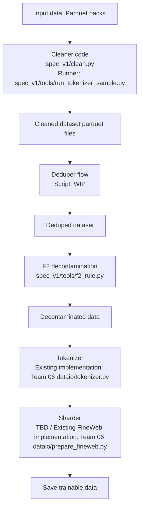

# Team 01-data-a

Put your work in a **topic folder**: `teams/01-data-a/<topic>/<file>`, for example `teams/01-data-a/harness/run.py`.
Team documents named in the week plan (for example `benchmarks_v1.md`) may sit directly in the team folder. The team lead decides the topic names. Do not make personal folders. Do not make new folders under `teams/`.
Open a pull request; the lead reviews and merges it. The pr-guard check must pass.

## Start here

| Task | Guide |
|---|---|
| Build, test, or run the cleaner | [Cleaner guide](spec_v1/README_clean.md), [spec and build flow](spec_v1/README.md) |
| Review family medicines and decisions | [Sheet index](spec_v1/sheets/README.md), [science conflict review](spec_v1/sheets/medicine_sci_clash_resolution_and_harm_report.md) |
| Build gold or review contributor rules | [Shared tools](tools/README.md), [gold builder](tools/README_build_gold.md), [harm tests](tools/README_harm_test.md) |
| Validate cleaner, privacy, or F2 behavior | [Cleaner tools](spec_v1/tools/README.md), [English checks](spec_v1/tools/README_english.md), [Indic checks](spec_v1/README_indic.md) |
| Run a sample job or inspect overlap results | [Jobs index](jobs/README.md) |
| Interpret validation evidence | [Results index](spec_v1/results/README.md) |
| Review cleanup and remaining limitations | [Cleanup status](cleanup_audit/README.md) |

Directory roles: `tools/` holds shared review, gold, and viewer utilities; `tests/` tests those utilities. `spec_v1/tools/` holds cleaner build and validation tools; `spec_v1/scripts/` holds sheet-reproduction and manual diagnosis helpers. Sample configuration remains in `spec_v1/jobs/`, linked from the jobs index.

## Data preparation flow

Script paths in the cleaner and F2 nodes are relative to this folder. This diagram describes the intended stage order; the full flow is not yet wired into one runner.

- **Cleaner:** [clean.py](spec_v1/clean.py) implements the rules. [run_tokenizer_sample.py](spec_v1/tools/run_tokenizer_sample.py) writes cleaned sample Parquet parts while preserving train/heldout splits. [run_clean.py](spec_v1/run_clean.py) is the single-pack/part runner.
- **Deduper:** A standalone dataset deduplication script is TBD.
- **F2:** [f2_rule.py](spec_v1/tools/f2_rule.py) checks benchmark contamination using Team 09's fingerprint set. The existing `run_clean.py --f2` integration runs F2 immediately after cleaning; it does not insert the deduper stage shown above. The tokenizer-sample runner disables optional F2. TBD: separate decontamination stage with documents being marked for exclusion.
- **Tokenizer, sharder, and save:** Team 06's [tokenizer.py](../06-performance/dataio/tokenizer.py) provides `BrahmicTokenizer.encode()`. Its [prepare_fineweb.py](../06-performance/dataio/prepare_fineweb.py) tokenizes a raw FineWeb stream and writes train/validation `.bin` shards containing uint32 token IDs, plus `tokenizer.json.meta`. These are existing implementations for that FineWeb path; an adapter from the decontaminated Parquet dataset to this final stage is still TBD.
