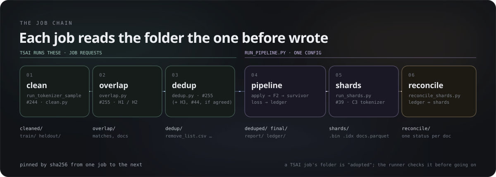
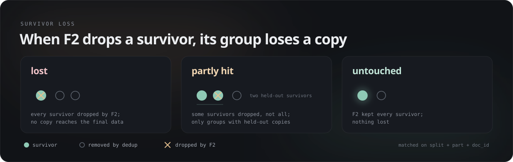
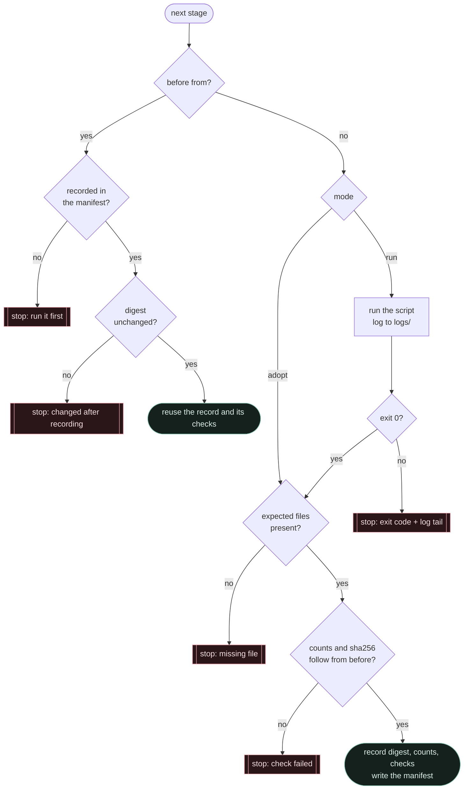

<p align="center">
  
</p>

<p align="center">
  <a href="#quick-start">Quick start</a>&nbsp;&nbsp;·&nbsp;&nbsp;<a href="#the-job-chain">Jobs</a>&nbsp;&nbsp;·&nbsp;&nbsp;<a href="#how-a-document-travels">Flow</a>&nbsp;&nbsp;·&nbsp;&nbsp;<a href="#the-count-chain">Count chain</a>&nbsp;&nbsp;·&nbsp;&nbsp;<a href="#guards">Guards</a>&nbsp;&nbsp;·&nbsp;&nbsp;<a href="#survivor-loss">Survivor loss</a>&nbsp;&nbsp;·&nbsp;&nbsp;<a href="#the-ledger">Ledger</a>&nbsp;&nbsp;·&nbsp;&nbsp;<a href="#outputs-and-the-manifest">Outputs</a>&nbsp;&nbsp;·&nbsp;&nbsp;<a href="#measured-on-real-data">Measured</a>&nbsp;&nbsp;·&nbsp;&nbsp;<a href="#speed-and-scale">Scale</a>&nbsp;&nbsp;·&nbsp;&nbsp;<a href="#tests">Tests</a>
</p>

<br>

The **Clean → Dedup → F2** pipeline of Data A, as one command. It chains the team's stages in the order TSAI set on 12 Nov, applies dedup's remove list, runs F2 decontamination, reports the duplicate groups F2 emptied, writes a **ledger** of every document's decision at every stage, and checks between every pair of stages that each document is accounted for. The output is **filtered Parquet** plus a **manifest** that TSAI can verify.

| | |
|---|---|
| **Order** | clean → overlap → dedup → **apply the remove list** → **F2** → **survivor loss** → **ledger** → **shards** → **reconcile** (the last two optional) |
| **In** | the cleaned parts (`train/`, `heldout/`) and the outputs of overlap and dedup |
| **Out** | filtered Parquet in the same layout, same schema, unchanged text · `pipeline_manifest.json` · the ledger, one row per document · shards (optional) |
| **New here** | `apply_dedup.py` · `survivor_loss.py` · `ledger.py` · `f2_pool.py` · `reconcile_shards.py` · `inventory_check.py` · `hashing.py` · `arrowtools.py` · `runlock.py` · `run_pipeline.py` · `pipeline.json` · `stage_args.py` · `local_trial/` · 445 tests |
| **Reused, never copied** | `spec_v1/run_clean.py` (#244) · `dedup/overlap.py`, `dedup/dedup.py` (#255) · `spec_v1/run_f2.py` (#35, on this branch since #40) |
| **Needs** | Python 3.11+ (tested on 3.13) with `pyarrow` for the pipeline; `numpy` and `tokenizers` for the shard stage; `numpy`, `scipy` and `pygments` to run overlap and dedup locally; `pytest` for the tests. Install them into the environment itself: the scripts run with `python -I` |

> [!NOTE]
> Cleaning, overlap and dedup are **TSAI jobs** (JOB_REQUEST rule 6). The runner **adopts** the folders TSAI returns and checks them before carrying on. Each of those stages can also be **run** locally, for tests and small trials.

<br>

## Quick start

```bash
# tests: synthetic data only, about 45 s
python -m pytest teams/01-data-a/pipeline/tests -q

# what a run would do (every stage's folder and command; runs and writes nothing)
python -I teams/01-data-a/pipeline/run_pipeline.py --config teams/01-data-a/pipeline/pipeline.json --plan

# the whole chain, from the repository root
python -I teams/01-data-a/pipeline/run_pipeline.py --config teams/01-data-a/pipeline/pipeline.json

# part of it: set "to": "apply" in the config file and run; later set "from": "f2" (and drop "to") and run again
```

The command line takes only `--config` and `--plan`. Everything that defines a run is a key in the config file (see Configuration), so a run is reproduced from that file alone.

**Try it on six small files first:** [local_trial/](local_trial/README.md) has example configs for a full run, stopping early, resuming in steps, adopting a folder and the expected errors, and the commands to run them and keep the local log a job request asks for.

Each step also runs on its own:

```bash
python -I teams/01-data-a/pipeline/apply_dedup.py   --cleaned <cleaned> --remove-list <remove_list.csv> --out <deduped>
python -I teams/01-data-a/spec_v1/run_f2.py          --inputs <deduped>/train --out <final>/train
python -I teams/01-data-a/pipeline/survivor_loss.py --groups <dedup_groups.csv> --f2 <final> --out <report>
python -I teams/01-data-a/pipeline/ledger.py        --cleaned <cleaned> --remove-list <remove_list.csv> --groups <dedup_groups.csv> \
                                                    --log <dedup_log.jsonl> --f2 <final> --out <ledger> [--raw <raw>]
python -I teams/01-data-a/pipeline/f2_pool.py      --inputs <deduped>/train --out <final>/train --workers 16
python -I teams/01-data-a/pipeline/reconcile_shards.py --ledger <run>/ledger --shards <run>/shards --out <run>/reconcile
python -I teams/01-data-a/pipeline/inventory_check.py  --inventory <expected_inventory.json> --ledger <run>/ledger --shards <run>/shards
```

Exit code `0`: every check passed. Exit code `1`: a check failed, and the message names it and where. Each script's output streams to `<run>/logs/<stage>.log`.

<br>

## The job chain

<p align="center"></p>

What runs after what, who runs it, and which folder each job reads and writes. Every hand-over is pinned: before a job's output is used, the runner checks it against the job before it, by counts and sha256 (see [The count chain](#the-count-chain)).

| # | Job | Who runs it | Code | Reads | Writes | Status (14 Nov) |
|:-:|---|---|---|---|---|---|
| 01 | **clean** | TSAI, from a job request | `spec_v1/run_tokenizer_sample.py` → `clean.py` (#244; rebuilt from spec v1.1 by Tue 17) | raw sample parts, `sample_manifest.json` | `cleaned/train/`, `cleaned/heldout/`, `reports/`, `job_summary.json` | sample v0 done on 13 Nov: 1,444,766 → 1,414,996 |
| 02 | **overlap** | TSAI, from a job request | `dedup/overlap.py` (#255, pin 7526194) | `cleaned/` | `overlap_summary.json`, `overlap_matches.csv`, `overlap_docs.parquet` | accepted on 14 Nov; results go on #255 |
| 03 | **dedup** | TSAI, from a job request | `dedup/dedup.py` (#255); H3 joins here if #44 is agreed | `overlap/`, and `cleaned/` for URLs | `remove_list.csv`, `dedup_groups.csv`, `dedup_log.jsonl`, `dedup_summary.json` | after 02 |
| 04 | **pipeline** | TSAI or the team, from one run config | `run_pipeline.py`: apply → F2 → survivor loss → ledger | `cleaned/`, `dedup/` | `deduped/`, `final/`, `report/`, `ledger/`, `pipeline_manifest.json` | ready; goes into the lead's job request (week 3, task 4) |
| 05 | **shards** | the same run, with `stages.shards` | `shards/run_shards.py` → `shard_writer.py` (#39) | `final/`, the manifest, G3's frozen tokenizer (p1536) | `shards/` | #39: the writer's open points |
| 06 | **reconcile** | the same run, with `stages.reconcile` | `reconcile_shards.py` | `ledger/`, `shards/` | `reconcile/` | ready for the first real shards |

**How the jobs hand over.** TSAI runs 01 to 03 as separate jobs, so the pipeline's run config adopts the folders they return, `{"mode": "adopt", "output": "<folder>"}`, and the runner checks each one before going on:
- overlap read every cleaned part;
- dedup used this overlap run (sha256);
- the remove list matches dedup's summary.

One config can also run 01 to 03 itself (`"mode": "run"` with a settings file), as `local_trial/` does on six parts.

**What the job must hold.** The checks above link each job to the one before it; none of them knows which packs and parts there should be. The job's run config names an [expected inventory](#expected-inventory) made from the approved input manifest (`"inventory"`), and the run stops when a listed pack or part is missing from the ledger or the shards, or one appears that is not listed.

**Removal happens in two places, in this order.**
1. **Dedup and apply** (03, then 04): dedup decides what goes and apply carries it out, so a removed copy never reaches F2.
2. **F2** (04) then drops the benchmark copies.

H1/H2 (same language) and, if agreed, H3 (another language, #44) all go through `dedup.py`'s clusters, so there is one remove list. Apply refuses any held-out row in it (rule 0).

**After the chain:** G9 checks the first shards for contamination (rotation R1, Wed 18), and G7's loader reads them.

<br>

## How a document travels

<p align="center"></p>

| | Stage | Script | From | Reads | Writes |
|:-:|---|---|---|---|---|
| 01 | **clean** | `spec_v1/run_tokenizer_sample.py` (`run_clean.py` inside) | #244 | raw parts | `train/**.parquet`, `heldout/**.parquet` |
| 02 | **overlap** | `dedup/overlap.py --config <run>/cfg/overlap.json` | #255 | cleaned parts | `overlap_summary.json`, `overlap_matches.csv`, `overlap_docs.parquet` |
| 03 | **dedup** | `dedup/dedup.py --config <run>/cfg/dedup.json` | #255 | overlap outputs | `remove_list.csv`, `dedup_groups.csv`, `dedup_summary.json` |
| 04 | **apply** | `pipeline/apply_dedup.py` | new | cleaned parts + `remove_list.csv` | `deduped/<split>/<part>`, `apply_dedup_summary.json` |
| 05 | **f2** | `spec_v1/run_f2.py`, per split, or per pack in parallel | #35 | `deduped/<split>` | `final/<split>/<part>`, `<part>.f2.json`, `f2_summary.json` |
| 06 | **survivor loss** | `pipeline/survivor_loss.py` | new | `dedup_groups.csv` + F2 reports | `survivor_loss.csv`, `survivor_loss_summary.json` |
| 07 | **ledger** | `pipeline/ledger.py` | new | cleaned parts (+ raw parts), dedup's list, groups and log, F2's reports and final parts | `ledger/<split>/<pack>.parquet`, `ledger_summary.json`, `ledger_sample.csv` |
| 09 | **reconcile** (optional) | `pipeline/reconcile_shards.py` | new | `ledger/` + `shards/` | `reconcile/reconcile_docs.parquet` (a status per kept document), `reconcile_summary.json` |
| 08 | **shards** (optional) | `shards/run_shards.py` → `shard_writer.py`, after `cleaning_pipeline.json` is written | new | `final/<split>/<part>` + the manifest | `shards/<pack>-<split>-NNNNNN.{bin,idx.npy,docs.parquet,json,quality_report.json}`, `shards_summary.json` |

Without `stages.shards` the run stops after the ledger. In **run** mode each stage gets its folder and its script's paths from the run config (`settings`; see Configuration), and `--plan` prints them.

```mermaid
flowchart LR
  raw[("raw<br/>sample")]:::data

  subgraph TSAI["TSAI jobs · adopt or run"]
    direction LR
    clean["01 clean<br/>run_clean.py · #244"]:::tsai
    overlap["02 overlap<br/>overlap.py · #255"]:::tsai
    dedup["03 dedup<br/>dedup.py · #255"]:::tsai
  end

  subgraph RUNNER["run_pipeline.py · always run; shards and reconcile optional"]
    direction LR
    apply["04 apply<br/>apply_dedup.py"]:::mine
    f2["05 f2 · per split<br/>run_f2.py or f2_pool.py"]:::mine
    loss["06 survivor loss<br/>survivor_loss.py"]:::mine
    led["07 ledger<br/>ledger.py"]:::mine
    shards["08 shards · optional<br/>run_shards.py"]:::mine
    rec["09 reconcile · optional<br/>reconcile_shards.py"]:::mine
  end

  raw --> clean -->|"cleaned"| overlap
  overlap -->|"matches"| dedup
  dedup -->|"remove_list"| apply
  clean -.->|"parts"| apply
  apply -->|"deduped/"| f2
  f2 -->|"f2.json"| loss
  dedup -.->|"groups"| loss
  f2 ==> final[("final<br/>parquet")]:::out
  f2 -->|"f2.json + parts"| led
  dedup -.->|"list, groups, log"| led
  raw -.->|"mode B"| led
  loss ==> man[["pipeline_manifest.json"]]:::out
  led ==> ldg[["ledger/<br/>one row per doc"]]:::out
  f2 -.->|"final/"| shards
  man -.->|"stages, checks"| shards
  shards ==> tokens[("shards<br/>.bin + manifest")]:::out
  led -.->|"kept docs"| rec
  tokens -.->|"docs.parquet"| rec
  rec ==> recout[["reconcile/<br/>a status per kept doc"]]:::out

  classDef data fill:#16191f,stroke:#5f6670,color:#e6e8ec
  classDef tsai fill:#14211d,stroke:#8fc9b5,color:#dff2ea
  classDef mine fill:#1c1a26,stroke:#c3aee8,color:#efe9fb
  classDef out fill:#221d15,stroke:#edcb9a,color:#f6ead6
```

<details>
<summary><b>The same flow, with every file</b></summary>
<br>



</details>

<br>

## The count chain

<p align="center"></p>

Each stage must account for every document it was given, and it must have read **exactly** what the stage before produced. Counts catch documents that went missing; sha256 links catch a stage that read the wrong files.

```text
overlap   status = complete
          documents_all            = clean.rows
          documents of every part  = that cleaned part's rows

dedup     status = complete
          checked_sha256 of overlap_matches.csv, overlap_docs.parquet = the adopted overlap's files
          documents_all = overlap.documents_all
          removed       = rows(remove_list.csv)
          heldout_removed = 0

apply     rows = clean.rows,  removed = rows(remove_list.csv)

f2        per split:  rows = apply.kept,  input_sha256 of every part = the sha256 apply wrote
          kept + dropped + errors = rows,  errors = 0,  one set_sha256

survivor  groups = groups in dedup_groups.csv

ledger    rows with a cleaned row = clean.rows
          removed_by_dedup = apply.removed,  dropped_by_f2 = f2.dropped,  f2_error = f2.errors,  kept = f2.kept
          set_sha256 = F2's,  and every final part holds the ledger's kept docs, in order
          per pack and split:  cleaned and removed = apply's by_pack;  each row adds up;  each column = its stage's count
```

The manifest's `totals` carry the headline: `cleaned → removed_by_dedup → dropped_by_f2 → final`, with `raw` and `dropped_by_clean` in front when the ledger ran in mode B.

<br>

## Guards

<p align="center"></p>

`apply_dedup.py` runs **all** of its checks before it writes anything. One process at a time may write an output folder (a lock the system releases if the process dies), a temp file left by a killed run is deleted rather than written through, and the ledger is swapped in whole, so no folder ever mixes two runs. Every file is written to `.tmp` and then renamed, so a stopped run never leaves a half-written Parquet in place. The runner stops at the first failed check: the files of the failed run stay in its run folder for inspection, and a rerun refuses Parquet files that don't belong to the current parts.

<details>
<summary><b>Every check, where it runs, what you see</b></summary>
<br>

| Check | Runs in | Message |
|---|---|---|
| Header is exactly `pack_id,split,part,row_in_part,doc_id` | apply | `header is …, expected dedup.py's …` |
| A `(split, part, row)` is listed once; `row_in_part` is a whole number ≥ 0 | apply | `… is listed twice` · `… is not a whole number >= 0` |
| No `heldout` row in the remove list (rule 0) | apply | `a held-out row … this remove list is broken` |
| Every listed part exists and every listed row is inside it | apply | `… not found under --cleaned` · `row 99 is listed, but the part has 5 rows` |
| The doc_id **and** pack_id at that row are the listed ones | apply | `doc_id is 'A', the remove list says 'B'. The list was made from another cleaning run` |
| Every part opens as Parquet with `doc_id` and `pack_id` (footer only) | apply | `… cannot be read as Parquet` · `… no pack_id column` |
| No Parquet under the output that isn't a current part | apply · f2 | `… left by an earlier run` · `no stale F2 output in final/train` |
| Output never inside input, nor input inside output | apply · f2 · config | `… overlap: the output would be read as input` |
| Overlap is complete and read these cleaned parts | runner | `overlap read every cleaned row` · `overlap read these cleaned parts` |
| Dedup is complete, used **this** overlap run, agrees with its list, removed no held-out | runner | `dedup used this overlap run` · `dedup summary matches its remove list` |
| F2 read every row, read what apply wrote, adds up, no errors, one set | runner | `F2 read what apply wrote in train` · `F2 reported no errors on train` |
| Survivor loss saw every dedup group; F2 covered every part holding a survivor | runner · survivor | `survivor loss saw every dedup group` · `… F2 did not cover them` |
| Every row the remove list, groups or log names is a row of its cleaned part, with that doc_id | ledger | `… name another doc_id than the cleaned part holds at that row` |
| No row named twice; the groups' removed rows and the log's rows are exactly the remove list's rows | ledger | `… names 1 row(s) of this part more than once` · `… in one of remove_list.csv and dedup_log.jsonl but not the other` |
| doc_id is unique within each part; mode B: the raw file has the reported sha256, and every cleaned doc is in it | ledger | `a doc_id appears twice in the part` · `no raw part has the sha256 the cleaning report names` · `… cleaned doc(s) are not in the raw part` |
| Every F2 report covers its part; each final part holds exactly the ledger's kept docs, in order | ledger | `no F2 report` · `the final part … does not hold the ledger's … kept documents in order` |
| Mode B with cleaning reports: drops and input rows per part agree | ledger | `… the cleaning report …` |
| Ledger totals = apply's and F2's counts | runner | `ledger kept = F2's kept` · `ledger removed_by_dedup = apply's removed` |
| One writer per output folder: a second apply, ledger or reconcile into the same folder stops at once | apply · ledger · reconcile | `another process is writing into … (it holds ….lock)` |
| A temp file a killed run left (possibly a hard link to the input) is deleted, never written through | apply | (no message: it is removed before the part is written) |
| No row of any part without a `pack_id` | apply | `… row(s) have no pack_id` |
| The ledger's `--out` is missing, empty or an earlier ledger, and is replaced only when the new ledger is complete | ledger | `--out … exists and is not a ledger folder` |
| The swap never loses a ledger: a rename Windows refuses (a file in it open) is retried, then undone, and a run killed between the renames gets the previous ledger back | ledger | `could not swap the new ledger in for … Nothing was lost: …` |
| The ledger never touches an input: no input may be or hold `--out`, `<out>.partial`, `<out>.old` or `<out>.lock`, nor lie inside them, and it deletes only folders it made (a marker file, or an earlier ledger) | ledger · reconcile | `--cleaned … and the staging folder … overlap` · `… exists and is not a folder the ledger made` |
| No stage output and no `stages.ledger.raw` inside a folder the run writes, swaps or deletes (`deduped/`, `ledger/`, … and `ledger.partial`, `ledger.old`, `deduped.lock`, …) | runner (config) | `config: stages.clean.output … is a folder of the run itself` |
| A part holding documents of two packs is checked against its shard once, with both packs' ledger files | reconcile | (no message: they are read together) |
| A pack the shard stage left out entirely fails: reconcile's scope is every pack the ledger holds (or `stages.shards.packs`), never the shards' own summary, and a listed pack the ledger does not hold fails too | reconcile | `… missing` · `every selected pack holds kept documents in the ledger` |
| A file system that cannot lock files does not stop the run | apply · ledger · reconcile | `runlock: the file system of … cannot lock files …` (a warning) |
| With `from`, earlier outputs still match their recorded digest | runner | `… changed after the manifest recorded it; rerun from …` |
| The whole config before the first stage | runner | `config: stages.dedup.output is missing` · `f2 script … not found` |
| A run stage's settings file exists and matches its pin; its output is below `out/`, not a folder of the run, not another stage's | runner (config) | `config: overlap: … pins …` · `… named subfolder …` · `… is a folder of the run itself` · `stages.clean.output and stages.overlap.output overlap` |
| Shards: no part failed or was skipped, `run_shards.py` exited 0, at least one shard written, the summary is this run's | runner | `shards: no part failed or was skipped` · `shards: the summary is this run's, made with this run's cleaning_pipeline.json` |
| With `inventory`: the ledger and `shards_summary.json` hold exactly the parts the input manifest lists, each with its listed raw sha256, raw rows and shard status; every listed pack is in the ledger and no other pack has kept documents; the clean job read the inventory's input manifest | runner (before the shard stage, and after reconcile) · `inventory_check.py` | `inventory: the ledger holds exactly the listed parts` · `inventory: every part ended in a listed status` |
| A run with `inventory` has `stages.ledger.raw`, `stages.shards` and `stages.reconcile`, ends at reconcile, and its `stages.shards.packs` are the inventory's packs | runner (config) | `config: "inventory" needs stages.ledger.raw …` · `config: "inventory" needs a run that ends at reconcile …` · `config: stages.shards.packs and the inventory's packs differ` |
| Every top-level key of the config is a run parameter and every key under `stages` is a stage (or a `_…` comment), so a mistyped `inventory` or `intermediates` is not silently ignored | runner (config) | `config: unknown key 'Inventory' …` · `config: stages.inventory is not a stage …` |

</details>

> [!IMPORTANT]
> **`doc_id` alone is not a key.** In cleaned sample v0 (86 files, 1,432,552 rows), 22,773 doc_ids appear in two parts of the same pack and split. A document is found by **split + part + row** (apply) or **split + part + doc_id** (survivor loss), never by doc_id alone.

<br>

## Survivor loss

<p align="center"></p>

Dedup keeps one copy of each duplicate group, or every held-out copy (rule 0). F2 runs afterwards, and when it drops a survivor, the removed copies are not brought back. TSAI accepted this on 12 Nov, on condition that those groups are **counted and listed**.

| Status | Meaning |
|---|---|
| `lost` | F2 dropped **every** survivor of the group: no copy reaches the final data |
| `partly_hit` | F2 dropped some survivors, not all (only groups with several held-out survivors) |
| `untouched` | F2 dropped none |
| `without_survivor` | dedup kept no copy (no usable licence, rule 1); F2 cannot change that |

A document whose F2 check raised an error is also kept out of the output, so it counts as dropped, with `f2_items` = `error:<type>`. `survivor_loss.csv` has one row per survivor F2 dropped: `status, group_id, group_size, priority_rule, pack_id, split, part, row_in_part, doc_id, f2_items, offset`. Benchmark **item IDs** and offsets only, never text.

<br>

## The ledger

<p align="center"></p>

The team asked for **every document's decision at every stage, including the documents that were dropped**. The ledger answers "what happened to this document, and why?" without opening any text: one row per document, with the cleaner's action, dedup's role and match, F2's action and benchmark items, and exactly one `final` status. It is built from what each stage wrote, so it decides nothing; it only lines the decisions up and checks that they agree.

<table>
<tr><th>Stage</th><th>Columns</th><th>Values</th></tr>
<tr><td>identity</td><td><code>pack_id</code> · <code>split</code> · <code>part</code> · <code>raw_row</code> · <code>row_in_part</code> · <code>doc_id</code></td><td><code>row_in_part</code> is the row in the cleaned part, as dedup numbers it (empty when the cleaner dropped the doc). <code>raw_row</code> is the row in the raw part (mode B only)</td></tr>
<tr><td>clean</td><td><code>clean_action</code> · <code>clean_rules</code></td><td><code>keep</code> · <code>fix</code> · <code>drop</code> · <code>unknown</code>; rule ids once mode A exists</td></tr>
<tr><td>dedup</td><td><code>dedup_role</code> · <code>dedup_group</code> · <code>dedup_priority_rule</code></td><td><code>none</code> · <code>survivor</code> · <code>removed</code>; <code>G000123</code>; rule <code>0</code>–<code>4</code> of source_priority_v1.md</td></tr>
<tr><td></td><td><code>dedup_match_rule</code> · <code>dedup_similarity</code> · <code>dedup_kept_doc</code> · <code>dedup_stage</code></td><td>from <code>dedup_log.jsonl</code>, for removed docs: <code>H1</code>/<code>H2</code>, the Jaccard score, the survivor's doc_id, <code>within_pack</code> or <code>cross_pack</code></td></tr>
<tr><td></td><td><code>dedup_list</code></td><td>which remove list removed it: <code>dedup</code> (dedup.py's list); later H3's</td></tr>
<tr><td>F2</td><td><code>f2_action</code> · <code>f2_items</code> · <code>f2_offset</code></td><td><code>kept</code> · <code>dropped</code> · <code>error</code> (empty when F2 never saw the doc); benchmark item ids; the character offset</td></tr>
<tr><td>final</td><td><code>final</code> · <code>final_part</code> · <code>final_row</code></td><td><code>kept</code> · <code>dropped_by_clean</code> · <code>removed_by_dedup</code> · <code>dropped_by_f2</code> · <code>f2_error</code>; where a kept doc is in <code>final/&lt;split&gt;/</code></td></tr>
</table>

**The cleaner's decision** depends on what is available, and the ledger records which mode it ran in:

| Mode | When | How |
|:-:|---|---|
| **A** | the cleaning job writes a per-document decisions file (not yet: a small addition to `run_tokenizer_sample.py`, to agree with its owners) | rule ids per document |
| **B** | `stages.ledger.raw` points at the raw parts | the raw file of each part is the one whose sha256 the cleaning job's report names (any file name, as the cleaner finds it), or the file of the same name when there is no report. It is joined to its cleaned part on doc_id (the cleaner refuses duplicate doc_ids in a part). Missing from the cleaned part: `drop`. Different text: `fix`. Same text: `keep`. The text is compared inside pyarrow and never written anywhere |
| **C** | neither | the ledger starts at the cleaned documents and `clean_action` is `unknown` |

When the cleaning job's per-part reports are in the cleaned folder (`reports/<split>/<part>.json`), the summary records their keep / fix / drop counts, and mode B stops if its drops or raw rows per part differ from them. In mode B the summary lists every raw file used, with its sha256, so two runs on different raw data never get the same digest.

**How rows are matched.** Dedup's list, groups and log are joined on **split + part + row** and must name the doc_id the cleaned part holds at that row; none may name a row twice, and the groups' removed rows and the log's rows must both be exactly the remove list's rows. F2's reports are joined on **split + part + doc_id**, and every doc_id they name must be one apply kept in that part. A kept document's `final_row` is its rank among the kept rows of its part, and the ledger reads each final part to check that it holds exactly those doc_ids in that order. The ledger is built **part by part with pyarrow joins and compute functions**: no Python loop over documents, and no numpy needed.

```text
ledger/
├── train/<pack>.parquet      one row per document (zstd), one file per pack and split
├── heldout/<pack>.parquet
├── ledger_summary.json       clean mode · inputs and their sha256 · totals and per pack × split counts by final status
└── ledger_sample.csv         to read by eye: per pack and split, up to 5 rows of each final status
```

<details>
<summary><b>Reading the ledger</b></summary>
<br>

```python
from pathlib import Path
import pyarrow.parquet as pq, pyarrow.compute as pc

t = pq.read_table(sorted(Path("out/pipeline/sample-v0/ledger").rglob("*.parquet")))
t.group_by(["pack_id", "split", "final"]).aggregate([("doc_id", "count")])     # the outcome per pack
t.filter(pc.equal(t["doc_id"], "<doc_id>"))                                  # every copy of one doc_id, with its part
t.filter(pc.equal(t["final"], "dropped_by_f2")).select(["pack_id", "doc_id", "f2_items", "f2_offset"])
```

`ledger_summary.json` holds the same counts without reading any Parquet. From the 2-pack smoke run:

```jsonc
"by_pack": {
  "sci-finepdfs": {
    "train":   { "rows": 6011, "rows_cleaned": 6011, "kept": 5995, "dropped_by_clean": 0, "removed_by_dedup": 2, "dropped_by_f2": 14, "f2_error": 0 },
    "heldout": { "rows": 63,   "rows_cleaned": 63,   "kept": 63,   "dropped_by_clean": 0, "removed_by_dedup": 0, "dropped_by_f2": 0,  "f2_error": 0 }
  }, …
}
```

</details>

<br>

## Configuration

`pipeline.json`: paths relative to the repository root, or absolute; keys starting with `_` are comments.

```jsonc
{
  "run_id": "sample-v0",                 // outputs go to <out>/<run_id>/; --run-id replaces it per job
  "out": "out/pipeline",                 // git-ignored, like every out/ folder
  "intermediates": "keep",               // or "drop": once reconcile has passed, delete the deduped and final Parquet of the parts the shard stage accounts for
  "inventory": "teams/01-data-a/jobs/<job>/expected_inventory.json",  // optional: the parts and packs the run must hold, from the input manifest
  "stages": {
    "clean":   { "mode": "run", "settings": "teams/01-data-a/spec_v1/clean.json", "input": "inputs/tokenizer_sample_v0",
                 "manifest_sha256": "7fd647c8…", "expected_parts": { "train": 48, "heldout": 38 } },
    "overlap": { "mode": "run", "settings": "teams/01-data-a/dedup/overlap.json" },
    "dedup":   { "mode": "run", "settings": "teams/01-data-a/dedup/dedup.json" },
    "apply":   { "link": true, "workers": 4 },   // hard-link untouched parts; 4 parts at a time
    "f2":      { "script": "teams/01-data-a/spec_v1/run_f2.py", "workers": 4, "pool": true },  // pool: the set loaded once
    "ledger":  { "raw": "out/tokenizer_sample_v0_raw" },  // optional: mode B
    "shards":  { "tokenizer": "<p1536>/tokenizer.json" },  // optional: leave it out and the run stops after the ledger
    "reconcile": {}                                    // optional, needs shards: every kept doc in a shard or left out for a reason
  }
}
```

| Key | Values | Meaning |
|---|---|---|
| `stages.<clean · overlap · dedup>.mode` | `adopt` (default) · `run` | **adopt**: TSAI ran it, and `output` is the folder it returned. **run**: the runner runs the stage's script |
| `stages.<…>.settings` | file | **run**: the stage's settings (no paths). The runner works out the rest: each of clean, overlap and dedup gets a copy with its path keys filled in, in `<run>/cfg/<stage>.json`, and is run with `--config` on that copy |
| `stages.clean.input` | folder | **required** for a run: the raw sample, written into the clean config as `input_root` (the settings file holds no paths) |
| `stages.clean.manifest_sha256` · `.expected_parts` · `.sample` | sha256 · `{"train": 48, "heldout": 38}` · label | **required** (the label is optional): the input set's description, written into the clean config. A new input set means new values; the clean settings file holds none of them |
| `stages.clean.manifest` | file | optional: the sample manifest. Default: `sample_manifest.json` in the `input` folder, where TSAI ships it. Its sha256 must equal `manifest_sha256`, checked before the clean job starts |
| `stages.clean.only` | list of sample parts | run the clean job on these parts only (e.g. `["train/code-go/part-00000.parquet"]`), for trials; overlap then expects no particular packs |
| `stages.<…>.settings_sha256` | sha256 | optional pin of the settings file, checked before anything runs; the manifest records the file's sha256 either way |
| `stages.<…>.script` | path | replaces the stage's default script (`run_tokenizer_sample.py`, `dedup/overlap.py`, `dedup/dedup.py`) |
| `stages.<…>.output` | folder | **adopt**: required, the folder returned. **run**: optional, default `<run>/<stage>`; must be below `out/` and not a folder name of the run (`deduped`, `final`, `report`, `ledger`, `shards`, `cfg`, `logs`) |
| `stages.<…>.command` | `["script.py", "--arg", "…"]` | escape hatch for **run**: run this Python from the repository root as it is (then `output` is required, and no settings or generated config are involved) |
| `stages.f2.script` | path | `run_f2.py` (default `teams/01-data-a/spec_v1/run_f2.py`, from #35, merged into this branch with #40) |
| `stages.f2.workers` | whole number ≥ 1 (default 1) | **1**: one `run_f2.py` per split. **N > 1**: up to N processes at once, one per pack folder, with one log per pack |
| `stages.f2.pool` | `false` (default) · `true` | **true**: one `f2_pool.py` per split. It loads G9's set **once** and shares the split's parts out to `workers` processes: on Linux they share the loaded set (about 1.1 GB in all), elsewhere each worker loads it. The output is byte for byte what `run_f2.py` writes |
| `stages.reconcile` | `{}` | optional, after `shards`: `reconcile_shards.py` checks that every kept document of the ledger is in exactly one shard at its ledger position, or left out by the writer for a stated reason (secret, empty, special token, round-trip), or in a part that is not sharded (held-out). A dropped document in a shard, a document in two shards, or a kept one missing or cut off (truncated) stops the run |
| `stages.shards.tokenizer` | file | G3's frozen `tokenizer.json` (p1536). Setting `stages.shards` adds the shard stage after survivor loss; without it the run stops there |
| `stages.shards.out` | folder (default `<run>/shards`) | where the shards, `cleaning_pipeline.json` and `shards_summary.json` go |
| `stages.shards.tokens` · `.packs` · `.pack_table` | optional | passed to `run_shards.py`: token limit per shard, only these packs, a pack table other than `shards/pack_table.json` |
| `stages.shards.script` · `.any_tokenizer` | optional | `run_shards.py` (default `teams/01-data-a/shards/run_shards.py`); `any_tokenizer: true` accepts another tokenizer (tests only) |
| `stages.apply.link` | `true` (default) · `false` | hard-link untouched parts instead of copying them; falls back to a copy across file systems |
| `stages.apply.workers` | whole number ≥ 1 (default 4) | parts checked and written at once; each holds one batch and one output row group in memory |
| `hash_cache` | `true` (default) · `false` | **true**: every sha256 is computed once and kept in `<run>/cache/sha256.json`, keyed on each file's device, inode, size, mtime and change time (ctime on Linux, NTFS's ChangeTime on Windows), so the digests reuse apply's hashes and a resumed run hashes nothing it has hashed already. **false**: hash everything again, for an audit |
| `intermediates` | `keep` (default) · `drop` | **keep**: every stage's Parquet stays on disk (the cleaner audit reads the parts before and after `clean.py`). **drop**: once reconcile has passed, the run deletes, from `deduped/` and `final/`, the Parquet of every part whose kept documents are all in shards or left out by the shard writer for a stated reason; held-out parts, parts of packs the shard stage was not asked for, and the cleaned folder stay. Needs a run that ends at reconcile. See [Intermediate Parquet](#intermediate-parquet-keep-or-drop) |
| `inventory` | file (optional) | the **expected inventory**: every part of the approved input manifest with its raw sha256, raw rows and the status its shards must end in. The run stops when the ledger or `shards_summary.json` lacks a listed part, holds one that is not listed, or a part has another raw file, row count or status than listed. A run with an inventory needs `stages.ledger.raw`, `stages.shards` and `stages.reconcile`, and must end at reconcile. Without the key none of this is checked or required, and `--plan` and the manifest say so (`inventory: none`). See [Expected inventory](#expected-inventory) |
| `stages.ledger.raw` | folder (optional; **required with `inventory`**) | the raw parts the cleaner read, as `<raw>/<split>/<pack>/<file>` or `<raw>/<pack>/<split>/<file>` (found by the sha256 in the cleaning report, else by name): the ledger runs in **mode B** (keep / fix / drop per document). Without it, **mode C** |

**One file per run.** Everything that defines a run is a key in the config file, and `--config <file>` is all a TSAI job's `Command:` needs. The committed `pipeline.json` is the generic template (no dates, no returned folders); for a job, copy it to `jobs/<date>-<name>/run.json` and edit that copy:

| Key | Meaning |
|---|---|
| `run_id` | names the run; its folders are `<out>/<run_id>/` (the clean job refuses an existing folder, so each run needs its own) |
| `stages.<clean · overlap · dedup>` with `"mode": "adopt"` and `"output": <folder>` | use a folder TSAI returned (or an earlier run's) instead of running that stage. The other stages always run |
| `to` | stop after this stage; only the stages up to it are checked, so a clean-only job needs no overlap or dedup entry |
| `from` | resume at this stage: earlier stages must be recorded in the manifest with unchanged digests |
| `stages.clean.only` | run the clean job on these sample parts only; for trials |

The only command-line option besides `--config` is `--plan`: print every stage's folder and command and run nothing.

```jsonc
// jobs/<date>-dedup/run.json: TSAI returned the cleaned folder; test the dedup change on it, stop after dedup
{ "run_id": "dedup-trial-1",
  "to": "dedup",
  "stages": {
    "clean":   { "mode": "adopt", "output": "out/<returned clean folder>" },
    "overlap": { "settings": "teams/01-data-a/dedup/overlap.json" },
    "dedup":   { "settings": "teams/01-data-a/dedup/dedup.json" } } }
```
```bash
python -I teams/01-data-a/pipeline/run_pipeline.py --config teams/01-data-a/jobs/<date>-dedup/run.json
```

Scripts run with `python -I`, which ignores user site-packages and `PYTHONPATH`: install `pyarrow` and the rest into the environment itself, not with `pip install --user`. Running overlap locally needs Linux or macOS (`overlap.py` uses `resource`). Adopting TSAI's overlap works anywhere.

<details>
<summary><b>How the runner treats each stage</b></summary>
<br>



</details>

<br>

## Outputs and the manifest

At the end of every run that reaches the ledger, the runner prints the chain **per pack and split** to stderr, and the manifest keeps the same table as `by_pack`. From the 2-pack smoke run:

```text
pack               split    cleaned  -dedup  -f2   final
ind-ta-sangraha-s  train      4,336       1    0   4,335
ind-ta-sangraha-s  heldout       36       0    0      36
sci-finepdfs       train      6,011       2   14   5,995
sci-finepdfs       heldout       63       0    0      63
total                        10,446       3   14  10,429
```

Read each row left to right: `cleaned − dedup − f2 = final`. In mode B two columns come first, `raw` and `-clean` (dropped by the cleaner), and `raw − clean = cleaned`. The table comes from the ledger, and two checks hold it to the other stages: per pack and split, its cleaned rows and dedup removals must equal **apply's own per-pack counts** (`apply_dedup_summary.json`); every row must add up (`raw − clean = cleaned`, `cleaned − dedup − f2 − F2 errors = final`); and each column must add up to the count of the stage that made it (clean, apply, F2). F2 errors have no column because a run with any stops at F2. A pack the cleaner emptied completely (mode B) shows `cleaned 0`. The per-pack F2 logs are in `logs/f2_<split>_<pack>.log` when `workers` > 1.

```text
out/pipeline/<run_id>/
├── pipeline_manifest.json             the record of the run
├── cache/sha256.json                  the hash cache (hashing.py): a shortcut, never trusted over a file that changed
├── logs/                              one log per script: overlap.log, f2_train.log or f2_train_<pack>.log, shards.log, …
├── deduped/                           04 apply
│   ├── train/<pack>/part-NNNNN.parquet
│   ├── heldout/<pack>/part-NNNNN.parquet      hard links: dedup never removes held-out
│   └── apply_dedup_summary.json
├── final/                             05 F2: the pipeline's output
│   ├── train/<pack>/part-NNNNN.parquet  (+ .f2.json)
│   ├── train/f2_summary.json
│   └── heldout/…
├── report/                            06 survivor loss
│   ├── survivor_loss.csv
│   └── survivor_loss_summary.json
├── ledger/                            07 ledger
│   ├── train/<pack>.parquet, heldout/<pack>.parquet
│   ├── ledger_summary.json
│   └── ledger_sample.csv
├── inventory_check.json               with "inventory": the report of the last inventory check point, with every difference
├── cleaning_pipeline.json             08 shards, first: clean.py sha256, F2 set, dedup remove list (what every shard of the run says)
├── shards/                            08 shards: <pack>-<split>-NNNNNN.{bin,idx.npy,docs.parquet,json,quality_report.json,dump.md},
│   ├── cleaning_pipeline.json         a copy of the run's file, and shards_summary.json
│   └── shards_summary.json
└── reconcile/                         09 reconcile
    ├── reconcile_docs.parquet         one row per kept document: shard_id, shard_status
    └── reconcile_summary.json         per pack and split, the count of each status; the checks
```

With `"intermediates": "drop"`, the `part-NNNNN.parquet` files of the parts the shard stage accounts for are gone from `deduped/` and `final/` at the end of the run; everything else in the tree stays, the held-out parts included.

<details>
<summary><b>What <code>pipeline_manifest.json</code> holds</b></summary>
<br>

```jsonc
{
  "tool": "run_pipeline.py", "run_id": "sample-v0",
  "code_sha256": "…", "git_commit": "…", "python": "3.13.x", "pyarrow": "…", "config": { … },
  "stages": [
    { "stage": "clean",   "mode": "adopt", "digest": "…", "files": 86,
      "counts": { "rows": …, "by_split": { … }, "by_part": { "train/en-dclm/part-00000.parquet": …, … } },
      "checks": [], "seconds": … },
    { "stage": "overlap", "counts": { "documents_all": …, "parts": …, "files_sha256": { … } }, "checks": [ … ] },
    { "stage": "dedup",   "counts": { "remove_list_rows": …, "removed": …, "heldout_removed": 0, "groups": … } },
    { "stage": "apply",   "code_sha256": "…", "counts": { "rows": …, "removed": …, "kept": …, "kept_by_split": { … } } },
    { "stage": "f2",      "set_sha256": "2826a3b8…", "counts": { "rows": …, "kept": …, "dropped_by_f2": …, "errors": 0, "by_split": { … } } },
    { "stage": "survivor_loss", "counts": { "lost": …, "partly_hit": …, "untouched": …, … } },
    { "stage": "ledger", "clean_mode": "C", "counts": { "rows": …, "rows_cleaned": …, "kept": …, "dropped_by_clean": …,
                                                        "removed_by_dedup": …, "dropped_by_f2": …, "f2_error": 0 } },
    { "stage": "shards",  "cleaning_pipeline_sha256": "…", "counts": { "written": …, "failed": 0, "skipped": 0, "not_sharded": …, "truncated": …, "parts": … } }
  ],
  "checks": [ { "stage": "dedup", "check": "dedup used this overlap run", "ok": true, "detail": "…" }, … ],
  "totals": { "cleaned": …, "removed_by_dedup": …, "dropped_by_f2": …, "final": …, "shards_written": … },  // mode B adds "raw", "dropped_by_clean"
  "inventory": { "file": "…/expected_inventory.json", "sha256": "…", "input_manifest_sha256": "…", "packs": 38, "parts": 86,
                 "expected": { "not_sharded": 38, "written": 48 }, "checked": { "ledger": "…", "reconcile": "…" },
                 "report": "inventory_check.json" },   // null without "inventory"; "checked": the sha256 of the inventory each check point passed with
  "intermediates": { "mode": "keep" },   // after a drop: "state": "done", "parts": { "dropped": …, "left": … }, "folders": { "final": { "stage": "f2", "parquet_files": …, "bytes": …, "hard_links": … }, … }
  "by_pack": {                                                                          // from the ledger
    "sci-finepdfs": { "train":   { "cleaned": 6011, "removed_by_dedup": 2, "dropped_by_f2": 14, "final": 5995 },
                      "heldout": { "cleaned": 63,   "removed_by_dedup": 0, "dropped_by_f2": 0,  "final": 63 } }, …
  }
}
```

A stage's **digest** is the sha256 over the sorted `relative/path<TAB>hash` of every file in its folder. JSON summaries are hashed without the fields that change between identical runs (timings, absolute paths, skip flags), so two runs on the same inputs give the same digests (a test checks this). Each stage keeps its own checks, so a `from` run still carries the earlier stages' checks.

</details>

### Shards

With `stages.shards` in the config, `run_pipeline.py` runs shards as its last stage, after the manifest holds every earlier stage. It first writes `<run>/cleaning_pipeline.json` (the `clean.py` sha256, the F2 fingerprint set, the dedup remove list with the overlap run and the dedup settings it came from: the processing behind every shard of the run, with no link to the manifest, which is rewritten after every stage). It then runs `shards/run_shards.py` on `final/`, with its log in `logs/shards.log`, and records the stage and rewrites the manifest like any other stage. The stage stops the run if a part failed or was skipped (a pack without a lane in `shards/pack_table.json`; restrict the run with `stages.shards.packs`), if nothing was written, or if the summary is not this run's. Held-out parts are not sharded. `"from": "shards"` runs just this stage on a finished run, into an `--out` that holds no shards yet.

`shards/shard_writer.py` makes one shard from one part of `final/`. Before it writes anything, `shards/provenance.py` checks the part's chain back to the raw sample part (`shards/shard_format_v1.md`, "Where a shard's input comes from").

```bash
python -I teams/01-data-a/shards/shard_writer.py --input <run>/final/train/<pack>/<part>.parquet \
    --manifest <run>/pipeline_manifest.json --tokenizer <tokenizer.json> \
    --language <language> --script <script> --lane <lane> --out <dir>
```

| Argument | Meaning |
|---|---|
| `--input` | a part under `<run>/final/<split>/<pack>/`; only `train` parts are sharded for now |
| `--manifest` | the run's `pipeline_manifest.json`; `cleaning_pipeline.json` must sit next to it (the shard stage writes it, or `python -I teams/01-data-a/shards/provenance.py --manifest <run>/pipeline_manifest.json --write-record`) |
| `--tokenizer` | G3's frozen `tokenizer.json`, p1536 (`--any-tokenizer` accepts another one, for tests only) |
| `--language`, `--script`, `--lane` | recorded in the shard's manifest |
| `--domain` | optional; default: the pack's family in `clean.py` |
| `--index`, `--tokens` | shard number (default 0) and token limit (default 2^26) |
| `--out` | output folder |

`shards/run_shards.py` runs the writer on every part of a run's `final/` folder:

```bash
python -I teams/01-data-a/shards/run_shards.py --input <run>/final --manifest <run>/pipeline_manifest.json \
    --tokenizer <tokenizer.json> --out <dir> [--pack <pack> ...] [--tokens <n>]
```

| Argument | Meaning |
|---|---|
| `--input` | the run's `final/` folder: `<split>/<pack>/<part>.parquet`. Every part found goes to the writer, except those in a `heldout`, `validation` or `val` folder (reported as `not_sharded`, not an error: held-out data is not sharded yet) |
| `--manifest`, `--tokenizer`, `--out`, `--tokens` | as for the writer |
| `--pack` | only this pack (repeatable) |

Language, script, domain and lane come from the pack's row in `shards/pack_table.json`; a pack that is not in the table, or has a null field, is skipped. The shard number is the part's number (`part-00001.parquet` becomes `<pack>-train-000001`). Nothing is written if one of the shards is already in `--out`. A part the writer stops on is recorded and the run goes on; the exit code is 1 unless every part was written or `not_sharded`. `<out>/shards_summary.json` lists each part with its status, shard id, docs, tokens, rows read of the rows in the part, and `truncated` (the writer fills one shard per part up to `--tokens` and drops the rest).

### Intermediate Parquet: keep or drop

Between the input and the shards, a run writes Parquet three times: `clean/` (when it runs the clean job itself), `deduped/` and `final/`. One key, `intermediates`, says what happens to `deduped/` and `final/` when the run is over.

| | `"intermediates": "keep"` (default) | `"intermediates": "drop"` |
|---|---|---|
| **Use it for** | the cleaner audit (task 5), which reads the parts before and after `clean.py`; trials; any run you may resume | a run whose product is the shards |
| **At the end of the run** | nothing is deleted | in `deduped/` and `final/`, the Parquet of every part **whose kept documents are all in shards, or left out by the shard writer for a stated reason,** is deleted |
| **Needs** | nothing | a run that ends at `reconcile` (so `stages.shards` and `stages.reconcile`, and no earlier `"to"`) |
| **Afterwards** | `"from"` works as usual | the run cannot be resumed or rerun in place: a new run needs a new `run_id` |

**Which parts go.** The drop reads `reconcile/reconcile_docs.parquet`, the reconciliation's one row per kept document. A part's Parquet is deleted only when **every** kept document of that part has the status `in_shard` or `left_out:<reason>` (the shard writer left it out and says why), and `shards_summary.json` reports the part as `written`. Anything else keeps the whole part, in both folders:

| Part | Status of its kept documents | Its Parquet in `deduped/` and `final/` |
|---|---|---|
| a train part the shard stage wrote | `in_shard`, `left_out:<reason>` | **deleted** |
| a held-out part | `not_sharded` | stays: `final/heldout/` is the only filtered copy of the held-out set |
| a part of a pack the shard stage was not asked for (`stages.shards.packs`) | `not_selected` | stays |
| a part with no kept document | (no row) | stays |

A run stops at `reconcile` when a kept document of a selected pack is missing, cut off or in a failed part, so those never reach the drop; if such a status were present, the part would stay too.

**What a drop never deletes.**

- **The cleaned folder**, adopted or written by this run. An adopted folder is an input. A folder this run wrote may since have been adopted by another run (`local_trial/configs/4-adopt-clean.json` does exactly that), and the runner cannot see who has, so it stays.
- The raw input, the overlap and dedup folders, the ledger, the shards (`*.docs.parquet` included), the reconciliation, F2's `*.f2.json` reports, every summary, the logs, the manifest.

A part that apply hard-linked from the cleaned folder loses only its name in `deduped/`; the file stays in the cleaned folder (`hard_links` in the manifest counts these: deleting them frees no disk).

**What still tells the story afterwards.** The ledger has one row per document with every stage's decision and the document's position in the final part; `reconcile_docs.parquet` maps each kept document to its shard; the shards' `docs.parquet` point back at the same `(input_part, input_row)`. The manifest keeps every stage's digest **as it was checked, before the drop**, and adds what was deleted:

```jsonc
"intermediates": { "mode": "drop", "state": "done",
  "parts": { "dropped": …, "left": … },              // left: held-out, not selected
  "folders": { "deduped": { "stage": "apply", "parquet_files": …, "bytes": …, "hard_links": … },
               "final":   { "stage": "f2",    "parquet_files": …, "bytes": …, "hard_links": 0 } } }
```

**Guards.** The config is checked before the first stage runs, and `--plan` names the two folders. Everything about the files is checked before the first one is deleted.

| Guard | What it stops |
|---|---|
| `drop` without a run that ends at `reconcile` | deleting `final/` when it is the run's only product, or before the shards are known to hold a part's documents |
| `stages.shards.out` or `stages.clean.input` inside `deduped/` or `final/` (a `stages.ledger.raw` there is refused for every run) | shards or an input in a folder the drop deletes from |
| only files named `<split>/<pack>/<file>.parquet` from the reconciliation are deleted | anything else that happens to lie in the folder |
| `deduped/`, `final/` and each part's own folder must be where they should be once links are resolved | a folder that is a link to somewhere else, outside the run folder or inside it: the drop stops, nothing is deleted |
| a read-only part (Windows) stops the drop before it starts | changing the attribute of a file that a hard link shares with the adopted folder |
| `"state": "started"` is in the manifest before the first file goes; it is taken back only if the very first deletion fails, and never written when there is nothing to delete | a drop that was interrupted halfway looking like an intact run. A run killed between the mark and the first deletion stays marked: the guard errs on the side of refusing |
| a manifest with a drop state refuses `"from"` and a rerun | a stage starting on folders whose reports are there but whose Parquet is gone |

**For the audit.** Run the sample with the final cleaner and `"intermediates": "keep"` (clean in `"mode": "run"`): the raw parts are the input folder, the cleaned parts are `<run>/clean/`, and the ledger (with `stages.ledger.raw`) says keep / fix / drop per document. The job on the training sources can then set `"drop"`.

**What this switch is not.** It does not change how the stages pass data to each other: each stage is still the team's own script reading and writing Parquet, so a run with `drop` uses the same disk at its peak as one with `keep`, and its cleaned folder stays. It decides what is left of `deduped/` and `final/` when the run is over.

### Expected inventory

Every check above compares one output of the run with another. None of them can say that a pack or a part **never reached the run**: a part that was not in the cleaned folder is in no ledger, no shard summary and no reconciliation, and all of them still agree. The expected inventory closes that gap. It is written **before the run, from the approved input manifest**, and reads nothing the run writes.

```jsonc
// expected_inventory.json
{ "input_manifest_sha256": "7fd647c8…",          // the input manifest it was made from
  "packs": ["code-go", "en-dclm", …],
  "parts": [
    { "split": "train",   "pack_id": "code-go", "part": "train/code-go/part-00000.parquet",
      "raw_sha256": "…", "raw_rows": 61393, "expected": "written" },
    { "split": "heldout", "pack_id": "code-go", "part": "heldout/code-go/part-00000.parquet",
      "raw_sha256": "…", "raw_rows": 872,   "expected": "not_sharded" } ] }
```

| Field | Meaning |
|---|---|
| `input_manifest_sha256` | the sha256 of the input manifest the inventory was made from; compared with the `manifest_sha256` in the clean job's `job_summary.json` |
| `packs` | every pack of the input manifest; each must have at least one part |
| `parts[].part` | `<split>/<pack>/<file>.parquet`, split `train` or `heldout`: the name the part has in the cleaned folder, the ledger and `shards_summary.json` |
| `parts[].expected` | the status the part must have in `shards_summary.json`: `"written"`, `"not_sharded"`, or a **list** of acceptable statuses (a status the shard writer gets later, such as one for a part with no document left, needs only the inventory to list it). `failed` and `skipped` are refused. A status is any text, so a mistyped one (`"writen"`) fails only when the statuses are compared, after reconcile: the `inventory:` line of `--plan` counts the parts per expected status, which is where it shows beforehand |
| `parts[].raw_sha256` · `.raw_rows` | the raw part's sha256 and rows, both required: every part is compared on both |
| `parts[].pack_id` · `.split` | optional; when given they must be the pack and the split in `part` |

Every field is spelled as above. A key that is none of these is refused, at the top and in a part (keys starting with `_` are comments), so a hash under another name, such as the input manifest's own `sha256` and `rows`, cannot go uncompared.

Set `"inventory": "<file>"` in the run config. **A run with an inventory is the production run**, and the config is refused, before anything runs, when it has

- no `stages.ledger.raw`: the ledger must account for every raw document (mode B), and the raw rows and hashes can only be checked there;
- no `stages.shards` or no `stages.reconcile`, or a `"to"` earlier than reconcile: such a run would end without one or both of the check points below;
- a `stages.shards.packs` that is not the inventory's `packs` (leave the key out and the shard stage takes every pack);
- a clean stage in `"mode": "run"` whose `manifest_sha256` is not the inventory's `input_manifest_sha256`, or an adopted cleaned folder (one that is there already) whose `job_summary.json` names another input manifest or none, is missing, or cannot be read as a JSON object;
- an inventory that is malformed: a part listed twice, a part of a pack that `packs` does not list, a pack without a part, a missing, unknown or wrong-typed field.

A config without the key runs as before: nothing is compared with an input manifest and the raw ledger is not required. `--plan` then prints `inventory: none … not a production run`, and the manifest has `"inventory": null`. A mistyped key cannot cause that by accident: a top-level key that is not a run parameter, a key under `stages` that is not a stage, and `inventory` or `intermediates` inside a stage's settings are refused.

**When it is checked.**

| When | What | Why there |
|---|---|---|
| on entry to the **shard stage**, in sequence or with `"from": "shards"` | the clean job's `job_summary.json` names the inventory's input manifest (no summary, or one that names none, fails) · the ledger is mode B · it holds exactly the listed parts · every listed pack is in it, and no other pack has kept documents · each part's raw file is the listed one (the sha256 `ledger.py` recorded for the raw file it read) · each part's raw rows are the listed ones (the part's rows in the ledger) | a part that is missing or not listed stops the run **before anything is sharded**. The ledger stage is already recorded, so after a mistake in the inventory file alone the corrected file resumes with `"from": "shards"`; the ledger is not built again |
| after **reconcile** | all of the above again · `shards_summary.json` holds exactly the listed parts · every part has a listed status · every part is of its listed pack (the `pack_id` the summary gives the part; an entry without one fails). The documents' own `pack_id` is not compared part by part: a raw file in another pack's folder fails the raw sha256 check, and a kept document of a pack that is not listed fails the ledger's pack check | the statuses exist only now; the ledger side is repeated because a run resumed with `"from": "reconcile"` skips the first check point and may have another inventory than the one it saw |

Packs are compared by the documents' `pack_id`. A listed pack must be in the ledger unless all its parts list 0 raw rows. A raw part of a listed pack may hold a document with another `pack_id`: when the cleaner dropped it, or dedup or F2 took it out, nothing of that pack goes on and the check passes, naming the pack in its detail; when such a document was **kept**, the check fails, since a pack the input manifest does not list would reach the shards.

Every check of a check point runs before the run stops, and the report goes to `<run>/inventory_check.json` first: under `differences` it lists every part and pack behind a failed check with both values (the ledger's and the listed one). Each check point writes the file over the one before it, and every run removes an earlier report when it starts, so the file is always the last check point's of the latest invocation (`checked_after`); a check point that cannot read an input writes `"ok": false` with the reason under `error`. A check point writes its report and never the manifest: stage records change only when a stage finishes, so a resumed run that a check point stops leaves the manifest, with the records of the stages after it, as it was. The stage records carry the checks (`inventory: …`, in the shards and reconcile records) and the sha256 of the inventory they passed with (`inventory_sha256`). The manifest names the inventory file, its sha256 and counts, where the report goes, and under `checked` the sha256 each check point passed with. `checked` is read from those two stage records: it is `null` until the stage is recorded (the shard stage for `ledger`, reconcile for `reconcile`), and holds two different values when a run was resumed with another inventory file. Paths in the report are shown as in the manifest, relative to the repository when inside it.

**After a job**, the same check runs on the returned files, without the pipeline:

```bash
python -I teams/01-data-a/pipeline/inventory_check.py --inventory <expected_inventory.json> \
    --ledger <run>/ledger --shards <run>/shards [--cleaned <cleaned>] [--out report.json]      # exit 0, or 1 with every difference
```

Only the sides that are given are checked: without `--cleaned` the input manifest is not compared.

It reads the two summaries and two columns of the ledger's Parquet (`split`, `part`); no raw or final part is opened and nothing is hashed again. On the shard side it depends on three things in `shards_summary.json`: `parts` is an object keyed by `<split>/<pack>/<file>.parquet`, with one entry per input part (held-out parts too), and each entry has `status` and `pack_id`. The report holds IDs, counts, hashes and the paths it was given, no document text.

<br>

## Data handling

- **IDs, counts, offsets and hashes only.** No summary, report, log or manifest holds document text or benchmark text, and the tests check this.
- **Outputs live in `out/`**, which git ignores. Parquet, archives and files over 5 MB never go into the repository.
- **Filtered parts keep their codec, rows and row order;** their row groups hold up to 64k rows or 32 MiB and their pages about 1 MiB, whatever the input used (the cleaner's 128-row groups made writing slow), so their bytes differ from a part copied row group by row group.
- **Untouched parts stay untouched.** A part with nothing to remove is hard-linked (or byte-copied), so its sha256 proves it, and it costs no extra disk. Nothing in the pipeline edits a file in place: every write goes to `.tmp` and is renamed, so a link never changes its source.
- **Benchmarks:** F2 uses G9's pinned fingerprint set v2 (`set_sha256 2826a3b8…d22a`), unchanged. The pipeline sees benchmark item IDs, never benchmark text.

<br>

## Measured on real data

Smoke run on 13 Nov: a Windows laptop, one process, two packs of cleaned sample v0 (**ind-ta-sangraha-s** and **sci-finepdfs**, both splits, 10,446 documents), a hand-made 3-row remove list, and the **real** `run_f2.py` (#35) with G9's **full** set v2.

| Stage | Result | Time |
|---|---|---:|
| apply | 10,446 → 3 removed → 10,443 · held-out parts byte-identical | 1.7 s |
| f2 | 10,443 → **14 benchmark copies dropped** (all in sci-finepdfs) → 10,429 · 0 errors | **467 s** |
| survivor loss | every group accounted for; a real F2-dropped survivor, made a survivor on purpose, is reported as `lost` | 0.1 s |
| runner | **21 of 21 checks passed**, including every sha256 link · a changed adopted folder is refused on `from` | |
| f2, 2 workers | 4 units (one per pack and split) · **identical final Parquet and totals** · 23 of 23 checks · held-out parts hard-linked | **400 s** |
| f2_pool (14 Nov, the **full** set v2, 2 packs) | parts, `.f2.json` reports and summaries **byte-identical** to the serial `run_f2.py` run (10 of 10 files) · train 400 s, bounded by its largest part | 400 s |
| **5 packs, real overlap and dedup** (14 Nov) | code-go, en-dclm, math-finemath, sci-finepdfs, ind-ta-sangraha-s: 2,000 train docs each + all held-out (11,891). Real `overlap.py` and `dedup.py` (#255, 43fa750), adopted · 11,891 → 1 removed by dedup (H2) → **32 dropped by F2** (pool, full set v2, 1 worker, about 55 docs/s) → **11,858** · per-pack table printed · **30 of 30 checks** | **217 s** |
| ledger (14 Nov, mode C, `"from": "ledger"`) | 10,446 rows · kept 10,429 · removed by dedup 3 · dropped by F2 14 · **equal to the manifest's totals, and to apply's counts per pack** · every final part matched row by row · **30 of 30 checks** | 1.0 s |

> [!WARNING]
> **F2 dominates the run time.** It checked about **15 docs/s on sci-finepdfs** (long PDF text) and **53 docs/s on Tamil**, plus about 10 s per split to load the set. At those rates the **1,432,552 documents** of sample v0 take roughly **8 to 26 hours in one process**. For the week-3 run, set `stages.f2.workers` (one `run_f2.py` per pack, about 1.1 GB of memory each). The wall time is then bounded by the **largest pack** (in the smoke run, sci-finepdfs alone took about 400 s), so expect roughly `total / workers`, but never less than the slowest pack. Size it as `workers ≈ min(cores − 1, free RAM in GB ÷ 1.5, number of packs)`. **Or set `stages.f2.pool: true`:** the set is loaded once per split and the parts are shared out, so on Linux the bound becomes the largest *part*, with about 1.1 GB of memory in all.

<br>

## Speed and scale

Every module works on whole columns with pyarrow (no Python loop over documents), keeps memory bounded by a batch, a part or a pack rather than the run, and is parallel where the work is independent. Measured on 2 million synthetic documents shaped like the real inputs: 20 parts written in the cleaner's 128-row groups, 5% removed by dedup with matching groups and log, 1% dropped by F2. A Windows laptop, one fresh process per module and run, **medians of 3 runs**; the old code is this branch before the scale pass (b5f6bd9). **The outputs are the same**: the same rows in the same order in every part, ledger file and reconcile file, and a byte-identical `survivor_loss.csv` (filtered parts are written with larger row groups, so their bytes differ).

| Module | Before | After | Speed | Peak memory |
|---|---:|---:|:-:|---|
| apply | 25.9 s | **2.6 s** | **10×** | Python heap 33 → 12 MiB. Arrow is bounded per worker (about 110 MiB with 4) where the old code read one 128-row group at a time (6 MiB). On 4,000 documents of 200 KB: 108 MiB (old 123); on 600 copies of one 200 KB text, which a dictionary stores in 1.5 KB a row: 59 MiB (old 50) |
| survivor loss | 4.1 s | **0.6 s** | 6.5× | Python heap 146 → 7 MiB (it grew with every group row); Arrow 118 MiB |
| ledger | 7.3 s | 7.6 s | same | Arrow 390 → **162 MiB** (each pack's first part was kept alive by the sample) |
| reconcile | 9.9 s | 8.7 s | same | Arrow **1,423 → 170 MiB**: one pack at a time instead of the whole run (about 14 GB at 20M documents before) |
| stage digests | 0.09 s | 0.12 s, then **0.01 s** | cached | the second hash of a file (the next stage, or a resumed run) comes from the cache instead of reading the data again |

The old apply varied most (25 to 121 s over 3 runs; writing thousands of 128-row groups). The gains that matter at full size are apply's time and every module's memory: reconcile and the ledger no longer grow with the run.

<details>
<summary><b>What makes each one scale</b></summary>
<br>

| Module | How |
|---|---|
| `apply_dedup.py` | The remove list is checked column-wise (held-out rows, split, row numbers, duplicates), and the first bad line is still reported. Every part is checked before anything is written, by `workers` threads. A part is filtered with **one keep-mask** while it is read in batches of about 16 MiB **of decoded data** (at most 1,024 rows), through an 8 MiB read buffer: each read is sized from the decoded bytes per row seen so far, after a first read of 16 rows, since the footer cannot see repeated text that a dictionary stores in a few bytes a row (`arrowtools.iter_sized`). A batch that loses no row is not copied; one bigger than an output row group is split. Output row groups are coalesced to 64k rows or 32 MiB, with pages of about 1 MiB. |
| `hashing.py` | Each file is hashed **once**, keyed on (device, inode, size, mtime, change time), the change time being ctime on Linux and NTFS's ChangeTime on Windows, so an edit that puts mtime back is still seen. A hard link moves the change time, so apply records the input's sha256 for a part it linked (`remember`). Files are hashed in parallel threads. Kept on disk under `<run>/cache/`, so a resumed run hashes nothing it has hashed already. |
| `survivor_loss.py` | One join of the survivors with F2's drops on (split, part, doc_id), and one `group_by(group_id)` for the statuses. |
| `ledger.py` | Part by part. Mode B compares texts in batches sized from the decoded text, while both parts are read (the cleaner keeps raw order). The sample is taken by index. Built in `<out>.partial` (with a marker file) and swapped in whole, with retries and a way back; it deletes only folders it made. |
| `reconcile_shards.py` | One ledger file (one pack and split) at a time, appended to one Parquet writer; ledger files that share a part (two packs in one part) are read together; shards no ledger file claims are checked at the end. |
| `f2_pool.py` | G9's 1.1 GB set loaded once; on Linux the workers share it, so `workers` can match the cores. |
| `arrowtools.py` | Shared helpers. `by_part` cuts a sorted table where a key changes, never by `group_by`'s output order, which is not the order of first appearance (with 60+ parts it paired rows with the wrong part). `iter_sized` reads a Parquet file in batches of about a given decoded size: one reader across row groups, replaced only when the decoded row size changes by more than half. |

</details>

> [!IMPORTANT]
> **F2 takes about 95% of a run.** Measured at 15–55 docs/s per process on real text (more on short documents), plus about 20 s to load the set. For the job request, set `stages.f2.pool: true` with `workers` near the core count: the set is loaded once and the parts are shared out, so the run time divides by the cores. Further speed-ups beyond the pipeline folder (for example in the F2 check itself, or larger row groups from the cleaning job) are open questions for their owners; the measurements behind them are above.

<br>

## Tests

```bash
python -m pytest teams/01-data-a/pipeline/tests -q      # 445 passed
```

| File | Tests | Covers |
|---|:-:|---|
| `test_apply_dedup.py` | 48 | exact removal · byte copies · hard links (and `--copy`) · the same doc_id in two parts · Windows `\` paths · 8 bad lists, each with the bad row in the last part processed and nothing written · an unreadable or column-less part · row-group boundaries, with zstd kept · stale outputs · a corrupted output redone on rerun · train-only · resume · no text in the summary · CLI · a hard-linked temp file left by a killed run never touches the input · two runs into one folder · a newline inside a quoted doc_id · Unicode and odd doc_ids · a null pack_id · an empty part and a part with every row removed · one huge row group read in batches · 120 packs · 1 worker = 8 workers · a resumed run that hashes nothing · bad workers · batches and row groups bounded in bytes · the peak memory with 200 KB documents · a hard-linked part is not hashed again · other code redoes the parts · a part name with glob characters · the same long text repeated, read in small batches · its peak memory in a fresh process · a batch bigger than a row group is split |
| `test_survivor_loss.py` | 11 | lost · partly hit · untouched · without survivor · split + part + doc_id matching · F2 errors count as dropped · no drops · an uncovered part · mixed fingerprint sets · CLI · the row order (G9 before G10, the CSV's order within a group) · a doc both dropped and an error counts once, as the error |
| `test_local_trial.py` (not in the repo yet) | 10 | the trial configs agree with each other and with the tracked sample manifest (pin, parts, run ids, steps) and each has its command in the trial README · `show.py` prints a run and flags a failed check |
| `test_stage_args.py` | 19 | the command each stage script gets: a generated config for clean, overlap and dedup (path keys filled in, other settings kept) · `only` · the settings pin · outputs outside `out/` or the repository refused |
| `test_run_pipeline.py` | 173 | the full chain (13 → 11 → 9) · parallel F2 gives the same result as one process · a crashed pack is named and a rerun recovers · bad `workers` values · identical runs give identical digests · `--from` keeps earlier checks · a changed adopted folder · dedup from another overlap run · overlap of other parts · count mismatch · held-out removed · F2 errors · F2 that read other files · stale F2 output · train-only · `run` mode success and failure · a bad config stopped before anything runs · CLI · the ledger in the full chain and with parallel F2 · mode B adds the cleaner's drops to the totals · `"from": "ledger"` · a `raw` that is not a folder · the per-pack table, its checks against apply, a pack the cleaner emptied (mode B), and the table printed by the CLI · F2 through `f2_pool.py` gives the same run · the reconcile stage after shards, and a failed reconciliation · CSV records, not lines · the new config keys · a resumed run reuses the hash cache · the same digests without it · an input in a folder the run writes (`ledger.partial`, `ledger.old`, `deduped.lock`, `ledger`) is refused before any stage · a `raw` folder there too · run-varying fields of overlap and dedup summaries leave the digest unchanged · `intermediates`: kept by default · `drop` deletes, from `deduped/` and `final/`, only the parts whose kept documents are all in shards or left out for a stated reason (held-out and unselected parts stay byte for byte), leaves the cleaned folder alone even when the run wrote it, and keeps the checked digests · one document with any other status (not selected, not sharded, missing, none) keeps its part, and so does a part the shard stage did not write · with nothing to drop the run stays resumable · a name that is not `<split>/<pack>/<file>.parquet` is refused · a part already missing is skipped · a folder that cannot be written stops the drop first · it needs a run that ends at reconcile · a failed reconciliation drops nothing · a finished run resumed at reconcile drops · `started` is in the manifest before the first file goes · a first deletion that fails leaves the run whole and resumable, a later one leaves it marked · a dropped or half-dropped run cannot be resumed · a read-only part stops the drop first (Windows) · the shards or an input inside `deduped/` or `final/` is refused · a pack, split or stage folder that is a link elsewhere, outside or inside the run folder, stops the drop · `inventory`: a run that matches passes, and the manifest names the inventory, the report and the sha256 each check point passed with · the report shows paths as the manifest does · without the key the plan and the manifest say `inventory: none` and nothing is checked · the plan line, with the parts per expected status · an unknown top-level key (`Inventory`, `production`, …) and a key under `stages` that is not a stage are refused, comment keys are not · refused before anything runs without `stages.ledger.raw`, without shards or reconcile, with a `"to"` earlier than reconcile, with other `stages.shards.packs`, with another pinned input manifest, with an adopted clean job that read another input manifest or names none, or with a missing or malformed inventory (a part without its raw rows, a hash under another name) · without `stages.shards.packs` the stand-in shard script takes every pack, and the inventory is checked against the summary it writes, through the runner's own shard stage · a clean job without a summary fails the input-manifest check before the shard stage · a listed part the ledger lacks, a ledger part that is not listed, other raw rows and another raw file each stop the run before the shard stage, with the ledger stage recorded and the difference in the report · a corrected inventory resumes with `"from": "shards"` without the ledger being built again · a run resumed at the shard stage is checked before anything is sharded, also over a ledger built without the raw parts · a document of an unlisted pack: dropped by the cleaner it passes, kept it stops the run · another status than listed, a part in the shard summary that is not listed, and an entry without its pack stop it after reconcile · a list of acceptable statuses · a run resumed at reconcile is checked against the inventory as it is now, and `checked` shows a check point that passed with another file · a check point that cannot finish leaves no earlier report behind · a failed inventory check drops nothing, and the corrected run then drops · an inventory together with `drop` |
| `test_ledger.py` | 47 | each document's row in mode C (removed copy with its H1 match, survivor dropped by F2, kept with its final row) · `final_row` points into the final parts · mode B keep / fix / drop, with both raw layouts · a raw file found by sha256 under another name, and a same-named one from another run refused · cleaning reports agree, or stop · raw from another run · a missing raw part · a list naming another doc_id or a row past the end · groups disagreeing with the list · a row in two groups · a log row naming a survivor · an unknown part · a final part out of order · a missing F2 report · F2 naming a removed doc · F2 errors as their own status · no log · byte-identical reruns · stale ledger files · a stopped rebuild leaves no summary · no text in the sample or summary · CLI · two builds into one folder · an --out that is not a ledger folder · a rerun replaces the ledger whole · a stopped rebuild leaves the previous one whole · the streamed text compare = the in-memory one · a cleaned part out of raw order · a pack folder named unlike its pack_id · 60 parts keep their own dedup rows · mode B without a text column · large documents compared in small batches · a refused swap keeps both ledgers · a refused rename is retried · a run killed between the renames gets the previous ledger back · an input at `<out>.partial` or `<out>.old` is never touched · an --out inside an input · a folder by those names the ledger did not make is never deleted · a staging folder a killed run left is cleared · an old ledger only partly deleted is cleared next time · the same long text repeated in mode B |
| `test_f2_pool.py` | 14 | the pool writes the same bytes as run_f2.py part by part (spawn, and fork where the machine has it) · in-process · resume · a broken part or a dying worker fails only its part · a broken set stops before any worker · relative inputs reported as given · the summary names this run's script |
| `test_hashing_and_lock.py` | 24 | a file hashed once · a rewritten file and an in-place edit hashed again · a hard link has its source's hash · the cache on disk · a broken, old or bad cache never trusted · many files in parallel, in order · audit mode · one writer per folder · a killed holder releases the lock · an in-place edit that puts mtime back · a link recorded without reading it · the code hash covers the helper modules · only a lock someone holds is busy: a file system without locks warns and goes on, an I/O error is raised (7 cases) |
| `test_arrowtools.py` | 5 | `by_part` cuts at every key change in sorted order · rows with a null key stay together · `batch_rows` from the widest row group · `iter_sized` gives every row once, in order, through small rows, repeated long text and distinct long rows · an empty file and one big row group |
| `test_inventory_check.py` | 84 | a run that matches its inventory · one side alone · the inventory's shape, its optional `split` and `pack_id`, comment keys · the file is read once and the sha256 is of what was parsed · 13 malformed inventories and 30 malformed parts refused (a part listed twice, a pack without a part, `failed` or `skipped` expected, a bad or missing sha256 or row count, an unknown key at the top or in a part, a `pack_id` or `split` that is not the part's, …) · a listed part the ledger lacks and a ledger part that is not listed, each named · a listed pack missing from the ledger · a pack that is not listed fails only with kept documents · another raw file or row count, with both values · a raw file without a recorded hash differs · a raw part without rows is still a part · a pack whose parts all list 0 rows · a ledger without the raw parts (mode C) fails · `\` in the ledger's part names · a folder that is not a ledger · 7 ledger summaries that are not what `ledger.py` writes stop with a message · the same for the shard summary: missing and unlisted parts, 5 other statuses, a list of acceptable statuses, another pack and an entry without one, `\` in part names, a summary that is not an object · the input manifest: equal, another, and a clean job that names none or has no summary (a failed check, never left out) · CLI: the report, exit 0 and 1, `--cleaned`, nothing to check against, an unreadable or malformed input without a traceback |
| `test_reconcile_shards.py` | 20 | every kept document accounted for (in a shard, left out with each of the writer's four reasons, not sharded) · a document both left out and in a shard · a dropped document in a shard · a row past the part · a document in two shards · a truncated part (not_reached) · a silently missing document · a left-out document that is not kept · a manifest count mismatch · packs not selected · a written part without its files · CLI · a shard no ledger file claims · two runs into one folder · a part holding two packs · statuses in input_part order whatever the case of the pack names · an --out that overlaps an input · a pack the shard stage left out fails by default · a listed pack the ledger does not hold fails |

The data is made up inside the tests (`conftest.py`), in dedup's real formats (`G000001` group ids, rule numbers 0–4). The runner's tests use `tests/fake_run_f2.py`, a stand-in with `run_f2.py`'s command line, its output files and its exit codes. The real F2 needs G9's full set (about 1.1 GB) and is tested in its own PR, and on real data above.

<br>

## Design decisions

| Decision | Why |
|---|---|
| **Call the team's scripts, never copy them** | Their owners still change them in open PRs. A copy would drift, and its sha256 would no longer match what TSAI checks. |
| **Adopt or run** for clean, overlap and dedup | TSAI runs the data jobs, so the runner has to start from what TSAI returns. |
| **Link stages by sha256, not only by counts** | Two runs can have the same counts. Only hashes prove that dedup used this overlap and that F2 read what apply wrote. |
| **F2 after dedup, as its own stage** | TSAI's order (12 Nov). Runs are per split (or per pack), so `train/` and `heldout/` never collide in F2's output. |
| **Parallel F2 by pack, not by part** | F2 is the slow stage, and each process loads the 1.1 GB set once. Packs are big enough to keep that load small next to the work, and small enough to spread across cores. |
| **Hard-link untouched parts** | A third copy of the sample would triple the disk; a link costs nothing and keeps the same sha256. |
| **Find rows by position, then verify the doc_id** | doc_ids repeat across parts. A mismatch means the list belongs to another cleaning run. |
| **A held-out row in the list stops the run** | Rule 0 says dedup never removes held-out documents. If one is listed, something upstream is broken. |
| **Byte-copy untouched parts** | The sha256 proves the part is untouched, and copying is faster than rewriting. |
| **"Lost" vs "partly hit"** | Held-out groups can have several survivors. Losing one is not losing the group. |
| **Fail closed** | A half-filtered dataset is worse than no dataset. |
| **Hash each file once, by its identity** | The same bytes were hashed three or four times per run (stage digests, apply's input and output, every resume). A key of device, inode, size, mtime and change time finds a file again, and every writer replaces files by rename, so a changed file is always hashed again; a hard link apply makes takes its input's hash. |
| **A system lock per output folder** | Two runs into one folder would interleave their writes. An OS lock (flock / msvcrt) is released when the process dies, so a crash never leaves a lock to delete by hand. |
| **Build the ledger aside, swap it in whole** | A rerun can never leave files of two runs side by side, and a failed rebuild leaves the previous ledger as it was. |
| **Memory bounded by a batch, a part or a pack** | At tens of millions of documents, anything that holds the whole run (as reconcile did) or a whole part's text (as apply and mode B did) runs out of memory. Batches are sized in bytes, not rows, since documents range from a few hundred bytes to hundreds of KB. |
| **F2 pool: load the set once, share out parts** | The set costs 1.1 GB and 20 s per load. One load, forked workers and parts handed out largest first make the bound the largest part, not the largest pack, with no change to G9's code. |
| **Reconcile on (input_part, input_row)** | The shard writer records where each document came from in the final parts, and the ledger records where each kept document is: the two meet in one join, with nothing to guess. |
| **A ledger built from the stages' own outputs** | It records what happened rather than recomputing it, and every count it reports is checked against the stage that made it. |
| **Ledger in its own folder (`ledger/`)** | If it lived inside `report/`, writing it would change survivor loss's digest and make `"from": "ledger"` refuse to start. |
| **Ledger files per pack and split** | At 1.4M documents one file is unwieldy; per pack, anyone can open the pack they own. |
| **Intermediate Parquet is kept unless the config says `drop`; a drop is per part, after reconcile, and never the cleaned folder** | Deleting is the one thing a run cannot undo, so it is never the default. A part goes only when the reconciliation shows all its kept documents in shards or left out by the writer for a stated reason, which leaves the held-out set and unselected packs in place. The cleaned folder stays because other runs adopt it. |
| **The expected inventory comes from the input manifest, and a run with one must be whole** | The ledger, the shard summary and the reconciliation all describe what the run made, so a pack or part that never reached it is missing from all of them and they still agree. Only a list made before the run, from the approved manifest, can fail on it. Such a run is the production run, so it must also account for every raw document (`stages.ledger.raw`) and end at reconcile: no `"to"` lets it finish without its checks. The ledger side is checked on entry to the shard stage, also on a resume there, so a missing part stops the run before anything is sharded and with the ledger stage recorded; it is checked again at the end, with the statuses. The inventory is strict on purpose: every field is required and unknown keys are refused, because a field that is absent or misnamed would otherwise be a comparison that silently does not happen. |
| **Mode B compares text, mode A will name rules** | Comparing raw with cleaned works today with no change to the cleaning job; rule ids need the job to write them. |

<br>

## Troubleshooting

| Message | Meaning | Fix |
|---|---|---|
| `doc_id is 'A', the remove list says 'B'` | the remove list was made from different cleaned parts | point `clean.output` at the parts dedup used, or rerun overlap and dedup |
| `dedup used this overlap run` failed | the adopted dedup output came from another overlap run | adopt the matching pair of folders, or rerun dedup |
| `a held-out row … rule 0` | dedup's output is broken | report it to the dedup owners; don't edit the list by hand |
| `… left by an earlier run` · `no stale F2 output` | the run folder holds parts that aren't in the current input | use a new `run_id`, or delete that run folder |
| `F2 reported no errors on train` failed | some documents raised during the F2 check | see `logs/f2_train.log` and the `errors` in the `.f2.json` files |
| `f2 script … not found` | the branch has no `spec_v1/run_f2.py` (it came with #40) | update the branch, or set `stages.f2.script` to where `run_f2.py` is |
| `ledger per pack = apply per pack` failed | the ledger and apply count a pack differently | look at that pack's rows in `ledger/` and `deduped/apply_dedup_summary.json`; report it, it means a bug |
| `… changed after the manifest recorded it` | an adopted folder changed since the last run | rerun from that stage (`"from": "<stage>"`) |
| `"from": f2: stage clean has no record` | `from` needs the earlier stages recorded | run once without `from`, or with `"to": "apply"` |
| `ledger: … name another doc_id than the cleaned part holds` | the adopted dedup folder was made from other cleaned parts | adopt the matching folders, or rerun overlap and dedup |
| `another process is writing into … (it holds ….lock)` | a second run into the same folder, or one still running | wait for it; a killed run's lock is released by the system, so nothing needs deleting |
| `--out … exists and is not a ledger folder` | the ledger's `--out` holds other files | use a new `--out`; the ledger only replaces a folder that holds `ledger_summary.json` |
| `… row(s) have no pack_id` | a cleaned part has rows without a pack_id | fix the cleaning job's output; every row needs its pack |
| `ledger: --cleaned … and the staging folder … overlap` | an input sits at `<out>.partial`, `<out>.old` or `<out>.lock`, or inside `--out` | move the input, or use another `--out`: the ledger writes, swaps and deletes there |
| `ledger: … exists and is not a folder the ledger made` | a folder named `<out>.partial` or `<out>.old` that the ledger did not create | move it away; the ledger only deletes folders it made |
| `config: stages.… is a folder of the run itself` | an input or output inside `deduped/`, `ledger/`, … or `ledger.partial`, `ledger.old`, `*.lock` of the run | put it outside the run folder |
| `ledger: could not swap the new ledger in for …` | a file in the ledger folder is open (a notebook, an Explorer preview, a virus scan) | close it and rerun; nothing was lost, and the message says where the previous and the new ledger are |
| `runlock: the file system of … cannot lock files` | a mount without file locks (some NFS, FUSE or Lustre mounts) | a warning: the run goes on; make sure no other run writes into the same folder |
| `ledger: … no text column (mode B …)` | a raw or cleaned part has no `text` column | point `stages.ledger.raw` at the raw parts the cleaner read |
| `ledger: no raw part has the sha256 the cleaning report names` | the raw folder holds other files than the cleaning run read | point `stages.ledger.raw` at the raw parts of that run |
| `reconcile: … not_reached` | a part did not fit in one shard and was cut short | the shard writer must continue into another shard (#39); until then, a smaller part or a larger `stages.shards.tokens` |
| `reconcile: … missing` · `… at no kept ledger position` | the shards do not match this run's ledger | shard this run's `final/` again (`"from": "shards"`), and look at `reconcile/reconcile_docs.parquet` |
| `ledger: … cleaned doc(s) are not in the raw part` | `stages.ledger.raw` is not the raw input of this cleaning run | point it at the raw parts the cleaner read, or drop it (mode C) |
| `config: "inventory" needs stages.ledger.raw` | a run with an expected inventory must account for every raw document | set `stages.ledger.raw` to the raw parts the clean job read |
| `config: "inventory" needs a run that ends at reconcile` | `"to"` (or a missing reconcile stage) would end the run before the inventory's checks | leave `"to"` out; for a partial run, take `"inventory"` out of the config |
| `config: unknown key '…'` · `config: stages.… is not a stage` | a key that is not a run parameter: mistyped, or in the wrong place (`inventory` is a top-level key) | correct the name; a comment key starts with `_` |
| `config: inventory: … unknown key '…'` · `… raw_rows is missing` | the inventory has a field under another name, or lacks one | write every part with `part`, `expected`, `raw_sha256` and `raw_rows`, and the file with `input_manifest_sha256`, `packs` and `parts` |
| `inventory: made from the input manifest the clean job read` failed, or `config: the inventory was made from input manifest …` | the clean job read another input manifest than the inventory was made from, or its `job_summary.json` does not say which | rebuild the inventory from the manifest the clean job read (`manifest_sha256` in its `job_summary.json`) |
| `inventory: every listed pack is in the ledger, and no other pack has kept documents` failed | a listed pack has no document in the ledger, or a kept document carries a `pack_id` the input manifest does not list | see `differences.ledger_packs_missing` and `ledger_packs_unlisted` in the report |
| `shards: no part failed or was skipped` failed in a run with `inventory` | with an inventory the shard stage takes every pack of it (`stages.shards.packs` is all of them, or left out), so the pack table must hold a full row for every one; a pack with an empty field is skipped, and that stops the run | give `stages.shards.pack_table` a table with every pack filled in, then resume with `"from": "shards"` and a new `stages.shards.out` (the shard stage refuses a folder that already holds shards) |
| `inventory: the ledger holds exactly the listed parts` failed | a part of the input manifest never reached the run, or the run holds a part the manifest does not list | open `<run>/inventory_check.json` (`differences`): adopt the cleaned folder of the approved manifest, or rebuild the inventory from the manifest the clean job read; then resume with `"from": "shards"` (the ledger stage is recorded) |
| `inventory: every part ended in a listed status` failed | a part's status in `shards_summary.json` is not the one the inventory expects | see `differences.status` in the report; fix the shard stage, or list the status in the part's `expected` if it is acceptable and resume with `"from": "reconcile"` |
| `ledger: … does not hold the ledger's … kept documents in order` | a final part was changed or replaced after F2 wrote it | rerun with `"from": "f2"` |

<br>

<p align="center"><sub>Data A · G1 · ERA V5 Capstone Lab&nbsp;&nbsp;·&nbsp;&nbsp;design: <code>dedup/dedup_design_v1.md</code>&nbsp;&nbsp;·&nbsp;&nbsp;F2: <code>teams/09-evaluation/decontam</code>&nbsp;&nbsp;·&nbsp;&nbsp;fonts in the figures: Space Grotesk and JetBrains Mono (SIL OFL 1.1)</sub></p>
