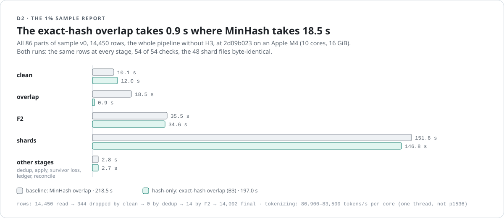

# Passes over the data, and which to cut (D2, Lab 5)

TSAI's design task 2 for Team 1 (28 Nov) asks:
- **The diagram.** Draw the pipeline from raw files to shards, and mark every pass over the data.
- **The cuts:**
  - exact-hash dedup of text at the first pass;
  - benchmark overlap (F2) in the same pass as tokenizing;
  - cleaning once;
  - nothing tokenized twice.
- **The 1% sample report:**
  - rows read;
  - rows dropped by each stage;
  - seconds per stage;
  - the tokenizing step's tokens per second per core.
- **Memory:** the overlap stage's peak RAM, and what to do when it does not fit.

The first cut is built in this branch. It is B3: the clean job's `text_hash` column, `dedup/hash_overlap.py`, and
`shards/provenance.py` for a hash-only dedup. The other cuts are proposals, each with the saving it can give.

## 1. The pipeline today: every pass

The numbers are from two runs.
- **38 packs:** the rehearsal on all 86 parts of tokenizer sample v0 (patilvijay23/era-v5-lab#62, 19 Nov). Runpod, 32
  vCPU, 251 GB RAM; exact-Jaccard overlap (`overlap.py`); F2 with 30 workers.
- **1%:** the run on a 1% slice of the same parts (`jobs/2026-11-28-d2-b3-sample-1pct/`), at commit `2d09b023`.
  Apple M4, 10 cores, 16 GiB; MinHash overlap; one tokenizer thread; no H3.

Red stages read or write document text. Teal stages read IDs, hashes and counts only. Survivor loss (2 s, IDs only) is
left out of the drawing.

| Text | Read by | Written by |
|---|---|---|
| raw | clean, ledger | |
| cleaned or later | overlap, H3, apply, F2, ledger, shards | clean, apply, F2 |

So raw text is read **twice**, the text after cleaning is read **six times** and written **three times**, and it is
tokenized **once**.

**38 packs, 9,314 s end to end:**
- overlap is 54% of the time, shards 19%, clean 15% and F2 8%;
- rows: 1,444,766 raw → 34,536 dropped by clean → 1,339 removed by dedup (H1 55, H2 1,284) → 1,533 dropped by F2 →
  1,407,358 kept;
- 1,385,709 documents in 48 shards, 1,132,509,915 tokens.

## 2. The cuts

| Cut | What changes | Pass removed | Saving | Status |
|---|---|---|---|---|
| **C1. Exact-hash dedup at the first pass** | The clean job writes `text_hash` (sha256 of the H1 key) while it cleans. Exact copies are found in one pass over the hashes, never the text (`dedup/hash_overlap.py`). The copies can then be skipped by every later stage. | The overlap stage's work on exact copies | **1%:** overlap stage 18.5 s → 0.9 s, peak RSS 233 MB per worker → 135 MB, the same 48 shards byte for byte. **38 packs:** exact copies are 148 documents (0.01%), so skipping them saves almost nothing later. At corpus scale it depends on the full sources' copy rate, which nobody has measured yet. | **Built** (B3) |
| **C2. MinHash instead of all-pairs Jaccard** | `dedup/minhash_overlap.py` (#744, #767) | The all-pairs comparison: 5,036 s and 14.0 GB on 38 packs | TSAI's sizing run on corpus-v1 passed its gate. Its per-factor numbers were not returned. | Built (Kunal) |
| **C3. Ledger without text** | The clean job records each document's action (keep or fix). The ledger then reads IDs only, instead of comparing the raw and cleaned text. | The ledger's re-read of raw and cleaned text | 97 s and one read of both texts on 38 packs. | Proposal |
| **C4. F2 in the tokenizing pass** | The shard writer checks each batch against G9's fingerprint set before it tokenizes, so no final parts are written. | F2's read and write of all text | Up to the input and output part of F2's 722 s. The matching stays. | Proposal; for F2's owners |
| **C5. Apply writes no text** | The remove list becomes a skip list that the tokenizing pass applies while it reads. | Apply's rewrite of the parts that lose rows | 23 s on 38 packs (apply already hard-links the parts that lose nothing) | Proposal, small |
| **C6. Clean once, restart from a manifest** | The clean job resumes (`"resume": true`). `pipeline/hashing.py` hashes each file once. | | | In place |

**After the cuts:**
- raw text is read once;
- cleaned text is written once, read by MinHash, H3 and the tokenizing pass, and tokenized once;
- every other stage reads IDs.

## 3. The 1% sample report

The input is a fixed-seed 1% of every part of sample v0 (`pipeline/local_trial/slice_sample.py`, seed 20261128): all
86 parts, **14,450 of 1,444,766 rows**. The whole pipeline ran twice on it, without H3: once with MinHash, once
hash-only. Each run passed 108 of 108 checks.

| Stage | Rows in | Dropped or removed | Seconds (MinHash) | Seconds (hash-only) |
|---|---|---|---|---|
| clean | 14,450 | 344 | 10.1 | 12.0 |
| overlap | 14,106 | | 18.5 | 0.9 |
| dedup | 14,106 | 0 | 1.0 | 0.9 |
| apply | 14,106 | 0 | 0.1 | 0.1 |
| F2 | 14,106 | 14 | 35.5 | 34.6 |
| survivor loss | | | 0.3 | 0.3 |
| ledger | 14,450 | | 0.9 | 0.9 |
| shards | 14,092 | | 151.6 | 146.8 |
| reconcile | | | 0.5 | 0.5 |
| **total** | | | **218.5** | **197.0** |

- **Tokenizing:** 11,987,677 tokens in 148.1 s and 143.6 s of shard-writer time, summed over parts, with one thread
  (`RAYON_NUM_THREADS=1`). That is **80,900–83,500 tokens per second per core**. It includes each part's process
  start-up and Parquet input and output. The tokenizer was not G3's p1536 (sha256 `01d968a7…`). p1536's rate is B5's
  (Kunal).
- **Run-to-run noise.** Clean, F2 and shards did the same work in both runs. Their differences (0.9 to 4.8 s) are noise.
- **The shard stage dominates at this size:** about 3 s for each of 48 parts. How much of that is the per-part process
  start-up (spawn, then imports) is not measured. If most of it is, writing several parts per process is a further cut.

## 4. The overlap stage's peak RAM, and when it does not fit

**Answer.** MinHash overlap's memory is the main process plus every worker. The main process grows with the corpus (about
2 GB per 1× of sample v0); each worker costs a fixed ~0.13–0.16 GiB plus the part it is working on. When it does not fit,
lower `workers` first (same results, a config change), then cut large parts into row ranges (#807). The main process has
no sharded pass yet; with 16 workers it is not needed below about 10–12× sample v0 (corpus-v1 is ~3×).

### On the 1% slice

Same slice as section 3 (14,106 cleaned documents, 86 parts), on Linux, 2 vCPU, Python 3.13
(`jobs/logs/2026-11-28-d2-sec4-overlap-ram/sec4_overlap_ram_1pct.log`).

Per stage, 16 workers (`overlap_summary.json`, `peak_rss_mb_after_stage`):

| Stage | Main | Largest worker |
|---|---:|---:|
| signatures (per part, in the workers) | 110 MB | 169 MB |
| LSH table and bands | 117–128 MB | — |
| verify, rules, outputs | 128–149 MB | — |

Total of main and all workers, by worker count (`minhash_sizing.py --factors 1 --workers N`, fresh `work/` each):

| Workers | Main | Largest worker | **Total** | Candidates | `overlap_matches.csv` |
|---:|---:|---:|---:|---:|---|
| 16 | 0.15 GiB | 0.16 GiB | **2.25 GiB** | 43 | `484f20ed…` |
| 12 | 0.15 GiB | 0.17 GiB | **1.80 GiB** | 43 | `484f20ed…` |
| 4 | 0.15 GiB | 0.18 GiB | **0.81 GiB** | 43 | `484f20ed…` |
| 1 | 0.15 GiB | 0.20 GiB | **0.30 GiB** | 43 | `484f20ed…` |

- **Outputs do not depend on the worker count:** the same 43 candidates and a byte-identical `overlap_matches.csv`.
- **At 1%, the total is almost all fixed cost per worker:** each worker holds Python, NumPy, PyArrow and Pygments
  (~0.13–0.16 GiB) before it reads a row. 16 workers cost 2.25 GiB for 14,106 documents that one worker handles in 0.30.
- The #898 run on an Apple M4 measured 233 MB in its largest worker and 104 MB in the main process at 16 workers; the
  difference is the platform's allocator and package builds, not the data.

### At scale

| Input | Documents | Main | Largest worker | Total | Source |
|---|---:|---:|---:|---:|---|
| 1% slice | 14,106 | 0.15 GiB | 0.16–0.20 GiB | 0.30–2.25 GiB | this section |
| Sample v0, 47 train parts | 1,395,320 | 2.18 GB | 1.51 GB | — | #807 (2 workers) |
| corpus-v1, 33 staged packs (raw) | 4,208,197 (~3×) | not returned | not returned | ~70% of 64 GiB | TSAI's sizing, 24 Nov |

- **Main process:** about 2 GB per 1× of sample v0 (signatures, H1 maps, candidates), so ~6 GB at corpus-v1's ~3×.
- **Workers:** set by the size of the part each one holds, not by the corpus. On sample v0's parts a worker peaks at
  0.8–0.9 GB while signing and ~1.5 GB while re-reading candidates.
- **corpus-v1:** TSAI's sizing passed at about 70% of 64 GiB (~45 GiB), above the ~32 GiB that the sample figures give
  for 16 workers. Its per-factor files (`sizing.csv`, `sizing.json`) have not been returned, so the split between main and
  workers is unknown; the likely cause is corpus-v1's larger parts (~237,000 documents each in the first 6).

### When it does not fit

In order of cost:

| Lever | Saves | Cost | Status |
|---|---|---|---|
| **Fewer workers** (`workers` in `minhash_overlap.json`) | each worker's fixed ~0.13–0.16 GiB plus its part's working set; 16 → 12 saves up to ~6 GiB at 1.5 GB a worker | slower signatures; results unchanged | a config change |
| **Row ranges for large parts** (`chunk_rows`) | caps the documents a worker signs at once (20,000), so large parts no longer set the signing peak | none: outputs byte-identical | #807, draft until the corpus-v1 run finishes |
| **Sharded pass for the main process** | main's ~2 GB per 1× | design and tests | not built; under a 48 GiB budget it is needed past ~10–12× sample v0 with 16 workers, later with fewer |

Row ranges do not cap the candidate re-read (`verify_words`, `rules`), which still reads per part; that step's ~1.5 GB
per worker on sample v0 is the next one to bound if a larger corpus needs it.

## 5. Not measured yet

- The exact-copy rate of the full sources, which decides what C1 saves at corpus scale.
- p1536's tokenizing rate, and the process start-up's share of the shard stage.
- C3, C4 and C5 are not built.
- MinHash's peak RAM on corpus-v1, split into main and workers: waits on TSAI's sizing files (section 4).
