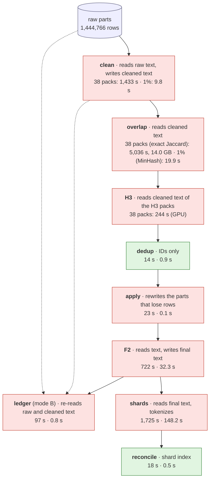
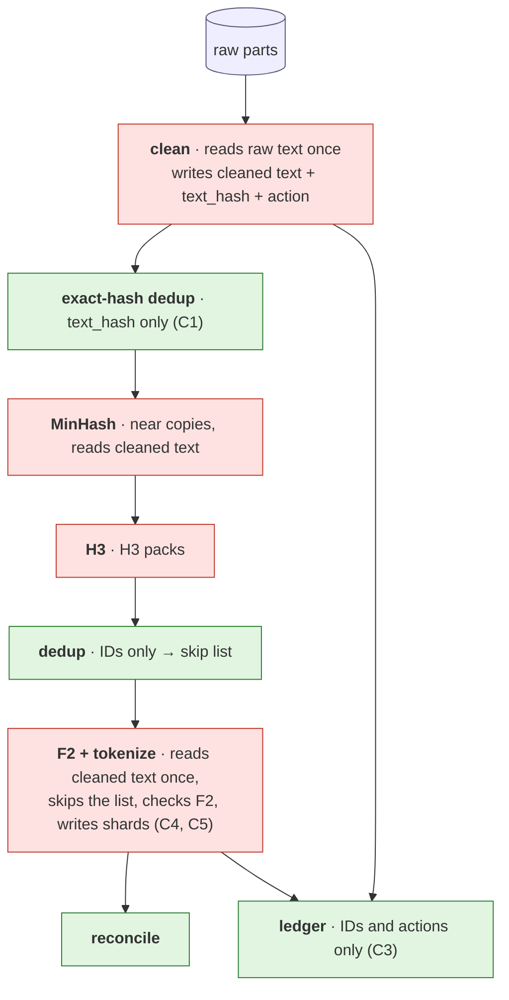

# Passes over the data, and which to cut (D2, Lab 5)

TSAI's design task 2 for Team 1 (28 Nov) asks:
- **The diagram.** Draw the pipeline from raw files to shards, and mark every pass over the data.
- **The cuts:**
  - exact-hash dedup of text at the first pass;
  - benchmark overlap (F2) in the same pass as tokenizing;
  - cleaning once;
  - nothing tokenized twice.
- **The 1% sample report:**
  - rows read;
  - rows dropped by each stage;
  - seconds per stage;
  - the tokenizing step's tokens per second per core.
- **Memory:** the overlap stage's peak RAM, and what to do when it does not fit.

The first cut is built in this branch. It is B3: the clean job's `text_hash` column, `dedup/hash_overlap.py`, and
`shards/provenance.py` for a hash-only dedup. The other cuts are proposals, each with the saving it can give.

## 1. The pipeline today: every pass

The numbers are from two runs.
- **38 packs:** the rehearsal on all 86 parts of tokenizer sample v0 (patilvijay23/era-v5-lab#62, 19 Nov). Runpod, 32
  vCPU, 251 GB RAM; exact-Jaccard overlap (`overlap.py`); F2 with 30 workers.
- **1%:** the run on a 1% slice of the same parts (`jobs/2026-11-28-d2-b3-sample-1pct/`). MinHash overlap, one
  tokenizer thread, no H3.

Red stages read or write document text. Green stages read IDs, hashes and counts only. Survivor loss (2 s, IDs only) is
left out of the drawing.

| Text | Read by | Written by |
|---|---|---|
| raw | clean, ledger | |
| cleaned or later | overlap, H3, apply, F2, ledger, shards | clean, apply, F2 |

So raw text is read **twice**, the text after cleaning is read **six times** and written **three times**, and it is
tokenized **once**.

**38 packs, 9,314 s end to end:**
- overlap is 54% of the time, shards 19%, clean 15% and F2 8%;
- rows: 1,444,766 raw → 34,536 dropped by clean → 1,339 removed by dedup (H1 55, H2 1,284) → 1,533 dropped by F2 →
  1,407,358 kept;
- 1,385,709 documents in 48 shards, 1,132,509,915 tokens.

## 2. The cuts

| Cut | What changes | Pass removed | Saving | Status |
|---|---|---|---|---|
| **C1. Exact-hash dedup at the first pass** | The clean job writes `text_hash` (sha256 of the H1 key) while it cleans. Exact copies are found in one pass over the hashes, never the text (`dedup/hash_overlap.py`). The copies can then be skipped by every later stage. | The overlap stage's work on exact copies | **1%:** overlap stage 19.9 s → 0.8 s, peak RSS 266 MB per worker → 137 MB, the same 48 shards byte for byte. **38 packs:** exact copies are 148 documents (0.01%), so skipping them saves almost nothing later. At corpus scale it depends on the full sources' copy rate, which nobody has measured yet. | **Built** (B3) |
| **C2. MinHash instead of all-pairs Jaccard** | `dedup/minhash_overlap.py` (#744, #767) | The all-pairs comparison: 5,036 s and 14.0 GB on 38 packs | TSAI's sizing run on corpus-v1 passed its gate. Its per-factor numbers were not returned. | Built (Kunal) |
| **C3. Ledger without text** | The clean job records each document's action (keep or fix). The ledger then reads IDs only, instead of comparing the raw and cleaned text. | The ledger's re-read of raw and cleaned text | 97 s and one read of both texts on 38 packs. | Proposal |
| **C4. F2 in the tokenizing pass** | The shard writer checks each batch against G9's fingerprint set before it tokenizes, so no final parts are written. | F2's read and write of all text | Up to the input and output part of F2's 722 s. The matching stays. | Proposal; for F2's owners |
| **C5. Apply writes no text** | The remove list becomes a skip list that the tokenizing pass applies while it reads. | Apply's rewrite of the parts that lose rows | 23 s on 38 packs (apply already hard-links the parts that lose nothing) | Proposal, small |
| **C6. Clean once, restart from a manifest** | The clean job resumes (`"resume": true`). `pipeline/hashing.py` hashes each file once. | | | In place |

**After the cuts:**
- raw text is read once;
- cleaned text is written once, read by MinHash, H3 and the tokenizing pass, and tokenized once;
- every other stage reads IDs.

## 3. The 1% sample report

The input is a fixed-seed 1% of every part of sample v0 (`pipeline/local_trial/slice_sample.py`, seed 20261128): all
86 parts, **14,450 of 1,444,766 rows**. The whole pipeline ran twice on it, without H3: once with MinHash, once
hash-only. Each run passed 108 of 108 checks.

| Stage | Rows in | Dropped or removed | Seconds (MinHash) | Seconds (hash-only) |
|---|---|---|---|---|
| clean | 14,450 | 344 | 9.8 | 10.9 |
| overlap | 14,106 | | 19.9 | 0.8 |
| dedup | 14,106 | 0 | 0.9 | 0.9 |
| apply | 14,106 | 0 | 0.1 | 0.1 |
| F2 | 14,106 | 14 | 32.3 | 44.7 |
| survivor loss | | | 0.3 | 0.3 |
| ledger | 14,450 | | 0.8 | 0.9 |
| shards | 14,092 | | 148.2 | 157.8 |
| reconcile | | | 0.5 | 0.6 |

- **Tokenizing:** 11,987,677 tokens in 144.8 s and 154.2 s of shard-writer time, summed over parts, with one thread
  (`RAYON_NUM_THREADS=1`). That is **77,700–82,800 tokens per second per core**. It includes each part's process
  start-up and Parquet input and output. The tokenizer was not G3's p1536 (sha256 `01d968a7…`), so p1536's rate still
  has to be measured.
- **Run-to-run noise.** Clean, F2 and shards did the same work in both runs. Their differences (1 to 12 s) are noise on
  one laptop.
- **The shard stage dominates at this size:** about 3 s for each of 48 parts. How much of that is the per-part process
  start-up (spawn, then imports) is not measured. If most of it is, writing several parts per process is a further cut.

## 4. The overlap stage's peak RAM, and when it does not fit

| Overlap | Input | Peak RSS |
|---|---|---|
| exact Jaccard (`overlap.py`) | 38 packs, 1,410,230 documents | 14.0 GB |
| MinHash (`minhash_overlap.py`), 16 workers | 1% slice, 14,106 documents | 266 MB in the largest worker, 99 MB in the main process |
| exact hash (`hash_overlap.py`) | 1% slice | 137 MB, one process |
| MinHash on corpus-v1's 33 packs | TSAI's sizing at 1x, 2x and 4x | passed the 48 GiB gate (G2 chat, 24 Nov); per-factor numbers not returned |

**When it does not fit:**
1. Fewer workers in MinHash's per-part signature step: memory grows with the number of workers.
2. LSH bands one at a time from memory-mapped signature files. `minhash_overlap.py` already works this way.
3. For the exact-hash pass: about 150 bytes per document for the whole table. Above that, partition the pass by the
   hash's first byte (256 independent buckets).
4. MinHash by groups of packs, then one pass across the groups over the stored signatures.

## 5. Not measured yet

- The exact-copy rate of the full sources, which decides what C1 saves at corpus scale.
- p1536's tokenizing rate, and the process start-up's share of the shard stage.
- C3, C4 and C5 are not built.
- MinHash's peak RAM on corpus-v1.
