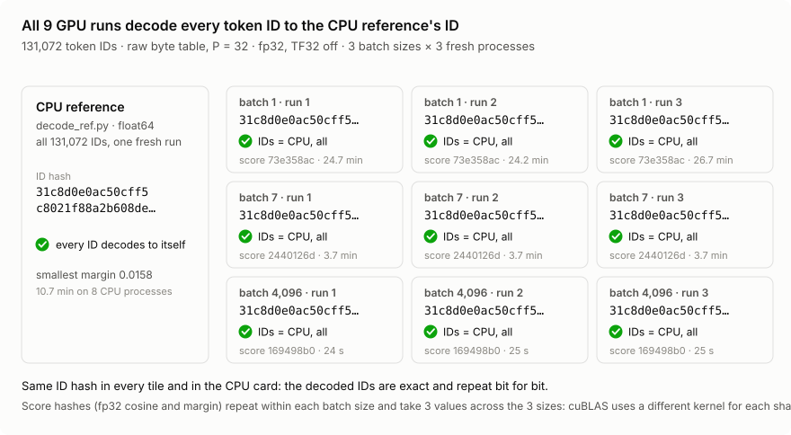
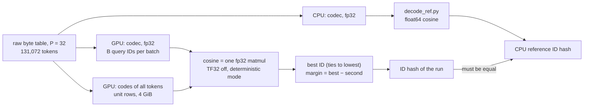
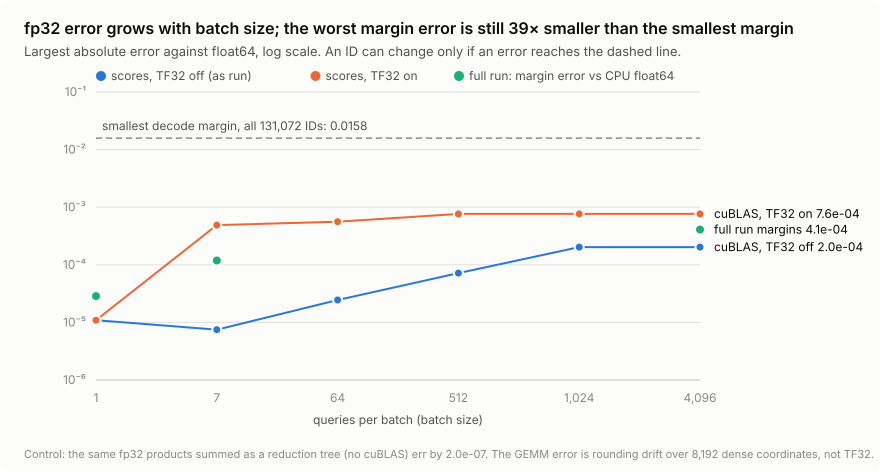
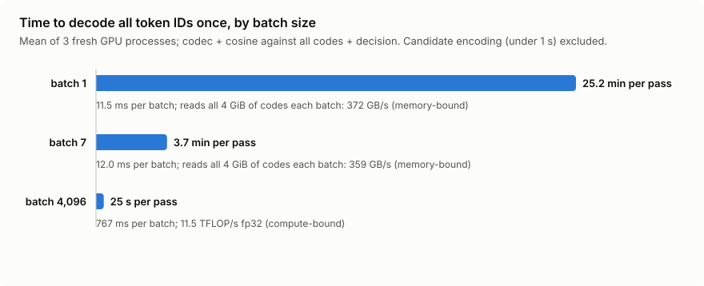
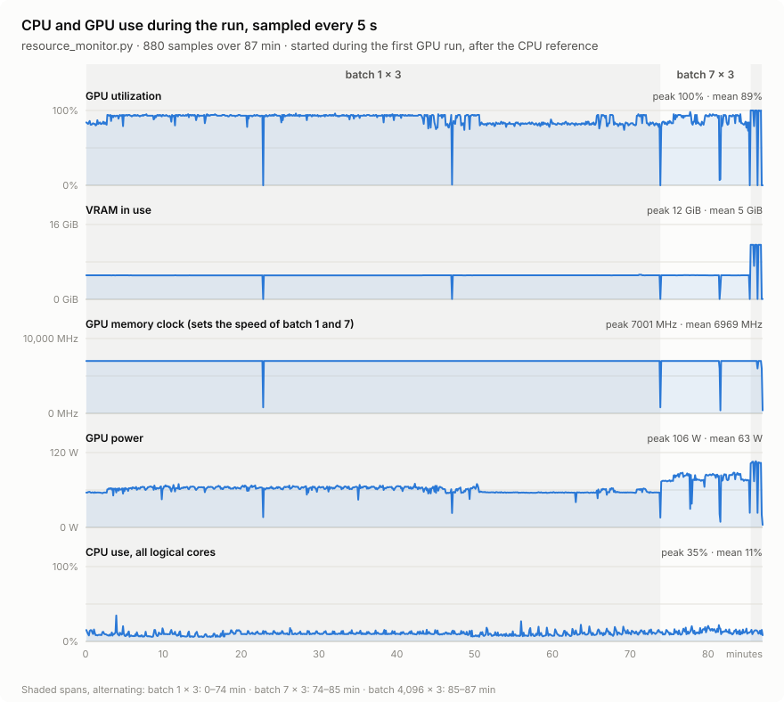

# GPU decode determinism: every token ID, from its KE2 code back to the ID

> **Result: pass.** On an NVIDIA GPU, all **131,072** token IDs of BrahmicTokenizer-131K decode back to
> themselves. That holds in **9 fresh processes** (batch sizes **1, 7 and 4,096**, three runs each,
> **fp32, TF32 off**), and the decoded IDs are bit for bit the same as the CPU float64 reference.
> This is the Gate 2 evidence for GPU determinism (`decision_input.md`, section 4).



## Gate 2 checklist

| Gate 2 asks for | Result | Evidence |
|---|---|---|
| Three GPU hashes match, batch size 1 | ✅ `31c8d0e0…` × 3 | [`raw_P32_sha256.txt`](results/decode_gpu/raw_P32_sha256.txt) |
| Three GPU hashes match, batch size 7 | ✅ `31c8d0e0…` × 3 | same file |
| Three GPU hashes match, batch size 4,096 | ✅ `31c8d0e0…` × 3 | same file |
| The IDs equal the CPU reference for every token ID | ✅ 131,072 of 131,072, in all 9 runs | `runs[].comparison` in [`raw_P32.json`](results/decode_gpu/raw_P32.json) |
| fp32, TF32 off | ✅ | `runs[].environment`: `dtype float32`, `tf32_matmul false`, `tf32_cudnn false`, precision `highest` |
| Every ID decodes to **itself**, not only to the CPU's answer | ✅ the ID hash is the hash of the identity map | `test_committed_gpu_results_are_complete_and_consistent` |
| The same protocol on **CPU** (three processes per batch size) gives the same IDs | ✅ 9 CPU runs, every ID equal to the reference; the same `31c8d0e0…` ID hash | section 7, [`results/decode_cpu/raw_P32.md`](results/decode_cpu/raw_P32.md) |

## What was decoded

**The KE2 code.** Each token's exact bytes come from the raw byte table
(`results/tables/raw_table_P32.npz`, the table with no collisions). The Kronecker codec turns them into a fixed
vector of D = 256 × 32 = 8,192 numbers. This is the code described in [output_shape.md](output_shape.md), and the
one Team 6's `models/ke2.py` builds its embedding from. The decode works on the code itself, before the learned
`Linear(D, d_model)`.

**Decode** means: find the token whose code has the highest cosine similarity with the given vector, over all
131,072 codes. Ties go to the lowest ID, and the **margin** is the best cosine minus the second best. This is the
contract of [decode_ref.py](decode_ref.md). It is not the tokenizer's `decode([id])`; that one is covered in
[determinism.md](determinism.md).



| | GPU runs | CPU reference |
|---|---|---|
| Script | [`src/determinism/decode_gpu.py`](src/determinism/decode_gpu.py) | the same script, `decode_ref.decode` inside |
| Encoder | upstream `kronecker_codec` on CUDA, float32 | upstream `kronecker_codec` on CPU, float32 |
| Scoring | float32 matmul of unit rows; TF32 off; `use_deterministic_algorithms(True)`; `CUBLAS_WORKSPACE_CONFIG=:4096:8` | float64 structured cosine (Lemma 1), no BLAS |
| Processes | 3 fresh processes per batch size | 1 fresh process with 8 worker processes |
| Hardware | NVIDIA RTX 5000 Ada Laptop GPU, 16 GB, driver 596.58, CUDA 13.0, torch 2.14.1+cu130 | Intel Core i7-13850HX, Windows 11, Python 3.13.5, NumPy 2.5.4 |

## Findings

### 1. The decoded IDs are exact and repeatable on CPU and GPU

All ten runs (9 GPU and the CPU reference) give the same ID hash:

```
31c8d0e0ac50cff5c8021f88a2b608de2298fdbf216c620a40e83d2adbe26f9a
```

That value is the hash of the identity map (query ID *i* → decoded ID *i* for every *i*), so **every token ID
decodes to itself**, with **no ties**. Batch size, process and device make no difference to the IDs.

### 2. The float scores repeat within a batch size, not across batch sizes

| Batch size | Score hash, all 3 runs | Same in all 3 runs |
|---:|---|:---:|
| 1 | `73e358ac73c30571…` | ✅ |
| 7 | `2440126d66135020…` | ✅ |
| 4,096 | `169498b06d3cd8be…` | ✅ |
| CPU reference (float64) | `760bc2261898f147…` | n/a |

The score hash covers the best cosine and the margin of every query. For a fixed batch size they repeat bit for
bit across fresh processes. Between batch sizes they differ, because cuBLAS uses a different kernel for each
matrix shape. **Compare float outputs across batch sizes or machines with a tolerance, never bit for bit.** The
IDs need no tolerance.

### 3. The fp32 error depends on the batch size, not on TF32, and stays far below the margins



| Batch size | 1 | 7 | 64 | 512 | 1,024 | 4,096 |
|---|---:|---:|---:|---:|---:|---:|
| Score error, TF32 off (16,384-code study) | 1.1e-5 | 7.5e-6 | 2.5e-5 | 7.2e-5 | 2.0e-4 | 2.0e-4 |
| Score error, TF32 on (16,384-code study, contrast only) | 1.1e-5 | 4.9e-4 | 5.6e-4 | 7.6e-4 | 7.6e-4 | 7.6e-4 |
| Full run: score error vs CPU | 2.2e-5 | 7.5e-5 | | | | 2.3e-4 |
| Full run: margin error vs CPU | 2.9e-5 | 1.2e-4 | | | | 4.1e-4 |

The first two rows come from [`gemm_accuracy_gpu.py`](src/determinism/gemm_accuracy_gpu.py)
([`gemm_accuracy_P32.json`](results/decode_gpu/gemm_accuracy_P32.json)). They compare the same fp32 inputs in
float32 and float64, over 16,384 codes.

- **TF32 is off.** Turning it on raises the error 4 to 65 times for batch sizes of 7 and up; batch 1 is
  unchanged. A second run with `NVIDIA_TF32_OVERRIDE=0`, which forces TF32 off in the driver, gives the
  TF32-off numbers exactly, in both rows
  ([`tf32_override_0/gemm_accuracy_P32.json`](results/decode_gpu/tf32_override_0/gemm_accuracy_P32.json)).
- **The cause is accumulation.** Every coordinate of a KE2 code is nonzero (z-normalisation gives the D − L
  "empty" cells a small negative value). A dot product therefore adds about 8,000 equal tiny products. The
  kernels cuBLAS picks for batches of 1,024 and up add them in long chains, so the rounding drifts one way. The
  same products added as a reduction tree are off by only **2.0e-7**.
- **The margins are safe.** The smallest margin over all 131,072 IDs is **0.0158**. It falls between token
  50346 (32 spaces) and token 83647 (31 spaces), which differ in one cell. The worst margin error is 4.1e-4,
  **39 times smaller**, so no ID can change.
- **For Team 6 and the margin owner:** treat fp32 GPU scores and margins as accurate to about **5e-4**. A tau
  or margin threshold closer than that to a real margin needs float64, or a summation-order check.

### 4. Speed: memory-bound for small batches, compute-bound for large ones



| Batch size | Time per pass (mean of 3) | Per batch | What limits it |
|---:|---:|---:|---|
| 1 | 25.2 min (1,485 / 1,454 / 1,600 s) | 11.5 ms | memory: all 4 GiB of codes are read for every batch, at 372 GB/s |
| 7 | 3.7 min (224 s each) | 12.0 ms | memory, the same as batch 1: 359 GB/s |
| 4,096 | 25 s | 767 ms | arithmetic: 11.5 TFLOP/s fp32, at the GPU's power limit |

Batch sizes 1 and 7 take the same time per batch, which shows they are limited by memory traffic. A
structured decoder that gathers only the L support cells (the `decode_ref.py` method) would avoid reading the
dense codes.

### 5. Resource use: where the run sat, and what would speed it up



These figures come from [`resource_monitor.py`](src/determinism/resource_monitor.py)
([`resources_raw_P32.csv`](results/decode_gpu/resources_raw_P32.csv), 880 samples, one every 5 s), averaged per
GPU process:

| Run | GPU power | SM clock | Memory controller | Temperature |
|---|---:|---:|---:|---:|
| Batch 1, runs 1–2 | 62–63 W | ~1,045 MHz | 99% | 66–67 °C |
| Batch 1, run 3 | 57 W | 809 MHz | 95% | 64 °C |
| Batch 7 | 79 W | ~865 MHz | 94–97% | 71–72 °C |
| Batch 4,096 | 101–104 W | ~1,000 MHz | 54–65% | 72 °C |

The table is averaged from the CSV; each batch-4,096 run lasted about 25 s at one sample every 6.5 s, so its row rests on 3 to 4 samples per run, about 11 in all. The
clock, power-state, power-limit and worker-memory figures in the bullets below were read from `nvidia-smi` and the task
manager during the run and have no committed source.

- **The GPU ran in a low-power state.** `nvidia-smi` reported P3: memory clock **7,001 of 9,001 MHz**, SM clock
  ~1,000 of 3,105 MHz. The software power-cap and software thermal-slowdown flags (`0x24`) were set in every
  sample. Windows was already in *Best performance*, so the limit is the laptop's GPU and thermal profile.
- **Batch 1, run 3 was 8% slower.** The laptop lowered the SM clock from ~1,045 to 809 MHz during that run. The
  hashes were unchanged, as expected: clocks change speed, not arithmetic.
- **Batch 4,096 hit the power limit** (enforced limit 101 W), so it ran as fast as this power setting allows.
- **The CPU reference used 8 worker processes**, about 0.9 GB each, and took 10.7 minutes. With 16 workers the
  run ran out of memory, so memory, not cores, was the limit there.
- **To go faster on this laptop:** set NVIDIA Control Panel → *Power management mode* → *Prefer maximum
  performance*, and use the HP *Performance* thermal profile. A 9,001 MHz memory clock would make batches 1
  and 7 up to about 1.29 times faster. The results would not change.

### 6. The CPU reference agrees with the committed week-1 `decode_ref` run, except for the last float bit

`raw_P32.json` → `cpu_reference.committed_sample` recomputes the
[`decode_ref/summary.json`](results/decode_ref/summary.json) hash for its 4,096 sampled IDs, and it differs
(`8d98c861…` here, `5808c837…` committed).

- **IDs, bytes and margins match.** Recomputing those 4,096 IDs with `decode_ref.py` on this machine gives
  identical IDs and bytes, and the smallest and the median margin are equal to the last digit. The smallest score differs by **1.1e-16**, one float64 rounding
  step.
- **The cause is the platform.** The committed run is from macOS on arm64; this one is Windows on x86-64.
  `decode_ref.md` already says it makes no claim of cross-platform bitwise equality. The torch thread count made
  no difference.
- **Compare machines with the ID hash.** It contains no floats, so it is the hash to use when comparing
  machines.
- **The sources are the same.** Recorded on this Windows checkout (CRLF), the sources hash differently from
  `summary.json`. With LF line endings, as git stores them, they match exactly:

| File | Recorded here (CRLF) | LF, as in git | `decode_ref/summary.json` (macOS) |
|---|---|---|---|
| `decode_ref.py` | `b7b8f7ea…` | `83e2e9f0…` | `83e2e9f0…` ✅ |
| upstream `codec.py` (`d07cb54`) | `d9613ac9…` | `08f08f13…` | `08f08f13…` ✅ |
| `decode_gpu.py` | `c82e28ea…` (LF) | `c82e28ea…` | n/a |

### 7. The same protocol on CPU gives the same IDs

The GPU runs above compare against one CPU reference process. The lead's run repeats the GPU protocol on CPU
(`src/determinism/decode_batches.py`): the same three fresh processes at each of batch sizes 1, 7 and 4,096, fp32 with
TF32 off and matmul precision `highest`, every one of the 131,072 IDs, scored by the structured cosine scorer
(`ke2.scoring`; the two-valued code structure of proof.md Lemma 1) instead of a dense GEMM. The deterministic-algorithms
mode and the cuBLAS workspace setting are CUDA-only and not set on CPU. Every run is compared ID for ID with the
float64 `decode_ref.decode` reference (macOS arm64, torch 2.15.0).

| batch size | runs | hashes match within the batch size | every ID equal to the reference |
|---|---|---|---|
| 1 | 3 | yes | yes |
| 7 | 3 | yes | yes |
| 4,096 | 3 | yes | yes |

Every CPU run decodes every ID to itself, so its ID hash in this document's format (`ke2-decode-gpu-ids-v1`, the
identity map over the committed table) is `31c8d0e0…`, the value of all nine GPU runs. Two decoders (dense fp32
GEMM on CUDA, structured fp32 cosine on CPU), two devices and three batch shapes give the same
131,072 IDs. The run's own per-run hash (`ke2-decode-batches-v1`) names the batch size in its header, so it differs
across batch sizes by construction; the ID bodies are identical.

## Hand-off to Team 6

| What | Where |
|---|---|
| Reference decoder (CPU, float64, exhaustive cosine) | [`src/decode_ref.py`](src/decode_ref.py), contract in [decode_ref.md](decode_ref.md) |
| The GPU decoder used here (fp32 matmul, ties to the lowest ID) | `candidate_codes` and `decode_batch` in [`decode_gpu.py`](src/determinism/decode_gpu.py) |
| **Target ID hash**: raw table, P = 32, all IDs, format `ke2-decode-gpu-ids-v1` | `31c8d0e0ac50cff5c8021f88a2b608de2298fdbf216c620a40e83d2adbe26f9a` |
| Float tolerance for scores and margins against `decode_ref.py` | 5e-4 (measured worst: 2.3e-4 for scores, 4.1e-4 for margins) |
| Score hashes | valid only for the same GPU, driver, torch and batch size |

Any faster decoder is correct on this table if it reproduces the target ID hash. `id_digest` in
`decode_gpu.py` computes it from a list of decoded IDs.

## Reproduce

From the lab repository root, with `kronecker-embeddings` at `d07cb54` next to the repository (or
`KRONECKER_SRC` set) and a CUDA build of PyTorch. The tokenizer is not needed: the committed table carries its
SHA-256.

```sh
pip install torch==2.14.1 --index-url https://download.pytorch.org/whl/cu130   # any CUDA build
pip install numpy psutil
python teams/04-ke2/src/determinism/decode_gpu.py --pos-dim 32          # ~100 min here; writes results/decode_gpu/raw_P32.*
python teams/04-ke2/src/determinism/gemm_accuracy_gpu.py --pos-dim 32   # ~1 min; gemm_accuracy_P32.json
python teams/04-ke2/src/docs/determinism_gpu_figures.py                 # the four figures
KE2_RUN_GPU_TESTS=1 python -m pytest teams/04-ke2/tests/test_decode_gpu.py -q
```

The CPU counterpart (section 7) needs no GPU and no tokenizer:

```sh
python teams/04-ke2/src/determinism/decode_batches.py --device cpu   # about 25 min on an Apple-silicon laptop; writes results/decode_cpu/raw_P32.{json,md}
python -m pytest teams/04-ke2/tests/test_decode_batches.py -q
```

To record resource use, start `resource_monitor.py --out <csv> --watch-pid <pid of decode_gpu.py>` next to the
run. `--limit N` decodes only the first N IDs, for a smoke test; the candidates stay complete.

**Hash formats.** The ID hash (`ke2-decode-gpu-ids-v1`) is the header
`ke2-decode-gpu-ids-v1|P=<P>|table=<table sha256>|n=<rows>` plus LF. After it come, for each query in ascending
ID order, the query ID and the decoded ID as big-endian uint32. The score hash (`ke2-decode-gpu-scores-v1`)
uses the same header plus `|dtype=<f4 or <f8`. After it come, for each query, the best cosine and the margin,
little-endian.

## Scope and limits

- **One machine.** One GPU model, driver and torch version. The IDs should be the same on any correct GPU
  setup; the float hashes will not be.
- **One table.** Raw table at P = 32 only. P = 64 doubles D and the run time; it was not run. The decode-text
  table was not run, because its 10 collision groups make ties by construction.
- **Unprojected codes only.** Vectors after the learned projection need the trained weights.
- **The monitor started late.** It began during the first GPU run, after the CPU reference, so the figure starts
  there.
- **The tokenizer.** BrahmicTokenizer-131K (`01d968a7…`). Rerun this check when Team 3's frozen tokenizer
  arrives (Sat 14 Nov). It takes about 100 minutes here, 76 of them for batch size 1.

## Files

| File | What it is |
|---|---|
| [`src/determinism/decode_gpu.py`](src/determinism/decode_gpu.py) | The check: the CPU reference, then 3 fresh GPU processes per batch size; it writes the results and exits nonzero on failure |
| [`src/determinism/gemm_accuracy_gpu.py`](src/determinism/gemm_accuracy_gpu.py) | fp32 against float64 error by batch size, TF32 off and on |
| [`src/determinism/resource_monitor.py`](src/determinism/resource_monitor.py) | CPU, RAM and GPU sampler |
| [`src/docs/determinism_gpu_figures.py`](src/docs/determinism_gpu_figures.py) | Draws the four figures from the result files |
| [`results/decode_gpu/raw_P32.json`](results/decode_gpu/raw_P32.json) | Every run: hashes, comparison with the CPU, timings, environment, smallest-margin pair |
| [`results/decode_gpu/raw_P32_sha256.txt`](results/decode_gpu/raw_P32_sha256.txt) | One line per run: device, batch size, run, ID hash, score hash |
| [`results/decode_gpu/gemm_accuracy_P32.json`](results/decode_gpu/gemm_accuracy_P32.json) | The precision measurement |
| [`results/decode_gpu/tf32_override_0/gemm_accuracy_P32.json`](results/decode_gpu/tf32_override_0/gemm_accuracy_P32.json) | The same measurement with TF32 forced off in the driver |
| [`results/decode_gpu/resources_raw_P32.csv`](results/decode_gpu/resources_raw_P32.csv) | The resource trace |
| [`tests/test_decode_gpu.py`](tests/test_decode_gpu.py) | 8 tests: hash framing, decoder logic against `decode_ref` and the tie rule (portable), the committed results, and an opt-in CUDA run (`KE2_RUN_GPU_TESTS=1`) |
| [`src/determinism/decode_batches.py`](src/determinism/decode_batches.py) | The CPU counterpart (section 7): three fresh processes per batch size on a chosen device, compared with the float64 reference; reports the ID hash in this document's format |
| [`results/decode_cpu/raw_P32.json`](results/decode_cpu/raw_P32.json), [`raw_P32.md`](results/decode_cpu/raw_P32.md) | Every CPU run: per-run hash, equality with the reference, seconds; the cached reference is `decode_ref_full_raw_P32_b3f5476e.npz` next to them |
| [`tests/test_decode_batches.py`](tests/test_decode_batches.py) | 8 tests: batch sizes agree and match the reference on a synthetic table, TF32 off, the reference cache, the environment record, the GPU-format digest equals `decode_gpu.id_digest`, the default output folder never targets `decode_gpu/`, an end-to-end parent/child run on a synthetic table, and the committed CPU report against the GPU report |
