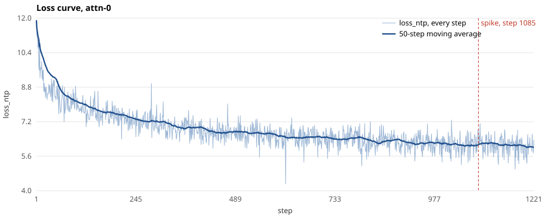

# Dry run 1: the loss record (SAMPLE, filled from a week-2 log)

**This is a sample, not dry run 1.** It is [`dryrun1_loss.md`](dryrun1_loss.md) filled in end to end from the
T2 reference run of the 10 Nov attention screen (`attn-0`), to show exactly what the real record will look like
and to test the method before dry run 1's logs arrive. Every number below comes from that run's files; the
real record uses the same six sections, the same script and the same wording rules.
How it was made and how to rerun it: [`dryrun1_README.md`](dryrun1_README.md), section 4.

<!-- generated by dryrun1_spikes.py from metrics.jsonl (sha256 0e4efcf320a554bd9f67bf253de42aceb0f9e205b18413f8dfe256bd21219857): 1221 training steps -->

## 1. What ran

| Item | Value | Source |
|---|---|---|
| Config | `configs/arms/t2.yaml` with `configs/runtime.yaml` (T2, the attention reference design) | `command.json` |
| Optimizer | AdamW, learning rate 0.001, constant schedule | `command.json`, `manifest.json` |
| Job request | [`jobs/2026-11-10-attention-t2.md`](../../jobs/2026-11-10-attention-t2.md) (Revant; one-seed preliminary screen) | job request |
| Data | all 48 TRAIN parts across 38 packs (train sha256 `368c6d7b…`); held-out `heldout_v1` (sha256 `21c6e4b2…`, 1,059 documents) | `command.json` |
| Model size, steps, batch, sequence length | 8 layers, width 512, 8 heads (2 key/value), 16 routed + 1 shared expert, top-2; 1,221 steps; global batch 8, microbatch 1; context 2048; bf16; seed 1235 | `manifest.json`, evidence README |
| Hardware, run by, start and end | 1 × NVIDIA RTX PRO 6000 Blackwell (95 GiB); run by Revant on 10 Nov; 1,796.7 s wall time | `environment.json`, `summary.json` |
| Logs used | `attn-0/metrics.jsonl` sha256 `0e4efcf3…19857`; `summary.json` `9f64f88e…` | the evidence folder |

## 2. The loss curve

The first step, every 50 steps, the last step, and every spike step (marked *). loss_ntp is one batch, so it is noisy; the 50-step moving average shows the trend.

| step | loss_ntp | 50-step average | loss_mtp | gradient_norm | lr | tokens/s | held-out bpb |
|---:|---:|---:|---:|---:|---:|---:|---:|
| 1 | 11.9039 | 11.9039 | 0.0000 | 2.9849 | 0.0010 | 10507 | — |
| 50 | 8.4644 | 9.1682 | 0.0000 | 0.8322 | 0.0010 | 16813 | 2.4162 |
| 100 | 7.7149 | 8.1480 | 0.0000 | 0.7963 | 0.0010 | 15182 | 2.2314 |
| 150 | 7.7621 | 7.7458 | 0.0000 | 1.0410 | 0.0010 | 16890 | 2.1979 |
| 200 | 7.2745 | 7.5533 | 0.0000 | 0.7743 | 0.0010 | 16636 | 2.0751 |
| 250 | 7.3270 | 7.3042 | 0.0000 | 0.7038 | 0.0010 | 15999 | 2.0734 |
| 300 | 6.7816 | 7.1895 | 0.0000 | 0.8243 | 0.0010 | 17219 | 2.0242 |
| 350 | 6.8209 | 6.9489 | 0.0000 | 0.8264 | 0.0010 | 14469 | 1.9666 |
| 400 | 7.2189 | 6.9403 | 0.0000 | 1.2327 | 0.0010 | 14821 | 1.9770 |
| 450 | 7.1208 | 6.6903 | 0.0000 | 0.8470 | 0.0010 | 16474 | 1.9309 |
| 500 | 6.2884 | 6.7276 | 0.0000 | 1.1887 | 0.0010 | 9466 | 1.9086 |
| 550 | 6.7773 | 6.6730 | 0.0000 | 1.0221 | 0.0010 | 12826 | 1.8993 |
| 600 | 6.5412 | 6.5389 | 0.0000 | 0.7006 | 0.0010 | 11121 | 1.8656 |
| 650 | 6.8539 | 6.4571 | 0.0000 | 0.7899 | 0.0010 | 11756 | 1.8746 |
| 700 | 5.9298 | 6.4674 | 0.0000 | 0.7101 | 0.0010 | 11626 | 1.8414 |
| 750 | 6.3123 | 6.3827 | 0.0000 | 0.7389 | 0.0010 | 11903 | 1.8644 |
| 800 | 6.5749 | 6.4498 | 0.0000 | 0.7822 | 0.0010 | 12709 | 1.8451 |
| 850 | 6.0814 | 6.2638 | 0.0000 | 0.7630 | 0.0010 | 12602 | 1.8421 |
| 900 | 6.2493 | 6.3023 | 0.0000 | 0.5698 | 0.0010 | 12043 | 1.8210 |
| 950 | 5.9776 | 6.2006 | 0.0000 | 0.7142 | 0.0010 | 11471 | 1.8078 |
| 1000 | 6.5190 | 6.2005 | 0.0000 | 0.6850 | 0.0010 | 12935 | 1.7932 |
| 1050 | 5.6269 | 6.0840 | 0.0000 | 0.5969 | 0.0010 | 10368 | 1.7852 |
| 1085* | 6.6897 | 6.1389 | 0.0000 | 4.8726 | 0.0010 | 12617 | — |
| 1100 | 5.8388 | 6.1970 | 0.0000 | 0.8839 | 0.0010 | 11390 | 1.7758 |
| 1150 | 6.7041 | 6.1461 | 0.0000 | 0.7480 | 0.0010 | 10659 | 1.7742 |
| 1200 | 6.1667 | 6.0553 | 0.0000 | 0.8524 | 0.0010 | 11895 | 1.7761 |
| 1221 | 6.3524 | 6.0182 | 0.0000 | 0.6629 | 0.0010 | 11313 | 1.7770 |

## 3. Every spike

| step | metric | value | Team 7 guard (1.5 × median of last 100, 3 in a row stops) | Team 8 spike_score (mean + 7σ of last 1,000) | what happened next |
|---:|---|---:|---|---|---|
| 1085 | gradient_norm | 4.8726 | — | spike_score on gradient_norm: gradient_norm=4.873 is 14.3 sigma above trailing 1000-step mean 0.8652 | next step 1086: gradient_norm 0.5855; run continued to step 1221 (paging and any action: from the job log) |

What happened next, from the job log: the evidence folder has no alarm or paging log for this run, so this column shows only what `metrics.jsonl` itself shows. In dry run 1 it will
also say who was paged and what they did.

## 4. Stops and restarts

| Time | Step | Exit code | Cause | What happened | Source |
|---|---:|---:|---|---|---|
| — | — | — | none | one launch, no stop and no restart: `summary.json` shows `steps` 1221 of 1221 and `timed_out` false | `summary.json` |

Exit 75: saved and requeued by itself. Exit 78: no save, the job is held until a person rolls back.

## 5. Is the curve stable?

The loss falls: the 50-step average of `loss_ntp` goes from 9.17 at step 50 to 6.51 at step 611 and 6.02 at the
last step (1221), and held-out bits per byte falls from 2.99 before training to 1.78. Neither rule stopped the
run: Team 7's guard found no loss spike, and Team 8's rule raised one `spike_score` alarm, a gradient-norm jump
to 4.87 at step 1085 (14.3σ above its trailing mean) that the loss absorbed; the gradient norm was back to 0.59
at the next step. There were no stops, restarts, gaps or non-finite values. Nothing is unexplained. This reports
what the logs show; for dry run 1 the Gate 3 judgement is TSAI's.

### The script's summary

- Training steps read: 1221 (steps 1 to 1221); no gaps.
- Team 7 guard: 0 spike step(s); it would not have stopped the run.
- Team 8: 1 spike_score alarm(s), 0 non_finite; other Team 8 warnings: 0.
- Team 8's code: teams/08-monitoring/alarms/alarms.py.
- loss_ntp: first step 11.9039, last step 6.3524, lowest 4.3022 (step 612).
- 50-step moving average of loss_ntp: 9.1682 at step 50, 6.5136 at step 611, 6.0182 at step 1221.
- Held-out bpb: 2.9870 at step 0 → 1.7770 at step 1221 (26 evaluations; lowest 1.7742 at step 1150).
- Chart: dryrun1_loss_sample_attn0.svg.

## 6. Sources

- Job request: [`jobs/2026-11-10-attention-t2.md`](../../jobs/2026-11-10-attention-t2.md).
- Logs: [`jobs/evidence/2026-11-10-attention-screen/attn-0/`](../../jobs/evidence/2026-11-10-attention-screen/attn-0/)
  (`metrics.jsonl`, `command.json`, `manifest.json`, `summary.json`) and the screen's
  [`README.md`](../../jobs/evidence/2026-11-10-attention-screen/README.md) and `environment.json`.
- Spike rules: Team 8's [`alarms.py`](../../../08-monitoring/alarms/alarms.py), imported unchanged; Team 7's guard
  in [`train.py`](../../../07-infrastructure/support/simulation/trainer/train.py), copied with its defaults.
- Tables and chart: `python -I teams/05-architecture/experiments/results/dryrun1_spikes.py --jsonl teams/05-architecture/jobs/evidence/2026-11-10-attention-screen/attn-0/metrics.jsonl --svg teams/05-architecture/experiments/results/dryrun1_loss_sample_attn0.svg`.
