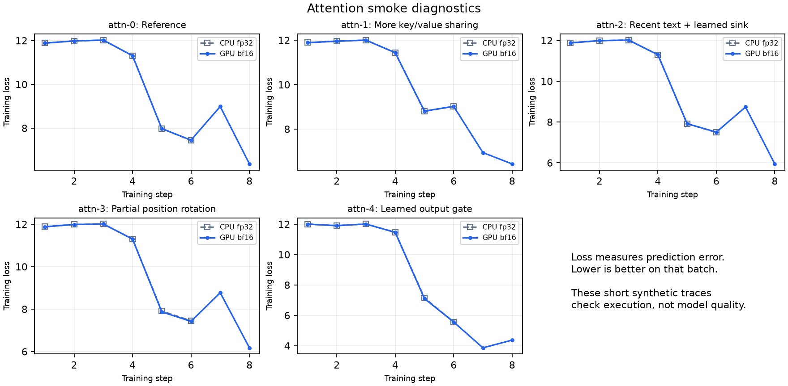
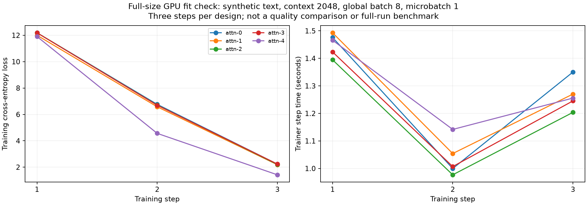

# Attention comparison: T2, five designs, three seeds

REQUEST FOR LEAD/TSAI REVIEW. No lead approval or official run completion is claimed.

```text
Team:            05-architecture
Owner:           Revant Gupta (revantg)
Lead approval:   pending review by shivman
Question:        Which of the four approved attention alternatives passes its rule against the reference design at T2?
Script:          teams/05-architecture/harness/train_week2.py
Command:         python teams/05-architecture/harness/train_week2.py --config teams/05-architecture/configs/arms/t2.yaml --runtime teams/05-architecture/configs/runtime.yaml --resolution ./inputs/resolution.yaml --tokenizer ./inputs/tokenizer_v0.json --byte-table ./inputs/raw_table_P32.npz --train-data ./inputs/train.jsonl --heldout-data ./inputs/heldout.jsonl --heldout-sources ./inputs/heldout_sources.jsonl --heldout-sha256 ./inputs/heldout.sha256 --heldout-report ./inputs/heldout_report.json --device cuda --lr 0.001 --seed 1234 --out ./out/attn-0-1234
Config:          five existing attention configurations listed below
Inputs:          reuse the EXACT TSAI-staged training/held-out/source/checksum/report bundle used for official job #310; same tokenizer v0 and matching P32 raw table
Hardware:        1 GPU supporting native bf16
Max time:        1350 minutes total maximum for 15 runs; each run capped at 90 minutes
Precision:       bf16
Measures:        every held-out slice, three-group/code/Indic BPB, seeds, completed steps, finite losses, timeouts, quality eligibility, step times and allocated GPU memory
Expected result: per-design means and seed ranges; no winning design is assumed
Outputs:         each run's metrics.jsonl, manifest.json and summary.json only; total return <=50 MB; retain required checkpoints internally, do not return them
Test log:        evidence/2026-11-10-attention-smoke/README.md (102 tests, five real CPU trainer logs, five GPU trainer logs)
Notebook:        ../notebooks/attention_smoke.py (annotated, explicit run control, no training on open)
```

## Source and controls

Reviewed source commit: c9cac5a0d5811e712212a37a01d6c540346ff1a1. Revalidate if TSAI applies a different commit.
All five designs keep the approved T2 shape, context 2048, global batch 8,
16 routed + 1 shared expert, top-2, expert width 768, SwiGLU, dense untied head.
Use AdamW LR 0.001 as the current proposed/common fallback; comparison_final remains
false until the lead records the final LR decision. No additional LR sweep requested.

Use the approved runtime resolution and return its approval reference and actual
input hashes. Start from the current microbatch 1; TSAI may approve a different
fitting value consistently across all designs, recording that change.
Use the merged evaluation implementation. Any execution-only token-cache changes
must be identified in the returned source manifest and applied consistently.

The input names in the command define staging paths, not invented data identities.
Use the official #310 bundle; return actual checksums, source sidecar, decontamination
report, tokenizer/table identity and resolution identity. Do not substitute this
notebook's synthetic smoke input or the repository's older baseline-tokenizer table.

## Fifteen runs, in requested order

Run seed 1234 across the five designs first, then 1235, then 1236.
The reference is included so helper assignment and baseline sharing do not delay filing.
Lead/TSAI may deduplicate its three runs with the optimizer/expert comparisons only
if input/configuration/budget/source identities match.

| Design | Seed | Existing config | Separate output |
|---|---:|---|---|
| attn-0 | 1234 | t2.yaml | ./out/attn-0-1234/ |
| attn-1 | 1234 | attn1_mqa.yaml | ./out/attn-1-1234/ |
| attn-2 | 1234 | attn2_swa128_sink.yaml | ./out/attn-2-1234/ |
| attn-3 | 1234 | attn3_prope_half.yaml | ./out/attn-3-1234/ |
| attn-4 | 1234 | attn4_gate.yaml | ./out/attn-4-1234/ |
| attn-0 | 1235 | t2.yaml | ./out/attn-0-1235/ |
| attn-1 | 1235 | attn1_mqa.yaml | ./out/attn-1-1235/ |
| attn-2 | 1235 | attn2_swa128_sink.yaml | ./out/attn-2-1235/ |
| attn-3 | 1235 | attn3_prope_half.yaml | ./out/attn-3-1235/ |
| attn-4 | 1235 | attn4_gate.yaml | ./out/attn-4-1235/ |
| attn-0 | 1236 | t2.yaml | ./out/attn-0-1236/ |
| attn-1 | 1236 | attn1_mqa.yaml | ./out/attn-1-1236/ |
| attn-2 | 1236 | attn2_swa128_sink.yaml | ./out/attn-2-1236/ |
| attn-3 | 1236 | attn3_prope_half.yaml | ./out/attn-3-1236/ |
| attn-4 | 1236 | attn4_gate.yaml | ./out/attn-4-1236/ |

## Acceptance and return

For alternatives 1–3, separately on three-group, code, and Indic BPB:
candidate mean minus reference mean <= max(candidate seed range, reference seed range).
All three conditions must pass.

Alternative 4 must improve three-group BPB by more than the larger seed range,
with code and Indic regressions within their corresponding seed ranges.
Use all three complete finite runs. A timeout before 1,221 steps is not a result.
The current winner-only helper does not implement alternatives 1–3's not-worse rule;
report their arithmetic explicitly. Smoke scores cannot select a winner.

## Commands

The following are separate sequential invocations, not a shell pipeline.
No --smoke, reduced-context flag, or --no-checkpoint is present in quality commands.

```text
python teams/05-architecture/harness/train_week2.py --config teams/05-architecture/configs/arms/t2.yaml --runtime teams/05-architecture/configs/runtime.yaml --resolution ./inputs/resolution.yaml --tokenizer ./inputs/tokenizer_v0.json --byte-table ./inputs/raw_table_P32.npz --train-data ./inputs/train.jsonl --heldout-data ./inputs/heldout.jsonl --heldout-sources ./inputs/heldout_sources.jsonl --heldout-sha256 ./inputs/heldout.sha256 --heldout-report ./inputs/heldout_report.json --device cuda --lr 0.001 --seed 1234 --out ./out/attn-0-1234
python teams/05-architecture/harness/train_week2.py --config teams/05-architecture/configs/arms/attn1_mqa.yaml --runtime teams/05-architecture/configs/runtime.yaml --resolution ./inputs/resolution.yaml --tokenizer ./inputs/tokenizer_v0.json --byte-table ./inputs/raw_table_P32.npz --train-data ./inputs/train.jsonl --heldout-data ./inputs/heldout.jsonl --heldout-sources ./inputs/heldout_sources.jsonl --heldout-sha256 ./inputs/heldout.sha256 --heldout-report ./inputs/heldout_report.json --device cuda --lr 0.001 --seed 1234 --out ./out/attn-1-1234
python teams/05-architecture/harness/train_week2.py --config teams/05-architecture/configs/arms/attn2_swa128_sink.yaml --runtime teams/05-architecture/configs/runtime.yaml --resolution ./inputs/resolution.yaml --tokenizer ./inputs/tokenizer_v0.json --byte-table ./inputs/raw_table_P32.npz --train-data ./inputs/train.jsonl --heldout-data ./inputs/heldout.jsonl --heldout-sources ./inputs/heldout_sources.jsonl --heldout-sha256 ./inputs/heldout.sha256 --heldout-report ./inputs/heldout_report.json --device cuda --lr 0.001 --seed 1234 --out ./out/attn-2-1234
python teams/05-architecture/harness/train_week2.py --config teams/05-architecture/configs/arms/attn3_prope_half.yaml --runtime teams/05-architecture/configs/runtime.yaml --resolution ./inputs/resolution.yaml --tokenizer ./inputs/tokenizer_v0.json --byte-table ./inputs/raw_table_P32.npz --train-data ./inputs/train.jsonl --heldout-data ./inputs/heldout.jsonl --heldout-sources ./inputs/heldout_sources.jsonl --heldout-sha256 ./inputs/heldout.sha256 --heldout-report ./inputs/heldout_report.json --device cuda --lr 0.001 --seed 1234 --out ./out/attn-3-1234
python teams/05-architecture/harness/train_week2.py --config teams/05-architecture/configs/arms/attn4_gate.yaml --runtime teams/05-architecture/configs/runtime.yaml --resolution ./inputs/resolution.yaml --tokenizer ./inputs/tokenizer_v0.json --byte-table ./inputs/raw_table_P32.npz --train-data ./inputs/train.jsonl --heldout-data ./inputs/heldout.jsonl --heldout-sources ./inputs/heldout_sources.jsonl --heldout-sha256 ./inputs/heldout.sha256 --heldout-report ./inputs/heldout_report.json --device cuda --lr 0.001 --seed 1234 --out ./out/attn-4-1234
python teams/05-architecture/harness/train_week2.py --config teams/05-architecture/configs/arms/t2.yaml --runtime teams/05-architecture/configs/runtime.yaml --resolution ./inputs/resolution.yaml --tokenizer ./inputs/tokenizer_v0.json --byte-table ./inputs/raw_table_P32.npz --train-data ./inputs/train.jsonl --heldout-data ./inputs/heldout.jsonl --heldout-sources ./inputs/heldout_sources.jsonl --heldout-sha256 ./inputs/heldout.sha256 --heldout-report ./inputs/heldout_report.json --device cuda --lr 0.001 --seed 1235 --out ./out/attn-0-1235
python teams/05-architecture/harness/train_week2.py --config teams/05-architecture/configs/arms/attn1_mqa.yaml --runtime teams/05-architecture/configs/runtime.yaml --resolution ./inputs/resolution.yaml --tokenizer ./inputs/tokenizer_v0.json --byte-table ./inputs/raw_table_P32.npz --train-data ./inputs/train.jsonl --heldout-data ./inputs/heldout.jsonl --heldout-sources ./inputs/heldout_sources.jsonl --heldout-sha256 ./inputs/heldout.sha256 --heldout-report ./inputs/heldout_report.json --device cuda --lr 0.001 --seed 1235 --out ./out/attn-1-1235
python teams/05-architecture/harness/train_week2.py --config teams/05-architecture/configs/arms/attn2_swa128_sink.yaml --runtime teams/05-architecture/configs/runtime.yaml --resolution ./inputs/resolution.yaml --tokenizer ./inputs/tokenizer_v0.json --byte-table ./inputs/raw_table_P32.npz --train-data ./inputs/train.jsonl --heldout-data ./inputs/heldout.jsonl --heldout-sources ./inputs/heldout_sources.jsonl --heldout-sha256 ./inputs/heldout.sha256 --heldout-report ./inputs/heldout_report.json --device cuda --lr 0.001 --seed 1235 --out ./out/attn-2-1235
python teams/05-architecture/harness/train_week2.py --config teams/05-architecture/configs/arms/attn3_prope_half.yaml --runtime teams/05-architecture/configs/runtime.yaml --resolution ./inputs/resolution.yaml --tokenizer ./inputs/tokenizer_v0.json --byte-table ./inputs/raw_table_P32.npz --train-data ./inputs/train.jsonl --heldout-data ./inputs/heldout.jsonl --heldout-sources ./inputs/heldout_sources.jsonl --heldout-sha256 ./inputs/heldout.sha256 --heldout-report ./inputs/heldout_report.json --device cuda --lr 0.001 --seed 1235 --out ./out/attn-3-1235
python teams/05-architecture/harness/train_week2.py --config teams/05-architecture/configs/arms/attn4_gate.yaml --runtime teams/05-architecture/configs/runtime.yaml --resolution ./inputs/resolution.yaml --tokenizer ./inputs/tokenizer_v0.json --byte-table ./inputs/raw_table_P32.npz --train-data ./inputs/train.jsonl --heldout-data ./inputs/heldout.jsonl --heldout-sources ./inputs/heldout_sources.jsonl --heldout-sha256 ./inputs/heldout.sha256 --heldout-report ./inputs/heldout_report.json --device cuda --lr 0.001 --seed 1235 --out ./out/attn-4-1235
python teams/05-architecture/harness/train_week2.py --config teams/05-architecture/configs/arms/t2.yaml --runtime teams/05-architecture/configs/runtime.yaml --resolution ./inputs/resolution.yaml --tokenizer ./inputs/tokenizer_v0.json --byte-table ./inputs/raw_table_P32.npz --train-data ./inputs/train.jsonl --heldout-data ./inputs/heldout.jsonl --heldout-sources ./inputs/heldout_sources.jsonl --heldout-sha256 ./inputs/heldout.sha256 --heldout-report ./inputs/heldout_report.json --device cuda --lr 0.001 --seed 1236 --out ./out/attn-0-1236
python teams/05-architecture/harness/train_week2.py --config teams/05-architecture/configs/arms/attn1_mqa.yaml --runtime teams/05-architecture/configs/runtime.yaml --resolution ./inputs/resolution.yaml --tokenizer ./inputs/tokenizer_v0.json --byte-table ./inputs/raw_table_P32.npz --train-data ./inputs/train.jsonl --heldout-data ./inputs/heldout.jsonl --heldout-sources ./inputs/heldout_sources.jsonl --heldout-sha256 ./inputs/heldout.sha256 --heldout-report ./inputs/heldout_report.json --device cuda --lr 0.001 --seed 1236 --out ./out/attn-1-1236
python teams/05-architecture/harness/train_week2.py --config teams/05-architecture/configs/arms/attn2_swa128_sink.yaml --runtime teams/05-architecture/configs/runtime.yaml --resolution ./inputs/resolution.yaml --tokenizer ./inputs/tokenizer_v0.json --byte-table ./inputs/raw_table_P32.npz --train-data ./inputs/train.jsonl --heldout-data ./inputs/heldout.jsonl --heldout-sources ./inputs/heldout_sources.jsonl --heldout-sha256 ./inputs/heldout.sha256 --heldout-report ./inputs/heldout_report.json --device cuda --lr 0.001 --seed 1236 --out ./out/attn-2-1236
python teams/05-architecture/harness/train_week2.py --config teams/05-architecture/configs/arms/attn3_prope_half.yaml --runtime teams/05-architecture/configs/runtime.yaml --resolution ./inputs/resolution.yaml --tokenizer ./inputs/tokenizer_v0.json --byte-table ./inputs/raw_table_P32.npz --train-data ./inputs/train.jsonl --heldout-data ./inputs/heldout.jsonl --heldout-sources ./inputs/heldout_sources.jsonl --heldout-sha256 ./inputs/heldout.sha256 --heldout-report ./inputs/heldout_report.json --device cuda --lr 0.001 --seed 1236 --out ./out/attn-3-1236
python teams/05-architecture/harness/train_week2.py --config teams/05-architecture/configs/arms/attn4_gate.yaml --runtime teams/05-architecture/configs/runtime.yaml --resolution ./inputs/resolution.yaml --tokenizer ./inputs/tokenizer_v0.json --byte-table ./inputs/raw_table_P32.npz --train-data ./inputs/train.jsonl --heldout-data ./inputs/heldout.jsonl --heldout-sources ./inputs/heldout_sources.jsonl --heldout-sha256 ./inputs/heldout.sha256 --heldout-report ./inputs/heldout_report.json --device cuda --lr 0.001 --seed 1236 --out ./out/attn-4-1236
```

## Smoke evidence

Reference plus four alternatives: see the matching cpu and cuda folders under
evidence/2026-11-10-attention-smoke/. CPU uses fp32 and GPU uses bf16.
Smoke context160/batch1/6–8 steps intentionally differs from the requested quality
budget; these logs prove launch readiness, not attention quality or full-budget timing.

## Execution boundary

Lead approval, approved runtime resolution, the official staged dataset and TSAI
scheduling are required before quality execution. This request grants none of them.

A separate owner-managed GPU feasibility check runs in parallel. Please coordinate
execution before reserving GPUs so the same quality matrix is not run twice.
The request remains useful for scheduling visibility, access to the existing
approved bundle, and a course-reviewed execution record.

## Notebook and launch-loss plots

[Notebook and instructions](../notebooks/README.md) · [notebook source](../notebooks/attention_smoke.py).



## Additional full-size feasibility evidence

All five designs also completed three sequential GPU steps at context 2048,
global batch 8, microbatch 1 and bf16, using long synthetic documents.
Median step time by design: 1.20–1.35 seconds; maximum sampled total device
memory by design: 10.96–11.95 GiB. This excludes the official evaluation
and checkpoint workload and does not guarantee a full-budget finish.

[Full-size evidence and limitations](evidence/2026-11-10-attention-smoke/full-shape/README.md).


