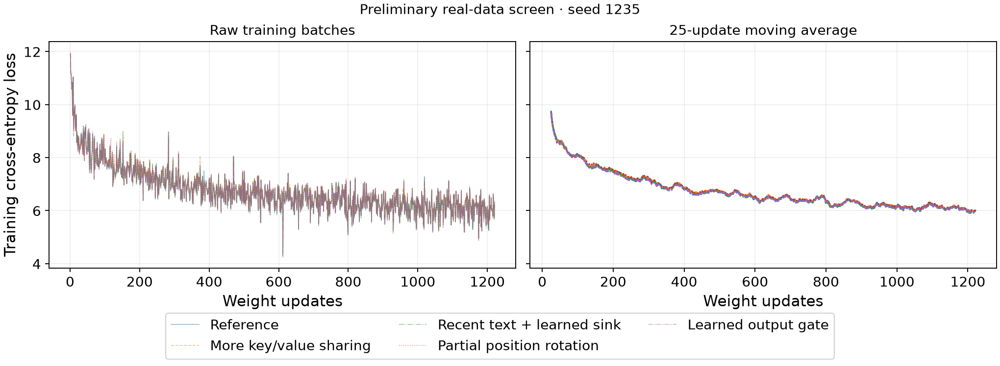
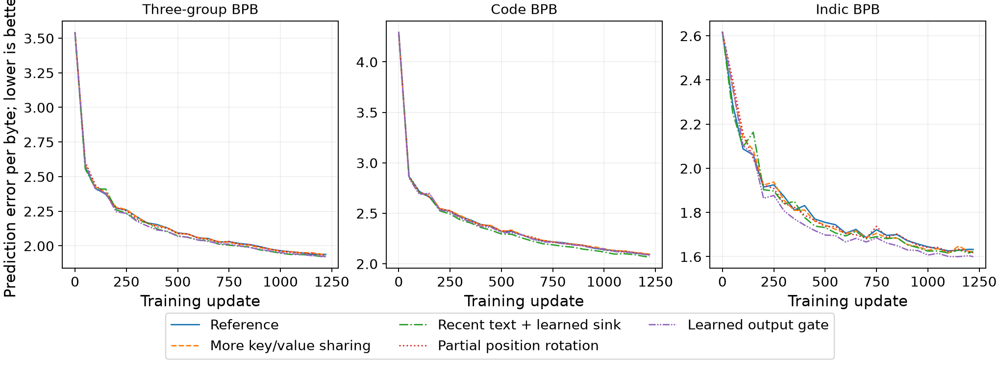

# Completed one-seed attention screen · 10 November 2026

All five designs completed **1,221 updates** at seed **1235**, context 2048,
global batch 8, microbatch 1, bf16 and AdamW learning rate 0.001. Checkpoints were
retained. Execution source: `c1849c1b9dd11eec9ed1958c07deee173ca73265`.

These are **preliminary development runs**. The common learning rate and runtime
approval remain pending; every summary has `eligible_for_quality_comparison=false`.
The trainer uses `--smoke --smoke-steps 1221` without any shape reduction.
The original five-design × three-seed compute request is unchanged. No seed range,
three-seed acceptance pass or final winner is inferred.

## Observed scores

| Design | Three-group BPB | Code BPB | Indic BPB | Difference from reference |
|---|---:|---:|---:|---:|
| Reference | 1.9379 | 2.0936 | 1.6325 | +0.0000 |
| More key/value sharing | 1.9360 | 2.0892 | 1.6243 | -0.0020 |
| Recent text + learned sink | 1.9250 | 2.0694 | 1.6231 | -0.0129 |
| Partial position rotation | 1.9313 | 2.0886 | 1.6177 | -0.0066 |
| Learned output gate | 1.9214 | 2.0844 | 1.5996 | -0.0165 |

BPB means bits of prediction error per original text byte; lower is better.
The primary score equally averages English, code and the mean of 11 Indic slices.
Math and science are also preserved in the complete **75-row slice report**.
The output gate has the lowest observed overall/Indic error; the windowed design
has the lowest code error. These are observations from one seed.

Each design scored **7,216,228 training tokens**, excluding padding, across
**20,004,864 input positions**. Every held-out evaluation conserved all
**3,775,551 raw UTF-8 bytes** across 1,059 documents and all 15 slices.

## Inputs and reproducibility

The exact staged JSONL bundle from job #310 was unavailable. This screen uses all
48 published cleaned TRAIN parts across 38 packs, in deterministic manifest/row
order, after full G9 v2 checks. It retains 1,400,499 of 1,402,081 documents:
1,578 fingerprint matches and four empty documents were removed. Other IDs and
text are preserved. The sampler draws its fixed update budget from this corpus.

The permanent published G5 heldout supplies all 15 slices; the cleaned sample's
own heldout lacks Punjabi and Assamese. The heldout passed checks against all
other v2 entries (excluding its protected self-entry as prescribed), and canary
scans had zero hits. This reconstructed staging is not claimed to be byte-identical
to job #310. See [provenance](provenance.json) and [heldout report](heldout_report.json).

- Training JSONL SHA-256: `368c6d7bf9185f5d16c73fd7262e0a4ed4cf3d11797d172d973e0c822c13ce20`.
- Heldout SHA-256: `21c6e4b2df8dae9d69e254f4a00fc934d2a3c70f0675065a03724299d94312bb`.
- Tokenizer v0 SHA-256: `2de039f20d17afd17615095c406c43087359673b767ed0fe2c480b995f2af8e5`.
- Raw byte-table content SHA-256: `47d411a9c6cae6fa2075935567243e51f4efbc377ccef3eef42c32fce66f869f`.

The optional numeric window cache preserves the strict tokenizer/UTF-8 checks,
ordered windows and sampler behavior. A CPU RNG placement repair enables CUDA
resume. **113 tests passed**. Uncached, cached and cached/resumed six-step GPU
checks produced byte-identical losses and the same final model hash; see
[the parity receipt](cache-gpu-equivalence.json). Model/optimizer mathematics are unchanged.

## Execution and files

Single-trainer telemetry showed 37–52% GPU activity and about 12.2 GiB of 95 GiB.
Bounded overlap increased activity to 94–100%, with up to three isolated trainers
using about 37 GiB. Short-window combined training throughput improved by roughly
50%; this is an operational estimate. Run wall times include unequal contention
and are **not comparative model-speed benchmarks**. All five finished below the
90-minute trainer cap. The original queue and each overlapped job have separate
processes, receipts, metrics and summaries.

- [Notebook](https://github.com/revantg/era-v5-lab/blob/codex/g5-attention-notebooks/teams/05-architecture/notebooks/attention_gpu_screen.py) · [opening instructions](https://github.com/revantg/era-v5-lab/blob/codex/g5-attention-notebooks/teams/05-architecture/notebooks/README.md).
- [Comparison CSV](screen-comparison.csv) · [all 75 slice scores](screen-slice-scores.csv).
- [Status of all 15 requested runs](requested-seed-status.csv): five local preliminary results; formal request remains open.
- [Final checks](screen-final-verification.json) · [113-test log](unit-tests.log).
- [Cold HTML export check](native-html-export-verification.json): no trainer output created or rewritten.
- Each `attn-*` folder contains the actual command, manifest, summary, metrics and hex loss traces.

Datasets, numeric caches and checkpoints are excluded from Git. Notebook preparation,
execution glue and reporting were AI-assisted; no independent learning assessment
or reported study hours is implied.

## Review handoff

The request and this record are reviewed in [#345](https://github.com/theschoolofai/era-v5-lab/pull/345).
Notebook sources are separate in [#344](https://github.com/theschoolofai/era-v5-lab/pull/344);
the cache/resume implementation and tests are separate in [#343](https://github.com/theschoolofai/era-v5-lab/pull/343).
The original execution pin, raw commands and eligibility flags are unchanged.
