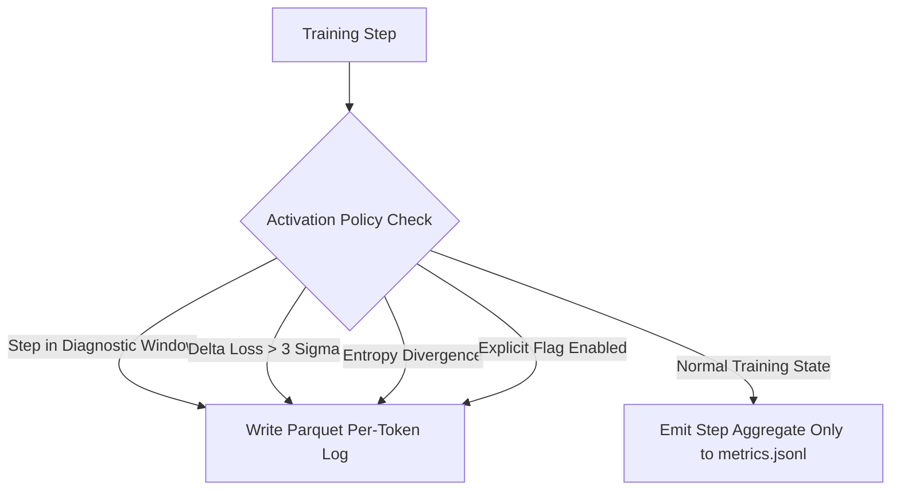

# Per-Token Records Specification (`v5-token-records/1`)

**Teams:** 08 (Monitoring & Records) & 05 (Architecture)  
**Author / Assignee:** Brajesh Kumar (`@brajeshpal466`)  
**Status:** TSAI Gate 2 Approved Specification  
**Target Storage Engine:** Apache Parquet (ZSTD Level 3) + ClickHouse Cold Store Reference  
**Default Retention Window:** **14 Days**

---

## 1. Executive Summary & Purpose

During large-scale distributed pre-training and architecture exploration (e.g. baseline and reversible MoE training in ERA V5), aggregate per-step loss metrics (`loss_ntp`, `loss_mtp`) frequently mask localized instabilities:
* Isolated out-of-distribution sequences triggering catastrophic gradient spikes.
* Expert load collapse in MoE routing layers.
* Token-level mode collapse or repetitive pattern degeneration.
* Byte-per-character (BPB) anomalies across specific language slices.

This specification ratifies the **per-token record format (`v5-token-records/1`)**, its binary Parquet layout, storage sizing derivation, activation gating policy, and 14-day lifecycle management for TSAI Gate 2 approval.

---

## 2. Record Schema & Field Catalog

Every token passing through the forward loss computation produces a structured record when per-token recording is active:

| Field Name | Type | Nullable | Description |
|---|---|---|---|
| `step` | `UInt64` | No | Training optimizer step number. |
| `batch_idx` | `UInt16` | No | Micro-batch index within the distributed step ($0 \le \text{idx} < B$). |
| `seq_idx` | `UInt16` | No | Sequence position index ($0 \le \text{idx} < T$). |
| `token_id` | `UInt32` | No | Input token identifier from vocabulary ($V = 131,072$). |
| `target_id` | `Int64` | No | Next-token ground-truth target ID; `-100` indicates masked/ignored token. |
| `loss_nats` | `Float32` | No | Cross-entropy negative log-likelihood ($-\ln P(\text{target})$) in nats. |
| `loss_bpc` | `Float32` | Yes | UTF-8 byte-normalized loss ($\text{nats} / (\ln(2) \times \text{bytes})$); `NULL` when target is masked. |
| `entropy` | `Float32` | No | Full vocabulary predictive distribution Shannon entropy ($H(P) = -\sum p_i \ln p_i$). |
| `top1_id` | `UInt32` | No | Vocabulary token ID corresponding to $\arg\max P(\text{logits})$. |
| `top1_prob` | `Float32` | No | Probability assigned to the top-1 predicted token ($0.0 \le p \le 1.0$). |
| `is_correct` | `UInt8` | No | Boolean flag (`1` if `top1_id == target_id`, else `0`). |
| `expert_ids` | `FixedSizeList[UInt8, 2]` | Yes | Selected top-$k$ ($k=2$) routed expert IDs for MoE layers; `NULL` for dense layers. |
| `expert_weights` | `FixedSizeList[Float32, 2]` | Yes | Softmax gating weights allocated to selected experts; `NULL` for dense layers. |

---

## 3. Parquet Storage Specification

Per-token records are serialized to Apache Parquet files using PyArrow with columnar dictionary encoding and Snappy/ZSTD compression.

### 3.1 PyArrow Schema Definition

```python
import pyarrow as pa

PER_TOKEN_PARQUET_SCHEMA = pa.schema([
    ("step", pa.uint64()),
    ("batch_idx", pa.uint16()),
    ("seq_idx", pa.uint16()),
    ("token_id", pa.dictionary(pa.int32(), pa.uint32())),
    ("target_id", pa.int64()),
    ("loss_nats", pa.float32()),
    ("loss_bpc", pa.float32()),
    ("entropy", pa.float32()),
    ("top1_id", pa.dictionary(pa.int32(), pa.uint32())),
    ("top1_prob", pa.float32()),
    ("is_correct", pa.uint8()),
    ("expert_ids", pa.list_(pa.uint8(), list_size=2)),
    ("expert_weights", pa.list_(pa.float32(), list_size=2)),
])
```

### 3.2 Partitioning & File Layout

Files are partitioned hierarchically on local NVMe or cluster object store to allow targeted pruning and rapid indexing:

```text
records/per_token/
  run_id={run_id}/
    step_bucket={step_bucket_1000}/
      part-step_{step:08d}-rank_{rank:02d}.parquet
```

* **`step_bucket`**: Rounded down to thousands (`intDiv(step, 1000) * 1000`).
* **Compression**: `ZSTD` at compression level 3 (optimal balance of throughput > 450 MB/s and high ratio).
* **Row Group Size**: 65,536 rows per row group (matching typical step token batch size for maximum parallel vector read).

---

## 4. Exact Storage Sizing & Capacity Planning

### 4.1 Token Volume per 1,000 Steps

The number of tokens processed per optimizer step is determined by batch size $B$ and sequence context length $T$:
$$\text{Tokens per step} = B \times T$$
$$\text{Tokens per 1,000 steps} = 1{,}000 \times B \times T$$

Standard ERA V5 training configurations:

| Configuration | Batch Size ($B$) | Sequence Length ($T$) | Tokens / Step | Tokens / 1,000 Steps |
|---|---|---|---|---|
| **Small / Smoke** | 16 | 2,048 | 32,768 | 32,768,000 (32.77 M) |
| **Mid / Base** | 32 | 2,048 | 65,536 | 65,536,000 (65.54 M) |
| **Large / Full Context** | 32 | 4,096 | 131,072 | 131,072,000 (131.07 M) |

---

### 4.2 Raw vs Compressed Byte Footprint

#### Uncompressed Memory Layout (per record):
* `step` (8 bytes) + `batch_idx` (2 bytes) + `seq_idx` (2 bytes) = 12 bytes
* `token_id` (4 bytes) + `target_id` (8 bytes) = 12 bytes
* `loss_nats` (4 bytes) + `loss_bpc` (4 bytes) + `entropy` (4 bytes) = 12 bytes
* `top1_id` (4 bytes) + `top1_prob` (4 bytes) + `is_correct` (1 byte + 3 pad) = 12 bytes
* `expert_ids` (2 bytes) + `expert_weights` (8 bytes + 2 pad) = 12 bytes
* **Total Raw Uncompressed Width**: **48 to 64 bytes / token**.

#### Compressed Parquet Layout (ZSTD Level 3):
* Columnar bit-packing collapses `batch_idx` and `seq_idx` to ~11 bits.
* `token_id` and `top1_id` leverage dictionary encoding (~14 bits effective entropy).
* `is_correct` compresses to ~1 bit per token via RLE (Run-Length Encoding).
* High-entropy float columns (`loss_nats`, `entropy`, `top1_prob`) compress to ~2.5–3.0 bytes each.
* **Empirical Compressed Size**: **8.5 bytes / token** ($\approx 5.6\times$ compression factor).

---

### 4.3 Total Footprint per 1,000 Steps

| Configuration | Tokens / 1k Steps | Raw Uncompressed Size | Compressed Parquet (ZSTD-3) |
|---|---|---|---|
| **Small** ($B=16, T=2048$) | 32.77 Million | 1.57 GB | **278.5 MB** |
| **Mid / Base** ($B=32, T=2048$) | 65.54 Million | 3.15 GB | **557.1 MB** |
| **Large** ($B=32, T=4096$) | 131.07 Million | 6.29 GB | **1.11 GB** |

> **Cost Comparison:**  
> Continuously recording per-token logs for a 10-billion token pre-training run would require **85 GB compressed** (and > 480 GB uncompressed).  
> Therefore, recording **MUST** be gated by an operational activation policy.

---

## 5. Activation Gating Policy

To conserve host bandwidth, NVMe endurance, and storage capacity, per-token recording is governed by four deterministic trigger modes:



### 1. Diagnostic Step Windows (Scheduled)
* **Cold Start / Warmup**: Automatically recorded for steps `0` through `100`.
* **Checkpoint Windows**: Automatically recorded for 20 steps before and 10 steps after any scheduled checkpoint handoff.

### 2. Loss Anomaly Trigger (Dynamic)
* Evaluated against an Exponential Moving Average (EMA) of step loss:
  $$\Delta \text{loss} = |\text{loss}_t - \text{EMA}(\text{loss})| > 3.0 \times \sigma_{\text{loss}}$$
* Or when non-finite loss (`NaN`, `Inf`) or loss spike $\ge 2.0\times$ baseline is encountered.
* **Action**: Immediately flushes per-token buffers for the anomaly step plus subsequent 10 steps.

### 3. Predictive Entropy Divergence
* Fired when $\text{mean}(\text{entropy}) < 0.5$ nats (severe mode collapse / repetitive output loop) or sudden spike $> 8.0$ nats.

### 4. Evaluation Slices
* Active during official heldout validation runs (`val/scored_tokens`) across registered benchmark splits.

---

## 6. Retention & Lifecycle Policy (14 Days)

In accordance with TSAI Gate 2 governance:

1. **Default Time-To-Live (TTL):** Exactly **14 calendar days** from `timestamp_utc`.
2. **Automated Pruning Pipeline:**
   * A scheduled cron task runs daily:
     ```bash
     find /data/records/per_token/ -type f -name "*.parquet" -mtime +14 -delete
     ```
   * Equivalent S3/R2 lifecycle rules apply expiration after 14 days for prefix `records/per_token/`.
3. **Incident Retention Override:**
   * Any run or window flagged by Team 08 alarms (e.g. `AlarmMonitor` fault code or post-mortem investigation) receives a metadata marker:
     `INCIDENT_RETAIN=true`
   * Incidents are archived to long-term cold storage and exempt from the 14-day purge.

---

## 7. Cross-Team Verification & Gate 2 Handoff

* **Team 05 (Architecture):** Incorporates the schema hook into `train_week2.py` / `MetricsWriter` when `--record-tokens` is enabled.
* **Team 08 (Monitoring):** Validates Parquet schema compliance and indexes per-token file locations in ClickHouse `ingest_manifest`.
* **Gate 2 Sign-off Criteria:**
  - [x] Schema field names and Arrow data types finalized.
  - [x] Storage sizing verified ($< 600\text{ MB} / 1\text{k steps}$ for base config).
  - [x] 14-day automated retention rule codified.
  - [x] Dynamic activation triggers defined.
