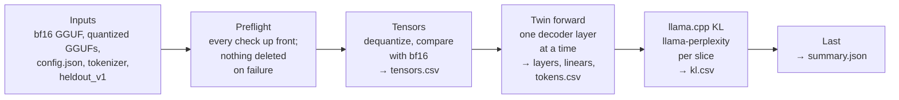

<p align="center">
  <picture>
    <source media="(prefers-color-scheme: dark)" srcset="figures/hero-dark.svg">
    
  </picture>
</p>

<p align="center"><sub>
An offline measuring tool for Team 12 &nbsp;·&nbsp; quantized GGUFs against their bf16 reference on G5’s <code>heldout_v1</code> &nbsp;·&nbsp; olmoe and our ERNIE export &nbsp;·&nbsp; tested on CPU and Apple MPS, not yet on CUDA
</sub></p>

<br>

**In one minute**

- **What it answers.** Our numbers so far stop at the output (scores, KL, same top-1): how much a format loses, not
  where. `quant_error.py all` says which tensors, layers, routers and held-out slices lose the most.
- **How.** It compares each quantized GGUF with its bf16 reference three ways: the weights themselves; a *twin
  forward*, which runs the bf16 and the quantized weights (dequantized from the GGUFs) side by side in PyTorch, one
  decoder layer at a time, on the same tokens; and `llama-perplexity`, through Team 12’s `quality/kl_eval.py`, for
  what llama.cpp users get.
- **What it writes.** Six small files, numbers only (no text, no token ids), under 5 MB in all.
- **Fails before it changes anything.** A preflight makes every check that can be made up front and stops before anything is
  computed or deleted.

> [!NOTE]
> Supported: `olmoe` and our model as `export_hf.py --target ernie4_5_moe` writes it (#838). The default Granite MoE
> Shared export is not supported yet ([section 8](#8--a-new-architecture)). `--device cuda` has not been run on CUDA.

**Contents** &nbsp;
[1 · Run it](#1--run-it) ·
[2 · The pipeline](#2--the-pipeline) ·
[3 · Inputs](#3--inputs) ·
[4 · Outputs](#4--outputs) ·
[5 · How to read the numbers](#5--how-to-read-the-numbers) ·
[6 · Tests](#6--tests) ·
[7 · As a job on TSAI’s machine](#7--as-a-job-on-tsais-machine) ·
[8 · A new architecture](#8--a-new-architecture)

<br>

## 1 · Run it

```bash
python teams/12-quantization/quant_error/quant_error.py all \
  --hf-config  <hf dir with config.json>   --tokenizer <tokenizer.json> \
  --ref        <model-bf16.gguf> \
  --quant      Q8_0=<model-q8_0.gguf>  --quant Q4_K_M=<model-q4_k_m.gguf> \
  --heldout    teams/05-architecture/heldout_v1/data/heldout_v1.jsonl \
  --llama-bin  <llama.cpp>/build/bin       --out <out dir> \
  [--tokens-per-slice 1024] [--seq-len 512] [--kl-chunks 8] [--device cpu|mps|cuda] \
  [--normalize] [--export-report <export_report.json>] [--work <scratch dir>]
```

Exit 0 on success; exit 1 if `--out` is over 5 MB; any error stops the run with a non-zero exit code. Step progress
goes to stderr; the `llama-perplexity` commands that `kl_eval` runs are printed to stdout.

<br>

## 2 · The pipeline



- **Preflight.** Before any work: transformers is 4.x, every input file exists (`--ref`, each `--quant`,
  `--hf-config`’s `config.json`, `--tokenizer`, `--heldout`, `llama-perplexity` in `--llama-bin`, `--export-report`),
  the llama.cpp version and build can be read, every GGUF loads as the `--hf-config` model, every slice holds at least
  one twin-forward sequence, and every `--quant` file is a `llama-quantize` output of `--ref` (section 3). A failure
  exits non-zero with a message naming the file, slice, tensor or key, **before anything is computed or deleted**: no
  `summary.json` is written and an earlier run’s files in `--out` stay as they were. Only then are those files deleted.
- **Each file is written as soon as its step finishes** (`tensors.csv`, then `layers/linears/tokens.csv`, then
  `kl.csv`) and `summary.json` last, so a late failure (say, one bad slice in the llama.cpp step) keeps the earlier
  results; `summary.json` then lists `steps_completed` and `failed`.
- **Scratch stays out of `--out`.** The slice texts and llama.cpp’s base logits (about 260 KB per scored token at a
  131k vocabulary) go to `--work`, a temporary folder removed at the end unless `--work` is given.
- **fp32 throughout the twin forward.** It pins full fp32 matmuls before it starts
  (`torch.set_float32_matmul_precision('highest')`, TF32 off for CUDA matmuls and cuDNN) and leaves them so;
  `summary.json` records them as `torch_fp32`.

<br>

## 3 · Inputs

| Input | What it is |
|:---|:---|
| `--ref` | The bf16 GGUF of the model, made with the same export and the same llama.cpp build as the quantized files. Every tensor except the router’s must be F32, F16 or BF16; a quantized reference is refused. |
| `--quant NAME=FILE` | One quantized GGUF per format (made with `llama-quantize` from `--ref`, router tensors stay F32, output layer `--output-tensor-type q8_0`). `NAME` labels the rows. A file is refused, naming the tensor or key, unless it has the same `general.architecture` and `tokenizer.ggml.tokens` (sha256) as `--ref`, the same tensor names and shapes (size-1 axes aside), and every tensor whose type is the same in both files is byte for byte the same (`llama-quantize` copies the tensors it does not quantize, so a difference there means another export). |
| `--hf-config` | A Hugging Face folder of the same model. Only `config.json` is read; weights come from the GGUFs. olmoe and ernie4_5_moe are supported: ernie4_5_moe is our model as `export_hf.py --target ernie4_5_moe` writes it (#838). The default Granite MoE Shared export, which the dry run 2 job (#862) uses, is not supported yet; section 8 lists what it needs. Needs transformers 4.x: 5.x fuses each layer’s experts into one module, so the preflight refuses it. |
| `--tokenizer` | The model’s `tokenizer.json`. Used for the twin forward and to count tokens for llama.cpp. |
| `--heldout` | `heldout_v1.jsonl` (20 slices: English, 11 Indic languages, math, science, 6 code languages). Its sha256 is checked against `SHA256SUMS` beside it. |
| `--llama-bin` | `<llama.cpp>/build/bin` (needs `llama-perplexity`). `<llama.cpp>` (else `$LLAMA_CPP_DIR`) must be a git checkout whose commit carries llama.cpp’s `b<number>` tag; otherwise the run stops at the start. The version is read from it: `git describe --tags --match 'b[0-9]*'` and the short commit, e.g. `b12359 (b1b770d)`. The binary’s own build number is not used: a shallow clone says “build 1”. |
| `--normalize` | Pass each slice’s text through the tokenizer’s normalizer before llama.cpp, which cannot apply it itself (needed for p1536). The twin forward always gets the tokenizer’s own normalization. |
| `--export-report` | `export_report.json` of the export; `verify.head_bias_effect` is copied to `summary.json` as `export_gap`. Nothing else is measured about the export gap here. |

<br>

## 4 · Outputs

<p align="center">
  <picture>
    <source media="(prefers-color-scheme: dark)" srcset="figures/outputs-dark.svg">
    
  </picture>
</p>

All in `--out`. `format` is the `NAME` of `--quant`. An empty field is “not applicable”; `inf` is an exact match (no
error).

| File | One row per | Columns |
|:---|:---|:---|
| `tensors.csv` | tensor of each format (per expert for expert tensors) | `tensor, layer, kind, expert, ggml_type, bits_per_weight, numel, rel_err, sqnr_db, max_abs_err`. Error of the dequantized tensor against the reference: `rel_err` = ‖Ŵ-W‖/‖W‖. |
| `layers.csv` | format, slice, layer | `hidden_rel_err` = ‖h_q-h_ref‖/‖h_ref‖ of the layer’s output (the quantized track runs on its own hidden states, so errors accumulate); `router_agree` = share of tokens whose top-k expert set is unchanged (empty for a dense layer). |
| `linears.csv` | format, nn.Linear (each expert; `lm_head` has an empty layer) | `rows`, `act_rel_err` = ‖X(W-Ŵ)ᵀ‖/‖XWᵀ‖ on up to 256 sampled real inputs X (an expert’s: tokens routed to it). Empty `act_rel_err` when `rows` is 0 (no token reached that expert). |
| `tokens.csv` | format, slice | `n_tokens, kl_mean, kl_p99, same_top1`: KL(ref‖quant) in nats and top-1 agreement of the twin forward, in fp32 on `--device`. |
| `kl.csv` | slice, format | `chunks, tokens_scored, ppl_ratio, ppl_ratio_unc, kld_mean, kld_mean_unc, kld_99, same_top_p, ppl, ppl_unc, kld_median, kld_max, same_top_p_unc, rms_dp, time_s` from `llama-perplexity` (what users get from llama.cpp; `same_top_p`, its `_unc` and `rms_dp` in %). `chunks` is 0, and the numbers are empty, for a slice under 1024 tokens (llama-perplexity refuses it). |
| `summary.json` | run | What reproducing the run needs (below). |

<details>
<summary><b>What <code>summary.json</code> records</b></summary>
<br>

`python`, `torch`, `transformers`, `gguf`, `tokenizers`, `numpy` versions; `llama_cpp` (tag and commit) and
`llama_cpp_build` (`llama-perplexity --version` lines and the devices of `--list-devices`, i.e. the backend);
`harness` (git `commit` of this folder and `dirty`: a tracked file here, or `quality/kl_eval.py` or
`scripts/quantize_eval.py`, differs from it); `machine` (`scripts/quantize_eval.py` `machine_string()`, with the GPU);
`torch_fp32` (matmul precision and TF32 flags in effect); `model_type`; `sha256` of the reference, every quantized
file, the held-out file, the tokenizer and `config.json`; `bytes` of every GGUF; `settings` (all options, `bos`,
`bos_id`, and the fixed `x_rows` 256, `seed` 0, `ngl` 99); per-step (`preflight`, `tensors`, `twin_forward`, `kl`) and
total wall time; `export_gap`; `steps_completed`, `failed`.

</details>

<br>

## 5 · How to read the numbers

<p align="center">
  <picture>
    <source media="(prefers-color-scheme: dark)" srcset="figures/positions-dark.svg">
    
  </picture>
</p>

- **Weights, then inputs, then the model.** `rel_err` (`tensors.csv`) is the error of a tensor on its own;
  `act_rel_err` (`linears.csv`) the same error on real inputs, which can be larger or smaller; `hidden_rel_err` and
  `router_agree` (`layers.csv`) are what reaches each layer’s output, so they include every earlier layer’s error.
- **`router_agree` is an exact set match.** A swap at rank k and k+1 counts as a change.
- **`tokens.csv` and `kl.csv` score different positions** (figure). The twin forward uses the first
  `--tokens-per-slice` tokens of every slice, cut into sequences of `n = min(--seq-len, --tokens-per-slice)` (a last
  partial sequence is dropped), and scores every position. llama.cpp scores up to `--kl-chunks` chunks of 512 tokens
  of each slice, only the second half of each chunk. So their numbers are not comparable slice by slice: read the twin
  forward for where the error arises, and `kl.csv` for what llama.cpp users get.
- **BOS.** When the reference GGUF has `tokenizer.ggml.add_bos_token` true, every twin sequence is `[BOS] + (n - 1)`
  slice tokens, the BOS id from `tokenizer.ggml.bos_token_id` (llama-perplexity starts each chunk the same way); when
  it is false or absent there is no BOS. `summary.json` settings record `bos` and `bos_id`.
- **KL against bf16 is drift, not accuracy.** Every measure here says how far a file moves from the bf16 model; none
  is a task or benchmark score.

<br>

## 6 · Tests

Six test files, 56 tests: `test_slices.py` 4, `test_tensors.py` 12, `test_weights.py` 8, `test_forward.py` 9,
`test_kl_slices.py` 7 and `test_cli.py` 16 (end to end), each run as `python teams/12-quantization/quant_error/<file>`.
`test_weights.py`’s five GGUF round trips and `test_cli.py` need `LLAMA_CPP_DIR` (a built llama.cpp b12359 checkout),
and `test_cli.py` also the p1536 tokenizer; without them those tests skip with a message. The tests run the twin
forward on CPU.

[`REHEARSAL.md`](REHEARSAL.md) is one end-to-end run at the dry-run-2 shape (a random 300 M model, two formats, 20
slices) on an Apple M6: exit 0 in 87.8 s, 213 KB of output.

<br>

## 7 · As a job on TSAI’s machine

<details>
<summary><b>The job request</b>, the environment and the time</summary>
<br>

```text
Team:            12-quantization
Script:          teams/12-quantization/quant_error/quant_error.py
Command:         python teams/12-quantization/quant_error/quant_error.py all --hf-config ./inputs/<model>-hf --tokenizer ./inputs/tokenizer.json --ref ./work/<model>-bf16.gguf --quant Q8_0=./work/<model>-q8_0.gguf --quant Q4_K_M=./work/<model>-q4_k_m.gguf --heldout teams/05-architecture/heldout_v1/data/heldout_v1.jsonl --llama-bin ./work/llama.cpp/build/bin --out ./out/quant-error-<model> --device cuda --normalize
Config:          none; every setting is on the command line
Inputs:          the model's Hugging Face folder (config.json only is read), its tokenizer.json, the bf16 GGUF and one GGUF per format, all made beforehand; heldout_v1.jsonl and SHA256SUMS from this repository; llama.cpp b12359 as a git checkout carrying its b12359 tag, built with the GPU backend (the same build made the GGUFs)
Hardware:        1 GPU; a CPU also works for the twin forward (slower); RAM for one decoder layer of the model in fp32 plus the sampled activations; the base logits of one slice on disk (about 260 KB per scored token at a 131k vocabulary: 8 chunks = about 0.5 GB)
Max time:        measured twice, on one Mac: 910 s and 1,250 s for OLMoE-1B-7B, 4 formats, 20 slices (see "Time" below); not measured on TSAI's machine
Precision:       bf16 reference, the quantized files as given; the twin forward in fp32
Measures:        see "Outputs"
Outputs:         ./out/quant-error-<model>/{summary.json, tensors.csv, layers.csv, linears.csv, tokens.csv, kl.csv}; under 5 MB; no text, no token ids
```

(`--normalize` is needed for the p1536 tokenizer, whose normalizer llama.cpp cannot apply; the OLMoE pilot ran without it.)

**`--device cuda` is not yet run on CUDA.** Every run so far was on `cpu` and `mps`, and the tests run the twin
forward on CPU, so I think one `quant_error.py all --device cuda` run on a small model (for example the rehearsal
model, on a Kaggle T4) is needed before a first job.

**Python environment:** Python 3.12, torch, transformers 4.x (tested with 4.57.6; the preflight refuses 5.x), gguf
(llama.cpp’s gguf-py), tokenizers, numpy. No network is used. The command exits 1 when the output is over 5 MB and 0
otherwise; any error stops the run with a message and a non-zero exit code (a preflight error before anything in
`--out` is deleted).

**Time.** Rehearsal (`REHEARSAL.md`: 300 M parameters, 8 layers, 16 experts, 2 formats, 20 slices, Apple M6, Metal):
about 90 s in total, of which tensors 9 s, twin forward 35 s and llama.cpp KL 42 s. The tensor step scales with the
file size and the format count, the twin forward with layers × experts × formats and `--tokens-per-slice`, the KL step
with the model’s speed in llama.cpp × slices × formats × `--kl-chunks`. A 7 B model is not a simple multiple of this.
Measured in the OLMoE pilot (`results/olmoe_pilot/`, `summary.json` and `/usr/bin/time -l`):
`allenai/OLMoE-1B-7B-0924` (7 B total, 16 layers, 64 experts), 4 formats (Q8_0, Q4_K_M, experts-only Q4_K,
MXFP4_MOE) against the bf16 GGUF, 20 slices, defaults otherwise, `--device mps` on an Apple M6 with 32 GB, llama.cpp
b12359 on Metal. On this code: 1,250 s in total (preflight 14 s, tensors 175 s, twin forward 679 s, about 170 s per
format, llama.cpp KL 369 s), 16.7 GB maximum resident set size, 7.8 GB peak memory footprint, output 2.8 MB. A first
run of the same inputs on an earlier version of the tool took 910 s (tensors 108 s, twin forward 515 s, llama.cpp KL
274 s; 19.8 GB maximum resident set size) and wrote the same numbers. Two runs on one machine thus differed by 37%,
and the time on other hardware (a CUDA GPU, a CPU) and for other models was not measured: set
the job’s `Max time` with a margin over these and not from them alone.

</details>

<br>

## 8 · A new architecture

<details>
<summary><b>What a new architecture needs</b> (Granite MoE Shared, for example)</summary>
<br>

olmoe and ernie4_5_moe are supported. A new architecture needs three things to pass:

1. the weights round trip (`test_weights.py`, a mapping in `weights.ARCHS`);
2. `test_streamed_matches_full_model` and `test_values_match_whole_models` in `test_forward.py` on a tiny model of it;
3. one matched-positions check against llama.cpp (`results/olmoe_pilot/matched_positions.py`, which comes with the
   OLMoE pilot, as in its `PILOT.md` section 5).

The twin forward runs the transformers decoder layers one at a time, so three things need changes in `forward.py`
first: model-level glue outside the decoder layers (for example Granite’s `embedding_multiplier` and
`logits_scaling`), experts that are not `nn.Linear` modules (Granite’s `GraniteMoeParallelExperts`), and a router
anywhere other than `mlp.gate`. An MoE layer (its MLP has `experts`) whose router is not `mlp.gate`, or whose
`mlp.gate` gave no logits, stops the run with an error naming the layer.

</details>

<br>

| File | What |
|:---|:---|
| [`quant_error.py`](quant_error.py) | the command: preflight, the three steps, the outputs |
| [`slices.py`](slices.py), [`tensors.py`](tensors.py), [`weights.py`](weights.py), [`forward.py`](forward.py), [`kl_slices.py`](kl_slices.py) | held-out slices; per-tensor error; GGUF to transformers weights; the twin forward; llama.cpp KL per slice |
| [`fixtures.py`](fixtures.py), `test_*.py` | tiny models for the tests, and the six test files |
| [`figures/make_figures.py`](figures/make_figures.py) | the figures above, light and dark, drawn from the code and `REHEARSAL.md`; every number in [`figures/values.json`](figures/values.json) |

<sub>Numbers only: the outputs hold no text, no token ids and no weights. The figures embed subsets of Inter and
JetBrains Mono under the SIL Open Font License 1.1 ([`figures/OFL.txt`](figures/OFL.txt)); `pip install
fonttools==4.68.0 brotli==1.2.1`, then `python figures/make_figures.py` from this folder reproduces them byte for
byte.</sub>
