# OLMoE pilot: where does the quantization error come from? (28 Nov 2026)

First real run of `quant_error.py all` ([the tool](../../README.md)) on `allenai/OLMoE-1B-7B-0924` @ `6d84c48581ec` (7 B total, 16 layers, 64 experts, top-8, untied head, vocabulary 50,304). Apple M6, 32 GB, llama.cpp `b12359 (b1b770d)` on Metal, PyTorch 2.15.0 on MPS (`summary.json`). The reference is the bf16 GGUF from the same converter and build. No importance matrix was used for any file. One model and one set of files; every number below is read from the committed file named in its table, except Section 7's steps outside `quant_error.py` and its memory figures, which come from `/usr/bin/time -l` logs that are not committed. The two figures are drawn from `kl.csv` and `layers.csv` by [`figures/make_figures.py`](figures/make_figures.py), which writes every number it plots to [`figures/values.json`](figures/values.json).

## How this pilot relates to the task 1 parts study

G12 design task 1 asks which parts of a quantized model stay at higher precision, and why. The parts study
([`quantize/parts/`](../../../quantize/parts/README.md), [parts study PR]) answers it, one part at a time. This pilot
is an independent second setup on the same model: another llama.cpp build, other text and context, and another
Q4_K_M baseline. On the one comparison both make, they agree.

| | Parts study (quoted from its README) | This pilot |
|---|---|---|
| llama.cpp | b11669 | b12359 |
| Text | six packs of the cleaned tokenizer sample (English, Python, Hindi, Bengali, Tamil, Kannada) | `heldout_v1`, 20 slices |
| Context | 4,096-token chunks, 4 per pack | 512-token chunks, 8 per slice |
| Q4_K_M baseline | llama.cpp’s default mix, output Q6_K | Team 12’s, output Q8_0 |
| Experts at Q4_K, everything else Q8_0, against Q4_K_M: mean KLD | 0.0124 against 0.0170 (−27%) | 0.0129 against 0.0173 (−25%) |

What this pilot adds:
- **Why, at the router.** Under `Q4_K_M` the top-8 expert choice already changes at layer 0 for 37% of tokens,
  against 5% for the three files with 8-bit embedding and attention (Section 3). This is the twin forward’s
  `router_agree`, which was not checked against llama.cpp.
- **Where, per tensor and per layer.** Weight error per tensor (Section 1), hidden-state error and router agreement
  per layer (Section 3), and error on real activations per module (Section 4).
- **A check against llama.cpp.** On the same 40,800 positions the twin forward and llama.cpp agree: for `Q4_K_M`,
  mean KL 0.01733 against 0.01735 and same top-1 93.92% against 94.05% (Section 5).

The parts study changes one part at a time (for example, attention at Q8_0 on top of Team 12’s mix lowers KL by 36%,
and the embedding at Q8_0 by 6%); this pilot does not, so it cannot say which of the embedding and attention causes the
layer-0 change.

## The four files

| Format | What it is | Size, GB (bytes / 1e9) | Embedding | Attention q,k,v,o | Routed experts (gate, up, down) | Output layer | Router |
|---|---|---|---|---|---|---|---|
| bf16 (reference) | converter output | 13.84 | BF16 | BF16 | BF16 | BF16 | F32 |
| `Q8_0` | `llama-quantize ... Q8_0` | 7.36 | Q8_0 | Q8_0 | Q8_0 | Q8_0 | F32 |
| `Q4_K_M` | `--output-tensor-type q8_0 ... Q4_K_M` | 4.24 | Q4_K | Q4_K (`attn_v`: half the layers Q6_K) | gate, up Q4_K; down half the layers Q6_K, half Q4_K | Q8_0 | F32 |
| `experts-Q4_K` | `--output-tensor-type q8_0 --tensor-type "ffn_(gate\|up\|down)_exps=q4_k" ... Q8_0` | 4.14 | Q8_0 | Q8_0 | Q4_K | Q8_0 | F32 |
| `MXFP4_MOE` | `llama-quantize ... MXFP4_MOE` | 3.94 | Q8_0 | Q8_0 | MXFP4 | Q8_0 | F32 |

Source: file sizes from `summary.json` (`bytes`); types from `tensors.csv` (`ggml_type`, all 12,876 rows). In `experts-Q4_K` only the routed experts are at 4 bits; everything else is Q8_0 (not bf16), so it carries the Q8_0 error on those tensors.

## 1. Weight error per tensor (`tensors.csv`)

Mean of `rel_err` = ‖Ŵ-W‖/‖W‖ over the tensors of a group (an expert tensor is one row per expert, so the experts rows are 1,024 per projection and format).

| Group | `Q8_0` | `Q4_K_M` | `experts-Q4_K` | `MXFP4_MOE` |
|---|---|---|---|---|
| `token_embd` | 0.55% (Q8_0) | 7.24% (Q4_K) | 0.55% (Q8_0) | 0.55% (Q8_0) |
| attention q,k,v,o (64 tensors) | 0.55% (Q8_0) | 6.59% (56 Q4_K, 8 Q6_K) | 0.55% (Q8_0) | 0.55% (Q8_0) |
| experts `gate` | 0.54% | 7.18% (Q4_K) | 7.18% (Q4_K) | 11.49% (MXFP4) |
| experts `up` | 0.54% | 7.18% (Q4_K) | 7.18% (Q4_K) | 11.53% (MXFP4) |
| experts `down` | 0.54% | 4.49% (512 Q6_K, 512 Q4_K) | 7.18% (Q4_K) | 11.53% (MXFP4) |
| `output` (lm_head) | 0.57% | 0.57% | 0.57% | 0.57% |
| router `ffn_gate_inp`, norms | exact (F32) | exact | exact | exact |

The spread within a type is small. For `experts_down` under `Q8_0`, the 1,024 expert tensors (16 layers x 64 experts) range from 0.535% to 0.575%, and the 16 per-layer means (over each layer's 64 experts) from 0.538% to 0.549%; under `experts-Q4_K`, 7.13% to 7.47% and 7.15% to 7.25%.

## 2. What llama.cpp users get (`kl.csv`) and what the twin forward sees (`tokens.csv`)

Mean over the 20 held-out slices (equal weights). `kl.csv`: 8 chunks of 512 tokens per slice, second halves scored, 2,040 tokens per slice and format. `tokens.csv`: the first 1,024 tokens of each slice as two sequences of 512, every position scored.

| Measure | `Q8_0` | `Q4_K_M` | `experts-Q4_K` | `MXFP4_MOE` |
|---|---|---|---|---|
| `kl.csv` mean KLD | 0.000685 | 0.01735 | 0.01293 | 0.03091 |
| `kl.csv` 99th-percentile KLD | 0.0083 | 0.1550 | 0.1123 | 0.2660 |
| `kl.csv` same top-p, % | 98.84 | 94.05 | 94.58 | 91.89 |
| `kl.csv` PPL ratio (quant/bf16) | 1.0000 | 1.0134 | 1.0091 | 1.0252 |
| `tokens.csv` mean KL | 0.000818 | 0.03216 | 0.02733 | 0.04100 |
| `tokens.csv` same top-1, % | 98.61 | 93.32 | 94.13 | 90.84 |

Per slice, in `kl.csv`, `experts-Q4_K` is below `Q4_K_M` on 20 of 20 slices, and `MXFP4_MOE` is above `Q4_K_M` on 20 of 20 (`tokens.csv`: 20 of 20 and 17 of 20). One slice's `kld_mean` has a reported uncertainty of about 0.0009 for `Q4_K_M` (mean of `kld_mean_unc`), so single-slice differences smaller than that mean little.

  <picture>
    <source media="(prefers-color-scheme: dark)" srcset="figures/kld-slices-dark.svg">
    
  </picture>

Mean KLD by slice group (`kl.csv`; the number after the slash is same top-p, %):

| Slice group | `Q8_0` | `Q4_K_M` | `experts-Q4_K` | `MXFP4_MOE` |
|---|---|---|---|---|
| English (c4-val) | 0.00122 / 98.1 | 0.01999 / 92.0 | 0.01462 / 92.9 | 0.02979 / 90.2 |
| Indic (11 slices) | 0.00081 / 98.5 | 0.02030 / 92.8 | 0.01564 / 93.3 | 0.03889 / 89.7 |
| math (owm-test) | 0.00114 / 98.8 | 0.02707 / 93.3 | 0.01887 / 94.4 | 0.03889 / 92.6 |
| science (pes2o-val) | 0.00057 / 99.1 | 0.01344 / 95.0 | 0.00886 / 95.5 | 0.02251 / 92.1 |
| code (6 slices) | 0.00032 / 99.6 | 0.01051 / 96.6 | 0.00735 / 97.1 | 0.01653 / 96.1 |

## 3. Where the error builds up, by layer (`layers.csv`, over the 20 slices)

The quantized track runs on its own hidden states, so errors accumulate. `hidden_rel_err` = ‖h_q-h_ref‖/‖h_ref‖ of the layer output.

| `hidden_rel_err` at layer, mean (median over the 20 slices) | `Q8_0` | `Q4_K_M` | `experts-Q4_K` | `MXFP4_MOE` |
|---|---|---|---|---|
| 0 | 0.013 (0.013) | 0.082 (0.082) | 0.041 (0.041) | 0.070 (0.070) |
| 3 | 0.006 (0.006) | 0.043 (0.044) | 0.039 (0.039) | 0.242 (0.240) |
| 7 | 0.014 (0.013) | 0.063 (0.066) | 0.054 (0.056) | 0.236 (0.235) |
| 11 | 0.083 (0.024) | 0.133 (0.113) | 0.133 (0.093) | 0.190 (0.182) |
| 15 | 0.030 (0.028) | 0.132 (0.130) | 0.120 (0.119) | 0.179 (0.176) |

The layer-11 means are pulled up by three code slices. For `Q8_0` at layer 11, `vault-java-test` is 0.575, `vault-py-test` 0.387 and `vault-cpp-test` 0.302; the other 17 slices average 0.023 (median of all 20: 0.024). On `vault-java-test` the `Q8_0` error starts rising at layer 8 (0.126), on `vault-py-test` at layers 9 to 10 and on `vault-cpp-test` at layers 10 to 11; it stays high to layer 14 and is back to 0.034 to 0.050 at layer 15. The other formats show the same jump on some of these slices (on `vault-py-test` all four formats are 0.387 to 0.412 at layer 11), so it is not specific to `Q8_0`. The `Q8_0` means at layers 9 to 14 therefore do not describe a typical slice; the medians do. The output-level KLD of these slices is not affected: `Q8_0` `kld_mean` is 0.000327, 0.000410 and 0.000326 on them (`kl.csv`), among the five lowest of 20.

`router_agree` = share of tokens whose top-8 expert set is exactly unchanged (a swap at rank 8 and 9 counts as a change; means over the 20 slices):

| `router_agree` at layer | `Q8_0` | `Q4_K_M` | `experts-Q4_K` | `MXFP4_MOE` |
|---|---|---|---|---|
| 0 | 0.952 | 0.627 | 0.952 | 0.952 |
| 1 | 0.943 | 0.637 | 0.832 | 0.682 |
| 4 | 0.934 | 0.612 | 0.716 | 0.565 |
| 8 | 0.933 | 0.691 | 0.756 | 0.635 |
| 15 | 0.938 | 0.727 | 0.759 | 0.643 |
| mean of the 16 layers | 0.936 | 0.666 | 0.764 | 0.639 |

  <picture>
    <source media="(prefers-color-scheme: dark)" srcset="figures/router-layers-dark.svg">
    
  </picture>

## 4. Error on real activations, per module (`linears.csv`)

Mean `act_rel_err` = ‖X(W-Ŵ)ᵀ‖/‖XWᵀ‖ over the modules of a kind, on up to 256 sampled real inputs each (an expert's inputs are the tokens routed to it; 45 of 3,072 expert modules per format had fewer than 256 rows, the smallest 21).

| Module | `Q8_0` | `Q4_K_M` | `experts-Q4_K` | `MXFP4_MOE` |
|---|---|---|---|---|
| attention q / k / v / o | 0.0037 / 0.0036 / 0.0060 / 0.0052 | 0.0493 / 0.0475 / 0.0502 / 0.0690 | same as `Q8_0` | same as `Q8_0` |
| expert gate / up / down | 0.0038 / 0.0047 / 0.0053 | 0.0505 / 0.0622 / 0.0446 | 0.0505 / 0.0622 / 0.0709 | 0.0838 / 0.0996 / 0.1133 |
| `lm_head` | 0.0036 | 0.0036 | 0.0036 | 0.0036 |

## 5. Twin forward against llama.cpp on the same positions (`matched_positions.csv`, `matched_base_check.csv`)

`tokens.csv` and `kl.csv` score different positions, so `matched_positions.py` runs the twin forward on llama-perplexity's own sequences: the GGUF has `add_bos_token` false, so no BOS; 8 chunks of 512 tokens per slice; positions 256 to 510 scored. 20 slices, 160 chunks, 40,800 positions. The tokens llama.cpp scored (read from its base file) are identical to the ones built here on all 20 slices.

| Over the 40,800 matched positions | `Q8_0` twin | `Q8_0` llama.cpp | `Q4_K_M` twin | `Q4_K_M` llama.cpp |
|---|---|---|---|---|
| mean KL(ref‖quant) | 0.000690 | 0.000685 | 0.01733 | 0.01735 |
| same top-1, % | 98.82 | 98.84 (± 0.05) | 93.92 | 94.05 (± 0.12) |

The ± is the binomial error of llama.cpp's own same-top-1 estimate (the formula `llama-perplexity` prints, 100·√(p(1-p)/(n-1)), here over the 40,800 positions); it is not an error of the twin-minus-llama.cpp difference. A yardstick for that difference: on the same positions the twin's own reference logits and llama.cpp's bf16 base already disagree on the top-1 token at 0.49% of positions (`matched_base_check.csv`, ALL row: 99.51% agreement).

Per slice (`matched_positions.csv`): the top-1 difference (twin minus llama.cpp) is -0.34 to +0.29 points for `Q8_0` and -0.59 to +0.29 for `Q4_K_M`; the KL ratio (twin over llama.cpp) is 0.926 to 1.106 and 0.919 to 1.023. The twin forward's own reference logits against llama.cpp's saved bf16 log-probabilities, same positions (`matched_base_check.csv`, ALL row): same top-1 99.51%, mean next-token NLL 1.1848 (twin) against 1.1850 (llama.cpp), mean absolute NLL difference 0.0073.

Read against Section 2: for `Q4_K_M` the twin's own `tokens.csv` KL (0.03216) is 1.9 times its KL on the matched positions (0.01733), and for `Q8_0` 1.2 times (0.000818 against 0.000690).

## 6. The llama.cpp KL step against the team's numbers (`kl_validation.csv`)

The tool's llama.cpp KL step reuses `quality/kl_eval.py`. That script on its own, `--formats Q8_0,Q4_K_M --chunks 64` on WikiText-2 (64 chunks of 512, 16,384 tokens), b12359, Metal, against the existing `quality/kl.csv` rows (b11669, Apple M5).

| Format | `kld_mean` now (`kl_validation.csv`) | `kld_mean` team (`quality/kl.csv`) | Difference | Same top-p now / team |
|---|---|---|---|---|
| `Q8_0` | 0.001258 | 0.001275 | -1.3% | 98.303 / 98.321 |
| `Q4_K_M` | 0.023227 | 0.023286 | -0.3% | 92.23 / 92.083 |

Both are within 1.3% of the team's rows, on a newer llama.cpp build (b12359 against b11669) and another Mac.

## 7. Cost on this Mac (`summary.json`, `/usr/bin/time -l`)

| Step | Wall time | Peak memory |
|---|---|---|
| Download of the HF model (13 GB) | about 11 min | n/a |
| Convert to bf16 GGUF | 41 s | 2.5 GB max resident |
| `llama-quantize` Q8_0 / Q4_K_M / experts-only / MXFP4_MOE | 4.8 / 24.5 / 24.7 / 4.0 s | 1.6 GB max resident each |
| `kl_eval.py` (bf16 base pass + 2 formats) | 43 s | 14.5 GB max resident |
| `quant_error.py all`, 4 formats, 20 slices, MPS, on the final tool (`summary.json`) | 1,250 s: preflight 14 s, tensors 175 s, twin forward 679 s (about 170 s per format), llama.cpp KL 369 s | 16.7 GB max resident, 7.8 GB peak memory footprint |
| the same, first run, on an earlier version of the tool | 910 s: tensors 108 s, twin forward 515 s (about 129 s per format), llama.cpp KL 274 s | 19.8 GB max resident, 7.8 GB peak memory footprint |
| `matched_positions.py` (20 base passes + 2 formats) | 800 s | 17.0 GB max resident |

Both runs wrote the same numbers: `tensors.csv`, `layers.csv`, `linears.csv` and `tokens.csv` are byte for byte the same, and so are the 11 `kl.csv` columns the first run wrote (apart from `time_s`). The committed `kl.csv` and `summary.json` are the rerun's, with six more `kl.csv` columns and the newer `summary.json` keys. The two times differ by 37% on the same Mac and inputs, so read them as a rough guide.

Output of the run: 2.7 MB in total (`tensors.csv` 1.6 MB, `linears.csv` 1.1 MB, others under 75 KB); the limit is 5 MB.

## Findings

1. **A 4-bit embedding and (mostly 4-bit) attention already disturb the router at layer 0.** `Q4_K_M` puts 7.2% weight error on `token_embd` and 6.6% on attention (Section 1); `experts-Q4_K` keeps both at 0.55%. At layer 0, where the router's input depends only on the embedding and layer-0 attention, 62.7% of tokens keep their top-8 expert set under `Q4_K_M`, against 95.2% under `Q8_0`, `experts-Q4_K` and `MXFP4_MOE` (Section 3). The expert set also changes for 4.8 to 7.4% of tokens per layer under `Q8_0` itself (mean agreement 0.936 over layers), at 0.55% weight error. Against that, `experts-Q4_K` has 25% lower llama.cpp KLD than `Q4_K_M` (0.01293 against 0.01735, lower on 20 of 20 slices) in a 100 MB smaller file, although its `down` experts are all Q4_K (7.18%) where `Q4_K_M` has Q6_K on half of them (4.49%). The two recipes differ in three ways (embedding, attention, `ffn_down`), so the comparison does not separate them, and the link from router agreement to KLD was not tested: `MXFP4_MOE`, with 8-bit embedding and attention, has lower mean router agreement over the 16 layers than `Q4_K_M` (0.639 against 0.666), so expert error also disturbs routing. `router_agree` is an exact top-8 set match, so a swap at rank 8 and 9 counts as a change.

2. **`MXFP4_MOE` is the smallest file and the largest error here.** Its experts sit at 11.5% weight error, against 7.2% for Q4_K, and its mean llama.cpp KLD is 0.03091, about 1.8 times `Q4_K_M` and 2.4 times `experts-Q4_K` (Section 2); it is above both on 20 of 20 slices in `kl.csv`. Its layer-3 hidden error is 0.242, against 0.039 for `experts-Q4_K` (Section 3). Code slices have the lowest error for every format and math the highest for `Q4_K_M` and `experts-Q4_K`; Indic slices (mean of 11) against English (one slice) are 0.02030 against 0.01999 for `Q4_K_M`, 0.01564 against 0.01462 for `experts-Q4_K` and 0.03889 against 0.02979 for `MXFP4_MOE`; these are per-token numbers and the scripts are not like-for-like (see Limits), so no ranking of languages is drawn from them.

3. **The twin forward and llama.cpp agree on the same positions; they differ in which positions `tokens.csv` scores.** On 40,800 matched positions the twin forward gives mean KL 0.01733 and same top-1 93.92% for `Q4_K_M`, llama.cpp 0.01735 and 94.05% (± 0.12, the binomial error of llama.cpp's own estimate, not of the difference); for `Q8_0` 0.000690 and 98.82% against 0.000685 and 98.84% (± 0.05). As a yardstick for the difference: the twin's reference and llama.cpp's bf16 base themselves disagree on top-1 at 0.49% of these positions (Section 5). `tokens.csv` scores every position of two 512-token sequences and is 1.9 times higher for `Q4_K_M`, so its absolute KL should not be read as what llama.cpp users get; `kl.csv` is that number. The ranking of the four formats by mean KL is the same in both files.

## Limits of this pilot

- One model and one run (repeated once on the final tool, with the same numbers); `kl.csv` rests on 8 chunks (2,040 scored tokens) per slice and format. English, math and science are one slice each.
- One tokenizer; per-token, not per-character. On these slice texts OLMoE's tokenizer gives 0.50 to 1.02 characters per token on the 11 Indic slices (hi 1.02, bn 0.73, ta 0.73) against 4.45 on English (c4-val), 3.52 on math and 5.03 on science, and the reference's mean NLL per token (`matched_base_check.csv`, `nll_llama_base`) is 0.88 to 1.32 on Indic slices against 2.55 on English. A per-token KL on Indic text is mostly near-deterministic byte fragments, so it does not compare with a per-token KL on whole English words.
- No importance matrix for any file. `experts-Q4_K` is not "bf16 attention with 4-bit experts": its non-expert tensors are Q8_0.
- In `matched_base_check.csv` the column `kl_llama_base_to_twin_ref` (ALL row 0.0229) is not used here: llama.cpp's base file stores log-probabilities only down to 16 nats below the top token (`log_softmax` in `perplexity.cpp`), and why that column is larger than the agreement in top-1 and NLL suggests was not tested.
- The `Q8_0` hidden-error spike at layers 8 to 14 is on three code slices only (`vault-java-test`, `vault-py-test`, `vault-cpp-test`; Section 3), shared with other formats on some of them, gone by layer 15, and the output KLD of those slices is unaffected. Its cause was not investigated.
- KL and top-1 agreement against bf16 measure how far each file drifts from the bf16 model; they are not task or benchmark accuracy.
- `router_agree`, `hidden_rel_err` and `act_rel_err` are internal to the twin forward and were never checked against llama.cpp: the matched-positions check (Section 5) compared the output logits only. Finding 1 rests on `router_agree`.
- Held-out text only: the first 1,024 tokens of each slice in the twin forward, and 8 chunks of 512 (4,096 tokens, 2,040 of them scored) per slice in llama.cpp.
- `MXFP4_MOE` here is plain post-training quantization of the bf16 model by `llama-quantize`, without an importance matrix; OLMoE was not trained for MXFP4.
- Mac only (MPS and Metal); not run on CUDA.
