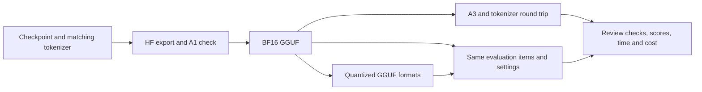

# G12 week 3 rotation — jssunil

**Status: draft preparation; checkpoint run NOT RUN.** Updated 15 November 2026.
R1 is the quantize-and-evaluate run on one checkpoint (due 18 November); R2 adds
measured time and cost (due 19 November). This report does not yet complete either task.

## Preparation and dependencies

- Target: `SreekanthZipsy/era-v5-lab`, `G12-Week3`; inspected base
  `f446357b150e6cf460495d5c18bc69a9cbcb17f7`.
- The base script's `--help` runs successfully, but it only supports the Hub-model
  path. The checkpoint path is in [PR #14](https://github.com/SreekanthZipsy/era-v5-lab/pull/14),
  inspected at `222be778537f9d1a9ee80114ef4a79839b9c30bd`; it was still open when checked.
  Recheck the merged implementation and pin its commit before running.
- PR #14 reports a random-weight smoke test. That establishes neither trained-checkpoint
  quality nor a passing round trip for the checkpoint's actual tokenizer.
- Checkpoint selection, its matching tokenizer release/hash, evaluation input and
  compute allocation remain unconfirmed. An earlier small checkpoint needs the lead's
  agreement; it must be labelled separately from dry run 1 evidence.
- The command below is a preparation template, **not a submitted TSAI job**. The current
  pipeline resolves a llama.cpp tag over the network and can download build dependencies
  and round-trip data. A TSAI submission needs an offline, provisioned entry point and
  local smoke log meeting [JOB_REQUEST.md](../../../JOB_REQUEST.md).
  Code basis: [`llama_tag`, `convert_env` and `roundtrip` in the inspected pipeline][pipeline].



## Inputs to pin before execution

| Input | Required record | Current state |
|---|---|---|
| Checkpoint | Source/run ID, training step, weights SHA-256, model manifest or explicit spec | Pending |
| Tokenizer | Checkpoint-matching release, tokenizer SHA-256, BOS/EOS strings and IDs | Pending; do not assume the pipeline's default C3 hash matches |
| Evaluation | File SHA-256, provenance, item count and kinds; any subset's IDs/seed | Pending |
| Pipeline/runtime | Lab commit, llama.cpp commit/build, converter and Python dependency versions | PR #14 inspected; execution versions pending |
| Run settings | Formats including BF16; prompt mode/template, context, generation caps, GPU offload | Pending confirmation |
| Machine and billing | CPU/GPU model and count, RAM/VRAM, billing interval, currency/rate and source | Pending allocation |

**Basis:** the pipeline records checkpoint/tokenizer hashes and evaluates all formats
with the same loaded items and arguments ([code][evaluation]). Model choice, hardware,
format subset and acceptance thresholds have **Basis: none in index** for this specific
run; settle these with the checkpoint manifest, G12 lead's scope and assigned machine.
No new threshold or bit-width recommendation is proposed here.

## Command template after the dependencies are resolved

Run from the lab repository root. Set the `G12_*` variables from the confirmed inputs
above; unset values stop the shell before inference. Use a fresh run ID and work directory
so cached exports, validation reports and quantization times cannot be mistaken for a
fresh run. A G5 checkpoint needs its model manifest beside it; otherwise add the
confirmed `--spec` argument. Use the tokenizer's actual BOS/EOS strings.

```bash
set -euo pipefail
G12_OUT="./out/rotation_jssunil/${G12_RUN_ID:?set a fresh run ID}"
mkdir -p "$(dirname "$G12_OUT")"
mkdir "$G12_OUT"
/usr/bin/time -p -o "$G12_OUT/wall_time.txt" \
  python teams/12-quantization/scripts/quantize_eval.py \
  --checkpoint "${G12_CHECKPOINT:?set checkpoint path}" \
  --name rotation_jssunil \
  --tokenizer "${G12_TOKENIZER:?set matching tokenizer path}" \
  --tokenizer-sha256 "${G12_TOKENIZER_SHA256:?set confirmed hash}" \
  --bos "${G12_BOS:?set BOS token}" --eos "${G12_EOS:?set EOS token}" \
  --eval "${G12_EVAL:?set approved evaluation JSON}" \
  --formats "${G12_FORMATS:?set formats including bf16}" \
  --prompt-mode "${G12_PROMPT_MODE:?set completion or chat}" \
  --ctx "${G12_CTX:?set context length}" \
  --max-tokens "${G12_MAX_TOKENS:?set generation cap}" \
  --max-tokens-mcq "${G12_MAX_TOKENS_MCQ:?set MCQ cap}" \
  --llama-bin "${G12_LLAMA_BIN:?set pinned binary directory}" \
  --ngl "${G12_NGL:?set GPU offload layers; 0 for CPU}" \
  --roundtrip \
  --work "$G12_OUT/work" \
  --runs-csv "$G12_OUT/runs.csv" \
  --scores-out "$G12_OUT/scores.json" \
  --notes "rotation=jssunil; run=$G12_RUN_ID" \
  > "$G12_OUT/pipeline.log" 2>&1
```

This uses the checkpoint CLI proposed in PR #14, not the current base CLI. Preserve
the exact expanded command and environment versions with the returned logs. Keep
weights, GGUFs and evaluation data outside Git; only small, reviewed evidence belongs
in the PR. The separate `--runs-csv` path also keeps incomplete runs out of the shared table.

## Checks required before interpreting scores

| Check | Evidence to retain | Result |
|---|---|---|
| Input identity | Checkpoint, tokenizer, evaluation and model-spec hashes | NOT RUN |
| A1: G5 versus HF export | `export_report.json`, compared prompts, error and top-1 results | NOT RUN |
| A3: G5 versus BF16 GGUF | A3 JSON, compared prompts and reported pass/fail | NOT RUN |
| Tokenizer round trip | Full report, line/token mismatch counts and exit code | NOT RUN |
| Tensor types | Observed router/output tensor types for every GGUF | NOT RUN |
| Evaluation completeness | Item count, per-kind scores, rejected prompts, effective context | NOT RUN |

The current implementation reports A3 failures and round-trip exit codes without
necessarily failing the whole command ([A3 code][checks], [round-trip implementation][pipeline]).
A process exit of zero is therefore insufficient. Retain failures and request lead
review before claiming the checkpoint/export is validated. Report observed router/output
types: the [current guard][types] permits F32, BF16, F16 or Q8_0, so passing it alone
does not prove the router stayed F32.

## R1 results — awaiting execution

| Format | GGUF SHA-256 / size | Score / per-kind scores | Delta vs BF16 (percentage points) | Rejected prompts | Evidence |
|---|---|---|---|---|---|
| BF16 baseline | NOT RUN | NOT RUN | — | NOT RUN | Pending |
| Each confirmed quantized format (one row per format) | NOT RUN | NOT RUN | NOT RUN | NOT RUN | Pending |

Compute the score delta as `100 * (quantized_score - bf16_score)` on identical items
and settings. The pipeline score is total correct / item count; its generation speed
is an average of reported per-request decode rates, not end-to-end throughput
([implementation][evaluation]). This evaluator is separate from G9's full `eval_mini`
runner. Label a stand-in or smoke subset explicitly; do not present it as full benchmark
or Gate 3 evidence. The template requires an explicit evaluation file and does not
silently generate the stand-in set.

## R2 time and cost — awaiting execution

| Stage | Measured elapsed seconds | Fresh/cached and evidence |
|---|---|---|
| Provisioning / downloads | NOT RUN | Pending |
| HF export + A1, BF16 conversion | NOT RUN | Pending |
| A3 and tokenizer round trip | NOT RUN | Pending |
| Quantization, per format | NOT RUN | Pending |
| Evaluation, per format | NOT RUN | Pending |
| Whole pipeline wall time | NOT RUN | `wall_time.txt` after execution |

Record stage timings from timestamped logs or explicit timers; if a boundary was not
measured, mark it unavailable. BF16's `quant_time_s = 0` does not measure conversion.
On resumed runs, `.quant_time` can contain the original creation time rather than work
done in the current invocation ([code][types]); keep that separate from current wall time.

**Cost: unavailable — no run or billed rate yet.** Record allocated runtime, node/GPU
count, rate unit, currency, billing rounding and the rate's source. For a per-node-hour
rate use billed node-hours × rate; for a per-GPU-hour rate use billed GPU-hours × rate.
Do not multiply the device count twice. Separate preparation from the measured pipeline
interval. If no billed rate is supplied, publish measured time and leave monetary cost
unavailable. **Basis:** [N1], Session 18 §10,
`local:sessions/session_18_preference_alignment_and_inference_serving.md#0014` (course notes;
no provider price assumed).

## Completion checklist

- [x] Inspect the target branch and checkpoint-pipeline proposal.
- [x] Prepare the report, input checklist and command template.
- [ ] Confirm and pin checkpoint, tokenizer, evaluation and runtime inputs.
- [ ] Resolve pipeline/offline-job dependencies; execute and attach logs.
- [ ] Review A1/A3, tokenizer and tensor-type evidence; disclose all failures.
- [ ] Fill R1 scores and R2 timing/cost from this run's artifacts.
- [ ] Ask the lead to review the completed evidence before taking the PR out of draft.

[pipeline]: https://github.com/shekar-maker/era-v5-lab/blob/222be778537f9d1a9ee80114ef4a79839b9c30bd/teams/12-quantization/scripts/quantize_eval.py
[evaluation]: https://github.com/shekar-maker/era-v5-lab/blob/222be778537f9d1a9ee80114ef4a79839b9c30bd/teams/12-quantization/scripts/quantize_eval.py#L372-L411
[checks]: https://github.com/shekar-maker/era-v5-lab/blob/222be778537f9d1a9ee80114ef4a79839b9c30bd/teams/12-quantization/scripts/quantize_eval.py#L497-L508
[types]: https://github.com/shekar-maker/era-v5-lab/blob/222be778537f9d1a9ee80114ef4a79839b9c30bd/teams/12-quantization/scripts/quantize_eval.py#L531-L554
