<p align="center">
  <picture>
    <source media="(prefers-color-scheme: dark)" srcset="figures/hero-dark.svg">
    
  </picture>
</p>

<p align="center"><sub>
TSAI's G12 task 4 (<i>memory per 1k tokens at 8k context for each choice</i>) and the memory part of lead item 8 (8k, 32k, 128k), for the runtime under our GGUF and Ollama release
&nbsp;·&nbsp; llama.cpp b11669 (Team 12's pin, commit 620d222), Metal, Apple M6 32 GB &nbsp;·&nbsp; the vLLM side is in <a href="../README.md"><code>../README.md</code></a> (#848)
</sub></p>

<br>

**In one minute**

- **Memory per 1k tokens is the formula, exactly.** Per token, llama.cpp's cache takes layers × KV heads × (head dim
  × bytes per K element + head dim × bytes per V element), for every cache type, on both models, at 8k, 32k and 128k
  (39 of 39 runs each). On the dry run 2 shape that is **4 MiB per 1k tokens at f16, 2.125 at q8_0, 1.375 at q5_0 and
  1.125 at q4_0**; the whole f16 cache at 8k is 32 MiB, small next to the 304 MiB of Q8_0 weights.
- **q8_0 is the safe default on this evidence.** On Llama-3.2-1B at 8k it halves the cache for a mean KL of 0.00023,
  99.3% same top-1 and +0.04% perplexity, and Ollama runs it (`OLLAMA_KV_CACHE_TYPE=q8_0`).
- **Four-bit caches drift at 8k:** q4_0 has KL 0.075, 88.7% same top-1 and +7.8% perplexity. Five bits cost +1.3 to
  +1.6% perplexity.
- **The keys need the bits, not the values.** At the same 6.5 bits per element, 8-bit keys with 4-bit values
  (`q8_0/q4_0`) have KL 0.0040, and 4-bit keys with 8-bit values (`q4_0/q8_0`) 0.057 (English and Hindi;
  q4_0 for both is 0.059 on the same packs). This agrees with #848's emulation (4-bit keys with 3-bit values
  beat 3-bit keys with 4-bit values).
- **llama.cpp rotates quantized K and V by default**, a Hadamard transform before the cache (`src/llama-kv-cache.cpp`,
  discussed in llama.cpp PR #21038; `LLAMA_ATTN_ROT_DISABLE=1` turns it off). Without it q4_0's KL is 2.7× higher
  (0.206) and q8_0's 2.2× (0.00050). Ollama 0.40.18's bundled llama.cpp rotates too.
- **On a Mac, iq4_nl and the mixed K/V types run attention on the CPU.** b11669's Metal flash attention needs the same
  K and V type, from f16, bf16, q8_0, q5_1, q5_0, q4_1 and q4_0, so iq4_nl and every mixed pair split the graph at
  every layer (18 graph splits on the dry run 2 shape and 34 on Llama-3.2-1B, against 2). With llama.cpp's default threads (2 of 12
  here), the dry run 2 shape at 8k then gives 131 prompt tokens per second against q4_0's 20,105, and 81 generated
  against 461.
- **At 8k a smaller cache is a little faster.** Llama-3.2-1B generates 55 tokens per second with f16, 59 with q8_0 and
  61 with q4_0 at 8k (single runs in a fixed order, so about ±3%); the five-bit types are a little slower than f16.
- **Ollama serves at most the GGUF's trained context.** With `num_ctx` 8192 it starts llama-server with `-c 2048` for
  the stand-in (its `context_length` is 2048) and logs "requested context size too large for model"; llama.cpp alone
  allows 8192 with a warning. So an 8k Ollama release needs a checkpoint trained (or extended) to 8k and metadata that
  says so.

> [!NOTE]
> Memory is measured on the dry run 2 shape, which needs no trained weights. Quality is measured on Llama-3.2-1B
> (16 layers, 8 KV heads, head dim 64, bf16 weights) as a proxy, on next-token metrics, not task scores. Our checkpoint
> is not used.

## What was measured

| | how | file |
|:--|:--|:--|
| memory | `llama-completion -c <ctx> -ctk K -ctv V -fa on -ngl 99 -n 1 -p Hello` under `/usr/bin/time -l`: llama.cpp's own report of the KV, compute and model buffers, and macOS's peak memory footprint | `results/memory_*.json` |
| quality | `llama-perplexity --kl-divergence` at `-c 8192` against the f16 cache of the same bf16 weights; llama.cpp scores the second half of each chunk, so every scored token attends to 4,096 to 8,191 cached tokens | `results/quality_*.json` |
| speed | `llama-bench -fa 1 -p 512 -n 128 -d 0,8192 -r 5`: a 512-token prompt and 128 generated tokens, with 0 and 8,192 tokens already in the cache; mean ± s.d. of 5 repetitions | `results/speed_kv.json` |

Models: the **dry run 2 shape** (8 layers, 8 query heads, 2 KV heads, head dim 64, 131,072-token vocabulary; the
random-weight stand-in in dry run 2's full shape from `make_random_checkpoint.py` with the flags below, sha256
24273cd9..., exported by `scripts/quantize_eval.py` with #862's run 1 settings `--drop-router-bias --drop-head-bias`,
Q8_0 weights, 300M parameters in the GGUF) for memory and speed, since memory does not depend on the weight values; and
**Llama-3.2-1B** (`unsloth/Llama-3.2-1B` @ 9535bd9b, converted with b11669's `convert_hf_to_gguf.py`) for quality,
because random weights say nothing about quality. Text: the train split of the cleaned tokenizer sample v0, six packs
(English, Python, Hindi, Bengali, Tamil, Kannada), 2 chunks of 8,192 tokens per pack; no benchmark item.

## 1 · Memory per 1k tokens at 8k context

| cache K/V | bits per element K/V | dry run 2 shape | Llama-3.2-1B | vs f16 | = formula | attention on Metal | tested in Ollama |
|:--|--:|--:|--:|--:|:--:|:--|:--:|
| f16 | 16 / 16 | 4.000 MiB | 32.000 MiB | 1.000× | yes | GPU | yes |
| bf16 | 16 / 16 | 4.000 MiB | 32.000 MiB | 1.000× | yes | GPU |  |
| q8_0 | 8.5 / 8.5 | 2.125 MiB | 17.000 MiB | 0.531× | yes | GPU | yes |
| q5_1 | 6 / 6 | 1.500 MiB | 12.000 MiB | 0.375× | yes | GPU |  |
| q5_0 | 5.5 / 5.5 | 1.375 MiB | 11.000 MiB | 0.344× | yes | GPU | Llama-1B |
| q4_1 | 5 / 5 | 1.250 MiB | 10.000 MiB | 0.312× | yes | GPU |  |
| q4_0 | 4.5 / 4.5 | 1.125 MiB | 9.000 MiB | 0.281× | yes | GPU | yes |
| iq4_nl | 4.5 / 4.5 | 1.125 MiB | 9.000 MiB | 0.281× | yes | CPU (18 / 34 graph splits, not 2) | Llama-1B |
| q8_0/q4_0 | 8.5 / 4.5 | 1.625 MiB | 13.000 MiB | 0.406× | yes | CPU (18 / 34 graph splits, not 2) |  |
| q8_0/q5_0 | 8.5 / 5.5 | 1.750 MiB | 14.000 MiB | 0.438× | yes | CPU (18 / 34 graph splits, not 2) |  |

vLLM 0.33.0 on the dry run 2 shape (8 layers, 2 KV heads, head dim 64), computed from its slot sizes as in #848, not run:

| `--kv-cache-dtype` | MiB per 1k tokens | vs bf16 |
|:--|--:|--:|
| auto (bf16) | 4.000 | 1.000× |
| fp8 | 2.000 | 0.500× |
| turboquant_4bit_nc | 2.547 | 0.637× |
| turboquant_k3v4_nc | 2.484 | 0.621× |
| turboquant_3bit_nc | 2.422 | 0.605× |

<p align="center">
  <picture>
    <source media="(prefers-color-scheme: dark)" srcset="figures/longctx-dark.svg">
    
  </picture>
</p>

## 2 · Long context (lead item 8)

With full attention the cache grows by the same amount per 1k tokens at any length, so 128k costs 16 times 8k. Dry run
2 has no linear-attention or local layers (its run record, #869's `manifest.json`).

| model | context | KV f16 | KV q8_0 | KV q4_0 | compute buffers (f16 run) | peak footprint f16 / q8_0 / q4_0 |
|:--|--:|--:|--:|--:|--:|--:|
| dry run 2 shape | 8k | 32 MiB | 17 MiB | 9 MiB | 280 MiB | 114 / 99 / 95 MiB |
| dry run 2 shape | 32k | 128 MiB | 68 MiB | 36 MiB | 328 MiB | 210 / 151 / 120 MiB |
| dry run 2 shape | 128k | 512 MiB | 272 MiB | 144 MiB | 520 MiB | 599 / 358 / 233 MiB |
| Llama-3.2-1B | 8k | 256 MiB | 136 MiB | 72 MiB | 299 MiB | 357 / 237 / 177 MiB |
| Llama-3.2-1B | 32k | 1,024 MiB | 544 MiB | 288 MiB | 347 MiB | 1,129 / 643 / 393 MiB |
| Llama-3.2-1B | 128k | 4,096 MiB | 2,176 MiB | 1,152 MiB | 557 MiB | 4,225 / 2,279 / 1,258 MiB |

- *KV* is llama.cpp's own report (`llama_kv_cache: size = ...`).
- *Compute buffers* are what llama.cpp reserves for one micro-batch of 512 tokens (Metal plus CPU). llama-completion
  and llama-perplexity reserve logits for every token of the micro-batch (`n_outputs_max` 2,048), and on the dry run 2
  shape that is 512 × 131,072 × 4 bytes = 256 MiB of the 280. llama-server as Ollama runs it reserves one output row
  (`n_outputs_max = 1`), and its compute buffer for the same stand-in is 22.5 MiB (16.52 Metal + 6.02 CPU, Ollama log).
- *Peak footprint* is macOS's `peak memory footprint` from `/usr/bin/time -l` for the whole process: pages actually
  touched. It does not count the memory-mapped weights or reserved buffers that were never written, so it is shown
  next to llama.cpp's numbers, not instead of them. It follows the KV column here: Llama-3.2-1B's footprint grows by
  3,868 MiB from 8k to 128k at f16, against 3,840 MiB of extra cache.

The compute buffer of llama-completion scales with the micro-batch, not with the cache (dry run 2 shape, 8k, f16):

| `-ub` | compute buffers | KV f16 | peak footprint |
|--:|--:|--:|--:|
| 64 | 35.0 MiB | 32 MiB | 112 MiB |
| 128 | 70.0 MiB | 32 MiB | 113 MiB |
| 256 | 140.0 MiB | 32 MiB | 114 MiB |
| 512 | 280.0 MiB | 32 MiB | 114 MiB |

At 0.55 MiB per micro-batch token it is one 131,072-token row of float32 logits (0.5 MiB) plus the rest of the graph.
The footprint does not move because these runs (a 2-token prompt and 1 generated token) never write most of the
reserved buffer.

## 3 · Quality at 8k context

<p align="center">
  <picture>
    <source media="(prefers-color-scheme: dark)" srcset="figures/tradeoff-dark.svg">
    
  </picture>
</p>

| cache K/V | rotation | packs | mean KL (s.e.) | KL range over packs | same top-1 | perplexity change |
|:--|:--|--:|--:|--:|--:|--:|
| bf16 | n/a | 6 | 0.00006 (0.00000) | 0.00005 to 0.00007 | 99.67% | +0.02% |
| q8_0 | on | 6 | 0.00023 (0.00000) | 0.00016 to 0.00030 | 99.34% | +0.04% |
| q5_1 | on | 6 | 0.01193 (0.00016) | 0.00932 to 0.01635 | 95.26% | +1.26% |
| q5_0 | on | 6 | 0.01533 (0.00024) | 0.01185 to 0.01917 | 94.88% | +1.56% |
| q4_1 | on | 6 | 0.06021 (0.00073) | 0.04362 to 0.08115 | 89.99% | +6.17% |
| q4_0 | on | 6 | 0.07493 (0.00087) | 0.05799 to 0.09437 | 88.69% | +7.79% |
| q8_0 | off | 6 | 0.00050 (0.00001) | 0.00045 to 0.00057 | 99.03% | +0.08% |
| q5_0 | off | 6 | 0.03803 (0.00055) | 0.03598 to 0.04153 | 91.84% | +3.69% |
| q4_0 | off | 6 | 0.20581 (0.00177) | 0.18608 to 0.22883 | 80.76% | +22.68% |
| iq4_nl | on | 2 | 0.05144 (0.00087) | 0.05115 to 0.05174 | 87.71% | +5.31% |
| q8_0/q4_0 | on | 2 | 0.00397 (0.00012) | 0.00378 to 0.00416 | 96.70% | +0.34% |
| q8_0/q5_0 | on | 2 | 0.00126 (0.00003) | 0.00117 to 0.00135 | 98.20% | +0.19% |
| q8_0/q4_0 | off | 2 | 0.00743 (0.00014) | 0.00716 to 0.00770 | 95.58% | +0.71% |
| q4_0/q8_0 | on | 2 | 0.05653 (0.00095) | 0.05590 to 0.05717 | 87.42% | +5.04% |

The rows with 2 packs (en-fineweb-edu, ind-hi-fw2) are the cache types whose attention runs on the CPU; on the same two packs the 6-pack rows give: q8_0 0.00020, q4_0 0.05925.

- KL is the mean over scored tokens of KL(f16 cache ‖ choice), from the same bf16 weights; *same top-1* is the share of
  tokens whose most likely next token does not change; *perplexity change* is exp(mean ln(PPL(Q)/PPL(f16))) − 1.
- Each scored token attends to 4,096 to 8,191 cached tokens (llama.cpp scores the second half of each chunk), so this
  is the drift a long prompt or a long answer sees, through the cache, as decode does.
- The bf16 row is the floor: two 16-bit caches already differ by KL 0.00006.
- With rotation, q4_0's KL is higher on Bengali, Tamil and Kannada (0.088 to 0.094) than on English, Python and Hindi
  (0.058 to 0.061). These are per Llama-3.2-1B token, and Llama's tokenizer splits those scripts into many more tokens
  (f16 perplexity 1.8 to 2.2 per token there, against 11.7 on English), so the packs are not directly comparable.

## 4 · Speed

t2-standin-Q8_0, tokens per second:

| cache K/V | prompt, empty cache | prompt at 8k | generation, empty cache | generation at 8k | generation at 8k vs f16 |
|:--|--:|--:|--:|--:|--:|
| f16 | 53,410 ± 4,105 | 19,005 ± 754 | 536 ± 28 | 442 ± 18 | 1.00× |
| bf16 | 49,866 ± 4,497 | 21,539 ± 210 | 533 ± 27 | 432 ± 69 | 0.98× |
| q8_0 | 48,461 ± 1,312 | 20,567 ± 466 | 519 ± 30 | 418 ± 70 | 0.95× |
| q5_1 | 50,236 ± 2,218 | 19,658 ± 406 | 496 ± 27 | 363 ± 63 | 0.82× |
| q5_0 | 48,056 ± 1,021 | 19,073 ± 3,373 | 517 ± 17 | 392 ± 67 | 0.89× |
| q4_1 | 48,765 ± 3,708 | 19,802 ± 1,155 | 500 ± 18 | 432 ± 78 | 0.98× |
| q4_0 | 49,910 ± 2,552 | 20,105 ± 589 | 527 ± 11 | 461 ± 18 | 1.04× |
| iq4_nl | 2,381 ± 365 | 131 ± 4 | 180 ± 5 | 81 ± 2 | 0.18× |
| q8_0/q4_0 | 3,610 ± 80 | 107 ± 13 | 236 ± 2 | 59 ± 11 | 0.13× |
| q8_0+norot | 51,241 ± 2,547 | 20,099 ± 450 | 504 ± 49 | 485 ± 15 | 1.10× |
| q4_0+norot | 53,579 ± 1,717 | 21,244 ± 415 | 548 ± 13 | 500 ± 15 | 1.13× |

llama-3.2-1b-Q8_0, tokens per second:

| cache K/V | prompt, empty cache | prompt at 8k | generation, empty cache | generation at 8k | generation at 8k vs f16 | bytes read per token at 8k | effective read rate at 8k |
|:--|--:|--:|--:|--:|--:|--:|--:|
| f16 | 5,308 ± 118 | 2,214 ± 90 | 68 ± 1 | 55 ± 1 | 1.00× | 1.584 GB | 87.7 GB/s |
| bf16 | 4,051 ± 560 | 2,209 ± 27 | 66 ± 1 | 56 ± 2 | 1.01× | 1.584 GB | 89.0 GB/s |
| q8_0 | 4,760 ± 242 | 2,328 ± 132 | 68 ± 4 | 59 ± 0 | 1.06× | 1.457 GB | 85.5 GB/s |
| q5_1 | 4,830 ± 615 | 2,203 ± 107 | 64 ± 5 | 52 ± 1 | 0.95× | 1.415 GB | 74.1 GB/s |
| q5_0 | 5,075 ± 62 | 2,440 ± 28 | 66 ± 3 | 54 ± 2 | 0.97× | 1.406 GB | 75.4 GB/s |
| q4_1 | 4,194 ± 579 | 2,418 ± 21 | 66 ± 5 | 61 ± 0 | 1.10× | 1.398 GB | 85.5 GB/s |
| q4_0 | 4,805 ± 703 | 2,410 ± 26 | 71 ± 1 | 61 ± 1 | 1.10× | 1.389 GB | 84.8 GB/s |
| q8_0+norot | 4,572 ± 400 | 2,493 ± 44 | 70 ± 1 | 60 ± 0 | 1.09× | 1.457 GB | 88.1 GB/s |
| q4_0+norot | 4,921 ± 562 | 2,524 ± 32 | 70 ± 2 | 59 ± 0 | 1.07× | 1.389 GB | 82.3 GB/s |

Bytes read per token = weights on the GPU (`MTL0_Mapped`) + cache bytes per token × (8,192 + 64), the mean cache length over the 128 generated tokens; effective read rate = generated tokens per second × that. For scale, `bw_mps.py` measured 133 to 150 GB/s of read bandwidth in its last run.

- **On Llama-3.2-1B the bytes read per token explain the speed at 8k.** Each generated token reads the weights on the
  GPU (1,252 MiB) and the cache (258 MiB at f16), and llama.cpp reads them at an effective 82 to 89 GB/s for f16, bf16,
  q8_0, q4_1 and q4_0, so a smaller cache is a little faster (q8_0 6% and q4_0 10% over f16). The five-bit types read
  at only 74 to 75 GB/s, so unpacking them seems to cost more than the bytes they save. These are single 5-repetition
  runs in a fixed order, and q8_0 and q4_0 with rotation on and off differ by about 3% in opposite directions, so read
  ±3% into every ratio.
- **Bandwidth for scale:** `bw_mps.py` (one PyTorch MPS kernel) measured 87 to 102 GB/s of read bandwidth in two sessions
  around the speed runs and 133 to 150 GB/s in a later one (`results/bandwidth_mps.json`). I think the GPU's clock state
  changes it, so it is not used as a limit here.
- **On the dry run 2 shape** (300M parameters in the GGUF, 176M in Team 5's count) the Metal cache types run at 363 to
  548 generated tokens per second, but the first of the five repetitions is low in five of them (252 to 311), which
  pulls their means down, so their ratios to f16 are not reliable. I think a model this small is limited by per-token
  overhead rather than memory, but that is not measured here.
- iq4_nl and `q8_0/q4_0` were timed on the dry run 2 shape only, with llama.cpp's default 2 CPU threads, so those
  numbers depend on the thread count. On Llama-3.2-1B their CPU attention would
  have taken roughly an hour for the five runs at 8k (the CPU-attention quality runs took 6 to 9 minutes each), so
  those two were stopped (`exit -15` in `results/speed_kv.json`).

## 5 · Ollama

Ollama 0.40.18 (Homebrew) runs both GGUFs through its bundled llama-server (`using llama-server for model`) and passes
`OLLAMA_KV_CACHE_TYPE` through unchanged as `--cache-type-k` / `--cache-type-v`, with `--flash-attn on` (all runs set
`OLLAMA_FLASH_ATTENTION=1`). f16, q8_0 and q4_0 were run on both models and q5_0 and iq4_nl on Llama-3.2-1B; its server
log shows the same KV sizes as llama.cpp (stand-in at 2,048 cells: 8.00 / 4.25 / 2.25 MiB for f16 / q8_0 / q4_0;
Llama-3.2-1B at 8,192 cells: 136 MiB q8_0, 88 MiB q5_0, 72 MiB iq4_nl) and `n_rot_k = 64` for the quantized types, so
it rotates as b11669 does. The stand-in was capped at 2,048 cells: `requested context size too large for model
num_ctx=8192 n_ctx_train=2048`.

## Not measured

- Our checkpoint: the dry run 2 weights are not available here, so quality on our own model (with the KAS head and the
  131,072-token vocabulary) is not measured. Memory does not depend on the weights, so the memory tables are ours.
- Cache quality on top of quantized weights: the quality runs use bf16 weights, so they isolate the cache.
- Task scores (benchmarks run only under the eval firewall); only next-token metrics on training-sample text.
- Quality of iq4_nl and the mixed K/V types on all six packs: their attention runs on the CPU, so they were scored on
  English and Hindi only (the rows with 2 packs). Their speed on Llama-3.2-1B was not measured (section 4).
- Batch sizes above 1, and memory under several parallel sequences (`-np`).
- Other machines: the 16 GB and 64 GB rows of the bit-width table come through #904's format; nothing here stands in
  for them.
- Contexts beyond 8k for quality (lead item 8's 32k and 128k are memory only).

## Files and rerun

| file | what |
|:--|:--|
| [`kv_llamacpp.py`](kv_llamacpp.py) | `memory`, `text`, `quality`, `speed`, `table` and `report` (the tables above) |
| [`test_kv_llamacpp.py`](test_kv_llamacpp.py) | cache-choice parsing, the bytes-per-token formula against llama.cpp's own numbers, the log parsers, and `report` (CPU, no llama.cpp) |
| [`bw_mps.py`](bw_mps.py) | the read bandwidth behind the speed table's limit |
| [`figures/make_figures.py`](figures/make_figures.py) | the figures, from `results/` (palette and motion from #848's `../figures/make_figures.py`) |
| `results/` | numbers only: no text and no token ids |

<details>
<summary><b>Rerun everything</b></summary>
<br>

With `B` = a llama.cpp b11669 `bin` folder that has `llama-completion`, `llama-perplexity` and `llama-bench`
(`cmake --build build --target llama-completion llama-perplexity llama-bench`), `T2` = the stand-in's Q8_0 GGUF
(`make_random_checkpoint.py --d-model 512 --n-layer 8 --n-head 8 --n-kv-head 2 --d-ff 768 --n-expert 16 --n-shared 1
--top-k 2 --seq-len 2048 --pos-dim 32 --std 0.05 --head-mode kas_v2 --bias-gamma 0.001 --router-bias-std 0.01`, then
`scripts/quantize_eval.py --checkpoint ... --drop-router-bias --drop-head-bias --formats Q8_0`), and `L1` / `L1Q` =
`unsloth/Llama-3.2-1B` @ 9535bd9b converted to bf16 / quantized to Q8_0 with the same build:

```
python kv_llamacpp.py memory --bin $B --model t2-standin-Q8_0=$T2 --ctx 8192 32768 131072 --out results/memory_t2.json
python kv_llamacpp.py memory --bin $B --model llama-3.2-1b-Q8_0=$L1Q --ctx 8192 32768 131072 --out results/memory_llama1b.json
for ub in 64 128 256 512; do python kv_llamacpp.py memory --bin $B --model t2-standin-Q8_0=$T2 --ctx 8192 \
    --choices f16 q8_0 --ubatch $ub --out results/memory_t2_ub$ub.json; done
python kv_llamacpp.py text --data <tokenizer_sample_v0_clean> --out-dir <texts>
python kv_llamacpp.py quality --bin $B --model llama-3.2-1b-bf16=$L1 --texts <texts> --kld-dir <scratch> \
    --choices bf16 q8_0 q5_1 q5_0 q4_1 q4_0 q8_0+norot q5_0+norot q4_0+norot --out results/quality_llama1b_ctx8192.json
python kv_llamacpp.py quality --bin $B --model llama-3.2-1b-bf16=$L1 --texts <texts> --kld-dir <scratch> \
    --packs en-fineweb-edu ind-hi-fw2 --choices iq4_nl q8_0/q4_0 q8_0/q5_0 q8_0/q4_0+norot q4_0/q8_0 \
    --out results/quality_llama1b_ctx8192_cpu_fa.json
python kv_llamacpp.py speed --bin $B --model t2-standin-Q8_0=$T2 llama-3.2-1b-Q8_0=$L1Q --depth 0 8192 --reps 5 \
    --choices f16 bf16 q8_0 q5_1 q5_0 q4_1 q4_0 iq4_nl q8_0/q4_0 q8_0+norot q4_0+norot --out results/speed_kv.json
python bw_mps.py --repeat 5 --out results/bandwidth_mps.json
python kv_llamacpp.py report           # the tables above
python figures/make_figures.py
python -m pytest test_kv_llamacpp.py -q
```

Speed runs need a quiet machine (nothing else on the GPU or CPU). The KL base files are 2.1 GB per pack for
Llama-3.2-1B and stay outside the repo. Each results file records the commands that wrote it (`argv`, and
`invocations` where a run was resumed).
</details>
