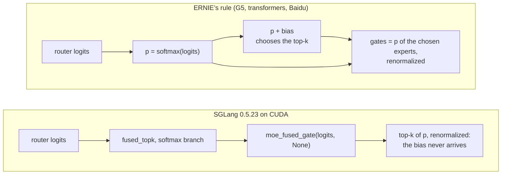

<p align="center">
  <picture>
    <source media="(prefers-color-scheme: dark)" srcset="figures/hero-dark.svg">
    
  </picture>
</p>

<p align="center"><sub>
Our model’s ERNIE export (<a href="../../scripts/export_hf.py"><code>export_hf.py --target ernie4_5_moe</code></a>) at the dry-run-2 shape, random weights &nbsp;·&nbsp; SGLang 0.5.23 and vLLM 0.33.0 on one NVIDIA L4 &nbsp;·&nbsp; for the SGLang row of <a href="../../tools/tools.md"><code>tools.md</code></a>, which said “not checked”
</sub></p>

<br>

**In one minute**

- **vLLM routes our model correctly.** vLLM 0.33.0 is as close to G5 as G5’s own rounded runs are: 93.4% same top-1
  in bf16 and 98.7% in fp16, against 91.8% and 98.6% for G5 itself in bf16 and fp16.
- **Stock SGLang drops the router’s selection bias on CUDA.** SGLang 0.5.23 serves our export as if the router bias
  were zero: it agrees with that model on 96.0% (bf16) and 99.4% (fp16) of top-1 tokens, and with our model on 68.5%.
- **For the lab:** G9’s checkpoint evals and G10’s rollouts are planned on vLLM
  ([`serving_plan.md`](../../docs/serving_plan.md) §1), so they are not affected. SGLang should not serve our model
  until the fix below is in a release.
- **The fix is upstream.** [sgl-project/sglang#53755](https://github.com/sgl-project/sglang/pull/53755) continues [#46669](https://github.com/sgl-project/sglang/pull/46669) by
  FeSens, who found and measured this bug first. On Baidu’s ERNIE-4.5-21B it raises routing agreement with
  transformers from 67.5% to 94.3%, with no measurable speed cost (bs=1 TPOT 3.77 against 3.78 ms).
- **The KAS head bias is dropped by every engine**, as was already known
  ([`exotic_heads_and_export_checks.md`](../../docs/exotic_heads_and_export_checks.md)); the export is made with
  `--drop-head-bias`, and every number here compares with G5 without `head.unigram`.

> [!NOTE]
> Random weights at our shape (std 0.02), one GPU type for our model (L4), prefill only, and no fp32 run in either
> engine. Section 6 lists what was not run.

**Contents** &nbsp;
[1 · What was checked](#1--what-was-checked) ·
[2 · SGLang and vLLM against G5](#2--sglang-and-vllm-against-g5) ·
[3 · Why SGLang drops the bias](#3--why-sglang-drops-the-bias) ·
[4 · The upstream fix](#4--the-upstream-fix) ·
[5 · What it means for the lab](#5--what-it-means-for-the-lab) ·
[6 · Limits](#6--limits) ·
[7 · Files and rerun](#7--files-and-rerun)

<br>

## 1 · What was checked

| | |
|:---|:---|
| Model | a random G5 `LanguageModel` at the dry-run-2 shape: 8 layers, d 512, 8 heads / 2 KV heads, 16 routed + 1 shared experts (FFN 768), top-2, `head_mode: kas_v2`, `bias_gamma` 0.001 with `router_bias` ~ N(0, 0.01), vocabulary 131,072 (p1536). `make_random_checkpoint.py --std 0.02` ([why 0.02](#why-std-002)) |
| Export | `export_hf.py --target ernie4_5_moe --dtype fp32 --drop-head-bias --verify 4` (transformers 4.57.6): A1 passes, max logit difference 4.05e-6, same top-1 on 256 of 256 positions |
| Reference | G5 in fp32 without `head.unigram`, which is what the export carries ([`make_ref.py`](make_ref.py)); G5’s own bf16 and fp16 runs and G5 with its router bias set to zero ([`variants.py`](variants.py)) |
| Prompts | 12 random-token prompts of 16 to 512 tokens: 2,016 positions for same top-1, 2,004 for log-probabilities |
| SGLang | 0.5.23 from PyPI, torch 2.14.1+cu130, transformers 5.19.0, Modal NVIDIA L4 (sm89), default MoE runner. Token ids in (`skip_tokenizer_init`), `return_logprob` from position 0, top-5, radix cache off; each prompt alone, then all 12 in one batch ([`sgl_probe.py`](sgl_probe.py)) |
| vLLM | 0.33.0 (Team 12’s pin), torch 2.14.0+cu130, the same L4 type, the same prompts and comparison ([`vllm_probe.py`](vllm_probe.py)) |
| Measures | same top-1 next token, and \|Δ log-probability\| of the real next token, against each G5 variant ([`summarize.py`](summarize.py), alignment in [`from_engine`](summarize.py#L47-L56)) |

<br>

## 2 · SGLang and vLLM against G5

<p align="center">
  <picture>
    <source media="(prefers-color-scheme: dark)" srcset="figures/engines-dark.svg">
    
  </picture>
</p>

One request at a time, against G5 fp32 (our model as exported). From
[`results/spike_summary.json`](results/spike_summary.json).

| Run | Same top-1 (of 2,016) | Mean \|Δ lp\| | Max \|Δ lp\| | Against G5 with the bias off: top-1, mean \|Δ lp\| | Alone vs in a batch of 12: max \|Δ lp\| |
|:---|---:|---:|---:|---:|---:|
| *G5, all bf16 (CPU): rounding yardstick* | 1,850 (91.8%) | 8.95e-3 | 0.128 | 1,343 (66.6%), 6.24e-2 | |
| *G5, all fp16 (CPU): rounding yardstick* | 1,987 (98.6%) | 1.41e-3 | 0.093 | 1,382 (68.6%), 6.27e-2 | |
| *G5 with its router bias set to zero: control* | 1,383 (68.6%) | 6.26e-2 | 0.414 | | |
| SGLang 0.5.23, bf16 | 1,380 (68.5%) | 6.28e-2 | 0.413 | **1,936 (96.0%), 6.90e-3** | 0.15 |
| SGLang 0.5.23, fp16 | 1,378 (68.4%) | 6.27e-2 | 0.414 | **2,004 (99.4%), 8.82e-4** | 0.08 |
| **vLLM 0.33.0, bf16** | **1,883 (93.4%)** | **6.60e-3** | 0.138 | 1,404 (69.6%), 6.24e-2 | 0.11 |
| **vLLM 0.33.0, fp16** | **1,989 (98.7%)** | **1.33e-3** | 0.091 | 1,389 (68.9%), 6.27e-2 | 0.05 |
| SGLang 0.5.23 + spike patch, bf16 | 1,875 (93.0%) | 8.51e-3 | 0.231 | 1,393 (69.1%), 6.23e-2 | 0.24 |
| SGLang 0.5.23 + spike patch, fp16 | 1,987 (98.6%) | 1.55e-3 | 0.237 | 1,390 (68.9%), 6.27e-2 | 0.09 |

<details>
<summary><b>Reading the table</b>: rounding against routing, the patch, batches, fp32</summary>
<br>

- **It is not rounding.** From bf16 to fp16, G5’s own noise shrinks about six-fold (mean 8.95e-3 to 1.41e-3) and
  vLLM’s about five-fold (6.60e-3 to 1.33e-3). Stock SGLang’s distance from G5 does not move (6.28e-2 to 6.27e-2),
  while its distance from G5 with the bias set to zero sits at rounding level (6.90e-3 and 8.82e-4).
- **vLLM in bf16 is even closer than G5’s all-bf16 yardstick** (6.60e-3 against 8.95e-3), likely because it keeps the
  router in fp32; the yardstick rounds the router weights to bf16.
- **The spike patch** ([`patch_topk.py`](patch_topk.py), a diagnostic) brings SGLang to G5’s rounding level on top-1
  and mean, with a few larger single-position outliers: 6 positions above 0.1 in bf16 against G5’s 3, and 1 in fp16
  against 0. It shows the rest of the export (KAS input and head folds, RoPE, GQA, shared expert, softmax top-2 with
  renormalization) is read correctly. It is not the fix to use (section 4).
- **Batch dependence.** The same prompt alone and inside a batch of 12 differs by up to 0.15 in log-probability
  (SGLang bf16) and 0.11 (vLLM bf16). Neither run asked for a deterministic or batch-invariant mode, the likely
  reason (not tested). It matters for the trainer-against-engine log-probability gap in RL.
- **fp32 does not run in either engine**, so exactness is never shown: SGLang’s CUDA RMSNorm has no fp32 kernel
  (`failed to dispatch data type Float`), and vLLM 0.33.0 stops at engine start on the L4 with a Triton
  shared-memory error (`OutOfResources`). Both errors are recorded in the summary file.

</details>

<br>

## 3 · Why SGLang drops the bias

ERNIE-4.5 routes as G5 does: the bias is added to the softmax **probabilities**, it only **chooses** the experts, and
the gates are the unbiased probabilities of the chosen experts, renormalized (G5’s
[`MoE.forward`](../../../05-architecture/harness/week2/model.py#L242-L248), transformers’ `Ernie4_5_MoeTopKRouter`,
Baidu’s remote code).



- `Ernie4Moe` builds `TopK(..., correction_bias=...)` with the default softmax scoring
  ([`ernie4.py` L96–L102](https://github.com/sgl-project/sglang/blob/v0.5.23/python/sglang/srt/models/ernie4.py#L96-L102)).
- On CUDA, `fused_topk`’s softmax branch calls the fused router with `None` in place of the bias
  ([`topk.py` L1295–L1307](https://github.com/sgl-project/sglang/blob/v0.5.23/python/sglang/srt/layers/moe/topk.py#L1295-L1307));
  the sigmoid branch passes it
  ([L1345–L1351](https://github.com/sgl-project/sglang/blob/v0.5.23/python/sglang/srt/layers/moe/topk.py#L1345-L1351)).
- Passing the bias to that kernel would not be right either: its softmax-with-bias mode adds the bias to the
  **logits** and keeps it in the weights, a different rule.
- SGLang’s torch-native route has the right rule but crashes on the `(1, E)` bias ERNIE passes on CUDA
  ([L1116–L1123](https://github.com/sgl-project/sglang/blob/v0.5.23/python/sglang/srt/layers/moe/topk.py#L1116-L1123)).

SGLang `main` still has it: at `4f1fa3ad` (27 Nov) the fix PR’s routing repro gives 0.00% agreement with the
reference rule. Two independent reviews checked the finding: one re-derived the SGLang numbers from the raw outputs
(and found that #46669 had reported the bug first), the other reproduced it at routing level on an L4 (72 cases,
SGLang equal to “bias ignored” in all of them) and on a public tiny ERNIE checkpoint.

<br>

## 4 · The upstream fix

<p align="center">
  <picture>
    <source media="(prefers-color-scheme: dark)" srcset="figures/routing-dark.svg">
    
  </picture>
</p>

[sgl-project/sglang#53755](https://github.com/sgl-project/sglang/pull/53755) continues [#46669](https://github.com/sgl-project/sglang/pull/46669) by FeSens (draft, unreviewed,
closed by the stale bot on 22 Nov), whose diagnosis and measurements came first; FeSens is co-author of both commits.
It adds a probability-space mode to SGLang’s fused Triton router (`moe_fused_gate`): rank by probability + bias, gate
with the unbiased probability, as its sigmoid branch already does. `fused_topk` uses it on CUDA and ROCm with a 1-D
bias, and the torch-native route now accepts ERNIE’s `(1, E)` bias. Measured for that PR on
`baidu/ERNIE-4.5-21B-A3B-PT`, SGLang `main` at `4f1fa3ad`, one H100 80GB
([`results/sglang_pr_ernie21b.json`](results/sglang_pr_ernie21b.json)):

| ERNIE-4.5-21B-A3B, bf16 | SGLang `main` | With the fix |
|:---|---:|---:|
| Routed experts equal to transformers’, prompt (8,748 token-layer pairs) | 67.5% | **94.3%** |
| … per MoE layer | 55.9% to 84.3% | 92.0% to 97.5% |
| … decode (5,022 pairs) | 65.0% | **93.8%** |
| Decode TPOT, median, 1 request at a time | 3.77 ms | 3.78 ms |
| Decode TPOT, median, 64 concurrent | 19.55 ms | 19.43 ms |
| Routing op in a CUDA graph, 1 / 16,384 tokens | 3.14 / 8.53 µs (bias dropped) | 3.33 / 8.67 µs |
| GSM8K (1,319, one run each) | 92.80% | 92.72% |

<details>
<summary><b>Notes on these numbers</b></summary>
<br>

- The reference is transformers 5.19.0 with the checkpoint in bf16, which keeps the router weight and bias in fp32.
  Six short natural-text prompts (324 tokens) plus 32 greedy tokens each.
- About 6% of pairs still differ with the fix. Part of it is `main`’s bf16 router GEMM, which open PR #49668 moves to
  fp32; the gap grows with depth, which points to accumulated bf16 differences too. The two were not separated.
- Speed and GSM8K are one run per build. The GSM8K difference is inside the run-to-run variance the SGLang
  contribution guide gives for this eval, so it shows only that nothing breaks.
- **Why not the spike patch.** 0.5.23 stores the bias in bf16 and the patch adds it in the model dtype. Baidu’s
  biases are a large common offset (about 22 to 63) with a per-layer spread of only 0.003 to 0.028, so in bf16 26 of
  ERNIE-4.5-21B’s 27 MoE layers collapse to one value, and layer 25 gets a false −0.125 offset on 6 experts: applying
  that bias routes worse than ignoring it (47.1% against 21.5% of tokens differ, synthetic logits). SGLang `main`
  already keeps the bias in fp32 (#38719, merged 2 Nov), and the PR computes the probabilities in fp32.

</details>

<br>

## 5 · What it means for the lab

- **G9 and G10:** checkpoint evals and RL rollouts are planned on vLLM ([`serving_plan.md`](../../docs/serving_plan.md)
  §1), and vLLM 0.33.0 routes our export at G5’s own rounding level. Nothing to change.
- **SGLang:** not for our model until the fix is in a release, and this check passes on it. Without the bias, our
  model routes as if its loss-free balancer had never run; on this random model that changes the top-1 at 31% of
  positions. How much it moves a trained model depends on how far a long run grows `router_bias`.
- **The KAS head bias** (`head.unigram`) is carried by no engine: SGLang refuses `lm_head.bias` at load
  ([`ernie4.py` L424–L431](https://github.com/sgl-project/sglang/blob/v0.5.23/python/sglang/srt/models/ernie4.py#L424-L431)),
  and llama.cpp, Ollama and vLLM have no output bias for this architecture. This is unchanged and already in
  `exotic_heads_and_export_checks.md`; served scores are those of G5 without it.
- **Batch dependence** (up to 0.15 in a single position’s log-probability in bf16, alone against batched) is worth
  keeping in mind when RL compares trainer and engine log-probabilities.

<br>

## 6 · Limits

- **Random weights.** Not a trained checkpoint: the next-token distribution is close to uniform, top-1 margins are
  tiny, and same top-1 is over-sensitive. The check shows the bias is ignored; it does not measure the quality cost on
  a trained model.
- **One GPU type for our model** (L4, sm89), TP 1, default MoE runner, bf16 and fp16. The upstream numbers are from
  one H100.
- **Prefill only.** One new token per prompt, so decode CUDA graphs were captured but never replayed on our model;
  chunked prefill never triggered and the radix cache was off.
- **12 prompts**, and positions are not independent (a routing flip carries to later positions): read differences of
  1–2 points as noise, not the 25–30 point gaps.
- **Not run:** SGLang `main` or the fixed build on our model; a trained checkpoint; T4 or other GPUs; speed on our
  model; quantized formats; TP > 1 or expert parallelism; other MoE runner backends; ERNIE-4.5-VL;
  `--enable-fp32-lm-head`. vLLM’s result is measured, not traced through its code.

<br>

## 7 · Files and rerun

| File | What |
|:---|:---|
| [`make_ref.py`](make_ref.py), [`variants.py`](variants.py) | G5 references on the 12 prompts: fp32 without `head.unigram`, bf16 and fp16 runs, router bias zeroed (CPU) |
| [`sgl_probe.py`](sgl_probe.py), [`vllm_probe.py`](vllm_probe.py) | load the export in the engine and dump prompt log-probabilities, alone and batched (GPU) |
| [`modal_sgl.py`](modal_sgl.py), [`modal_vllm.py`](modal_vllm.py) | the probes on one Modal L4 per config; `--patched` applies [`patch_topk.py`](patch_topk.py) in the image |
| [`summarize.py`](summarize.py) | the section 2 table and `results/spike_summary.json` from the probe outputs; [`test_summarize.py`](test_summarize.py) checks its alignment (CPU, under a second) |
| [`results/`](results/) | numbers only: per-run summaries, and the upstream measurements for the figure in section 4 |
| [`figures/make_figures.py`](figures/make_figures.py) | the figures above, light and dark, drawn from `results/`; every plotted number in [`figures/values.json`](figures/values.json) |

<details>
<summary><b>Rerun everything</b></summary>
<br>

With `<tok>` the frozen p1536 `tokenizer.json` (sha256 `e6b93a93…`), from the repo root:

```bash
# CPU: the random checkpoint (sha256 1eb906a8…), its ERNIE export, and the G5 references
python teams/12-quantization/scripts/make_random_checkpoint.py --tokenizer <tok> --out <ckpt> \
    --d-model 512 --n-layer 8 --n-head 8 --n-kv-head 2 --d-ff 768 --n-expert 16 --n-shared 1 --top-k 2 \
    --seq-len 2048 --pos-dim 32 --std 0.02 --head-mode kas_v2 --bias-gamma 0.001 --router-bias-std 0.01
python teams/12-quantization/scripts/export_hf.py --checkpoint <ckpt> --out <export> --tokenizer <tok> \
    --target ernie4_5_moe --dtype fp32 --drop-head-bias --verify 4
cd teams/12-quantization/serving/sglang
python make_ref.py --checkpoint <ckpt> --out <ref>
python variants.py --checkpoint <ckpt> --prompts <ref>/prompts.json --out <ref>/variants.json

# GPU: one Modal L4 per config
modal volume create era-v5-g12-sglang
modal volume put era-v5-g12-sglang <export> /export_t2_s002_fp32
modal volume put era-v5-g12-sglang <ref>/prompts.json /ref_s002/prompts.json
modal run modal_sgl.py::main --out-dir <out>
modal run modal_sgl.py::main --patched --only c2_s002_bf16,c3_s002_fp16 --out-dir <out>
modal run modal_vllm.py::main --out-dir <out>

# CPU: the table, the summary, the figures, the tests
python summarize.py --ref <ref> --runs <out>
pip install fonttools==4.68.0 brotli==1.2.1 && python figures/make_figures.py
python test_summarize.py
```

`make_ref.py` and `variants.py` reproduce the committed run’s references byte for byte, and `make_figures.py`
reproduces the SVGs byte for byte with the pinned fonttools and brotli.

<a id="why-std-002"></a>**Why std 0.02.** With `make_random_checkpoint.py`’s default `--std 0.1` a random model of this
width is chaotic: G5’s own bf16 autocast changes the top-1 at 59% of positions (std 0.05: 20%, on 640 positions;
std 0.02: 4.4%), which makes rounding comparisons meaningless (`std_check` in the summary; the std 0.1 and 0.05
references are `make_ref.py` runs on checkpoints made with those values).

</details>

<sub>Random weights only: no text, no benchmark items and no model weights are committed; the probe outputs (about
860 KB each) and the two exports stay on the machine that ran them. The Modal runs were on a member’s own account. The
figures embed subsets of Inter and JetBrains Mono under the SIL Open Font License 1.1 ([`figures/OFL.txt`](figures/OFL.txt)).</sub>
